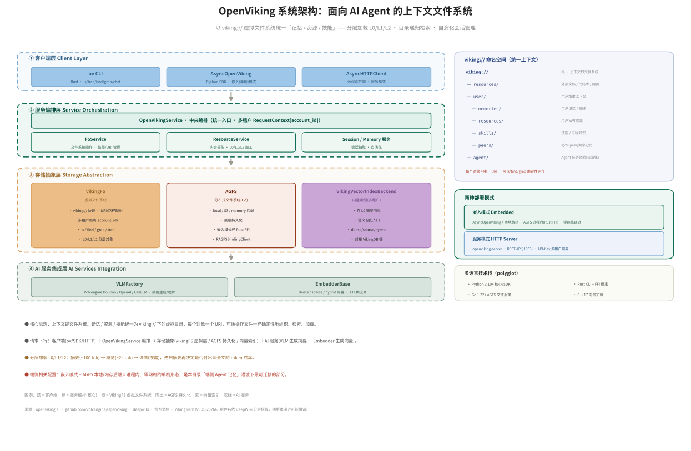
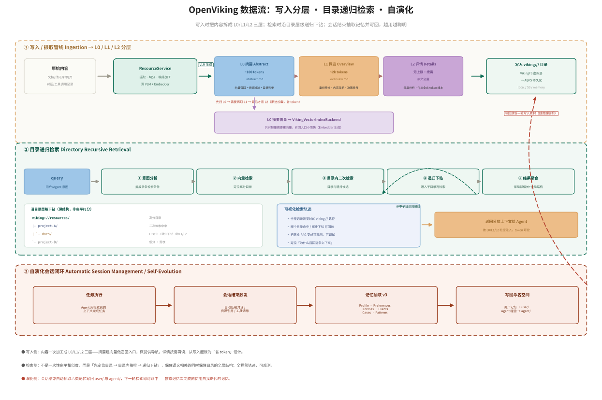

# OpenViking：把 Agent 记忆做成「上下文文件系统」

> 本文是本目录的一份**补充调研**，聚焦火山引擎（Volcengine）开源的 **OpenViking**——一个面向 AI Agent 的
> 「上下文数据库 / 上下文文件系统」。它与本目录主线 [on-device-agent-memory-system-CN](on-device-agent-memory-system-CN.md)
> 讲的 MemoryOS 三级明文记忆是**同一问题（Agent 长程记忆）的另一条工程路线**：MemoryOS 用「短/中/长期分层 + 热度晋升」，
> OpenViking 用「文件系统范式 + 分层加载 + 目录递归检索」。
>
> **一句范围声明**：OpenViking 主体是**服务端**上下文数据库（分布式文件系统、S3、Kubernetes、HTTP 多租户），
> 并非端侧专用系统。但它提供**嵌入式（进程内、零网络）单机模式**，且其架构思想与端侧「省 token / 省 RAM」诉求高度呼应，
> 因此收录为**横向对照样本**。凡涉及端侧结论，本文都会明确区分「服务端设计」与「可迁移到端侧的部分」。
>
> 参考：[openviking.ai](https://openviking.ai/) · [github.com/volcengine/OpenViking](https://github.com/volcengine/OpenViking) ·
> [官方文档](https://volcengine-openviking.mintlify.app/) · 学术底座《VikingMem》(VLDB 2026)。源汇总见 [sources/openviking.md](sources/openviking.md)。

---

## 1. 它是什么

OpenViking 自我定位是 **"Self-evolving Context Database for AI Agents"**——一个把 Agent 需要的
**记忆（memory）、知识 RAG（resource）、技能（skill）统一管理**的上下文数据库，目标是让开发者
"彻底告别上下文管理的琐碎"。它的核心信念一句话概括：

> **上下文即文件系统**。记忆、资源、技能都被映射成 `viking://` 协议下的**虚拟目录 / 文件**，
> 每个对象有唯一 URI，开发者可以像操作文件一样（`ls` / `find` / `grep` / `tree`）**确定性地**组织、检索、加载上下文——
> 而不是把一切都塞进一个扁平向量库里靠相似度"撞运气"。

它有一份学术底座论文《VikingMem: A Memory Base Management System for Stateful LLM-based Applications》(VLDB 2026)，
工程上以 AGPLv3 开源，典型宿主是 OpenClaw / Hermes / Claude Code 这类 Agent。

---

## 2. 针对的痛点：Agent 记忆到底难在哪

OpenViking 明确列出它要解决的**五个痛点**（README / 官网口径）：

| # | 痛点 | 症状 |
|---|---|---|
| 1 | **上下文碎片化** | 记忆散落在代码、向量库、技能配置里，各存各的，缺一个统一管理面。 |
| 2 | **上下文需求激增** | 长程 Agent 任务持续产出上下文；简单截断（滑窗）会直接丢掉关键信息。 |
| 3 | **检索效果差** | 传统 RAG 用**扁平分块 + 一次性相似度**，缺全局结构视野，召回不稳、噪声高。 |
| 4 | **上下文不可观测** | 黑盒 RAG——"为什么召回这一条？"无从回答，调试困难。 |
| 5 | **记忆迭代有限** | 现有系统多半只有"用户交互记忆"，缺**Agent 自己的任务经验**，而且记忆是**静态**的，不会随使用变好。 |

把这五条对照本目录主线：痛点 1/2/3 正是 [on-device-agent-memory-system-CN](on-device-agent-memory-system-CN.md)
里"有限窗口 + 全量重放代价高 + 缺跨会话整合"的另一种表述；痛点 4（可观测）与痛点 5（自演化 / Agent 经验）
则是 OpenViking 相对 MemoryOS/Mem0 **额外强调**的两点。

---

## 3. 解决思路：为什么是「文件系统范式」

OpenViking 的判断是：**扁平向量库丢掉了人类组织信息时最自然的结构——层级**。目录本身携带语义
（`resources/project-A/docs/` 一望而知比一个孤立 chunk 信息量大），而扁平 RAG 把所有 chunk 拍平成
一维向量空间后，这层结构信息就没了。于是它的思路是：

1. **用虚拟文件系统承载上下文** —— 保留"目录 = 语义分组"的层级结构，检索时可以"沿目录走"，
   既拿到局部相关性（向量相似），又拿到全局结构（在哪个目录下、和谁是邻居）。
2. **把每个对象拆成 L0/L1/L2 三层** —— 先给便宜的摘要，需要了再取贵的全文，从写入起就为"省 token"设计。
3. **检索走目录递归、且留痕** —— 不是一次性打分，而是"先定位目录 → 目录内精排 → 递归下钻"，
   并把整条浏览轨迹记录下来，让检索**可观测**。
4. **会话结束自动抽取记忆并写回** —— 让记忆库**自我迭代**（self-evolving），越用越聪明。

这四点分别对应下面 §5 的五大核心概念，也是它区别于扁平 RAG 与静态记忆库的关键。

---

## 4. 实现架构（分层）

下图是依据官方文档与 DeepWiki 组件拆解重绘的 OpenViking 分层架构。**请求自上而下**：
客户端 → 服务编排 → 存储抽象 → AI 服务。



*图 1. OpenViking 分层系统架构。左侧主栈为四层组件，右侧为 `viking://` 命名空间、两种部署模式与技术栈。
复现脚本：[assets/openviking-arch.py](assets/openviking-arch.py)。组件名依 DeepWiki 分层拆解，随版本演进可能微调。*

**① 客户端层（Client Layer）** —— 三个入口：
- `ov` CLI（Rust 实现，`ls / tree / find / grep / chat / add-resource / reindex` 等）；
- `AsyncOpenViking`（Python SDK，**嵌入模式**，本地进程内运行）；
- `AsyncHTTPClient`（远程客户端，**服务模式**，连 HTTP 服务）。

**② 服务编排层（Service Orchestration）** —— `OpenVikingService` 是中央编排器，统一入口、承载
多租户 `RequestContext[account_id]`，向下协调：
- `FSService`：文件系统操作、路径 / URI 管理；
- `ResourceService`：内容**摄取**与 L0/L1/L2 **加工**；
- 会话 / 记忆服务：会话结束的记忆抽取与自演化。

**③ 存储抽象层（Storage Abstraction）** —— 三块解耦的存储：
- **VikingFS**：虚拟文件系统，实现 `viking://` URI ↔ 路径映射、多租户隔离，对外暴露 `ls/find/grep/tree`，
  管理 L0/L1/L2 分层对象；
- **AGFS**：Go 写的分布式文件系统，支持 **local / S3 / memory** 后端做底层持久化；嵌入模式下经
  Rust FFI（`RAGFSBindingClient`）进程内调用；
- **VikingVectorIndexBackend**：多租户向量索引，**只存 L0 摘要的向量**作为语义召回入口，支持
  dense / sparse / hybrid。

**④ AI 服务集成层（AI Services Integration）** —— 可插拔的模型能力：
- `VLMFactory`：视觉 / 语言模型工厂（Volcengine Doubao、OpenAI、LiteLLM 等），负责生成摘要 / 理解内容；
- `EmbedderBase`：向量供应商抽象（Doubao、OpenAI、Jina、Ollama、Voyage、Cohere、VikingDB、Gemini… 13+ 家）。

**部署两态** —— 这是与端侧最相关的一点：
- **嵌入模式（Embedded）**：`AsyncOpenViking` + 本地路径，AGFS 进程内（Rust FFI）运行，**零网络延迟**，单机自足；
- **服务模式（HTTP Server）**：`openviking-server` 起 REST 服务（默认 `:1933`），API-Key 做多租户隔离。

**技术栈** —— 多语言（polyglot）：Python 3.10+（核心 / SDK）、Rust（CLI + FFI 绑定）、Go 1.22+（AGFS 文件服务）、
C++17（向量扩展）。

---

## 5. 具体方案：五大核心概念

OpenViking 把上面的思路落成五个可命名的机制。前四条是"上下文怎么组织 / 怎么取"，第五条是"记忆怎么自己变好"。

### 5.1 文件系统管理（Filesystem Management）

所有上下文挂在 `viking://` 下的虚拟目录里，每个对象一个唯一 URI：

```
viking://
├─ resources/            # 外部文档 / 代码库 / 网页（知识 RAG）
├─ user/                 # 用户维度上下文
│   ├─ memories/         #   用户记忆 / 偏好
│   ├─ resources/        #   用户私有资源
│   ├─ skills/           #   技能 / 过程知识
│   └─ peers/            #   协作(peer)共享记忆
└─ agent/                # Agent 任务经验（自演化产物）
```

好处：目录即语义分组，`ls / find / grep / tree` 可**确定性**定位，不必事事依赖向量相似度；
多租户下每个 `account_id` 有自己的隔离视图。

### 5.2 分层加载 L0 / L1 / L2（Tiered Context Loading）

写入时，每个对象被 VLM 加工成三层，**按需加载**、渐进付费：

| 层 | 名称 | 体量 | 产物 | 用途 |
|---|---|---|---|---|
| **L0** | 摘要 Abstract | ~100 tokens | `.abstract.md` | 向量召回、快速过滤、目录列举 |
| **L1** | 概览 Overview | ~2k tokens | `.overview.md` | 重排精修、内容导航、决策参考 |
| **L2** | 详情 Details | 无上限，按需 | 原始全文 | 深度分析（付出全文 token 成本） |

核心动作：**先扫 L0 → 需要再取 L1 → 最后才读 L2**。Agent 可以"先用 100 token 的摘要扫一大片目录，
再决定要不要为读全文付出成本"，这是它相对"一把塞进窗口"或"固定大小 chunk"省 token 的根本。

### 5.3 目录递归检索（Directory Recursive Retrieval）

不是一次性扁平相似度，而是一条多步、带层级的检索管线：

1. **意图分析**：把 query 拆成多条检索条件；
2. **向量检索**：用 L0 摘要向量定位**高分目录**（而不是直接定位孤立 chunk）；
3. **目录内二次检索**：在命中目录内部做精排；
4. **递归下钻**：若命中的是子目录，则进入子目录再检索，逐层深入；
5. **结果聚合**：合并结果，**同时保住局部相关性与全局目录结构**。

一句话：**"先找对目录，再在目录里找对文件"**，比"在一个扁平向量海里捞 top-k"更抗噪、更有结构感。

### 5.4 可视化检索轨迹（Visualized Retrieval Trajectory）

检索过程中浏览过的每个 `viking://` 路径、每一步下钻都被**完整记录**。于是"为什么召回这条上下文"
可以回放、可观测、可调试——把传统 RAG 的黑盒变成白盒。这是它对痛点 4 的直接答复。

### 5.5 自演化会话管理（Automatic Session Management / Self-Evolution）

会话结束时，系统自动压缩对话、资源引用、工具调用，跑**记忆抽取（v3 pipeline）**，抽出六类记忆：

> **Profile（画像）· Preferences（偏好）· Entities（实体）· Events（事件）· Cases（案例）· Patterns（模式）**

其中**用户记忆写回 `user/`、Agent 经验写回 `agent/`**。下一轮检索即可命中这些新记忆——
静态记忆库因此变成**随使用自我迭代**的记忆，这也是它区别于"只记用户对话"的系统的地方
（既记用户，也记 Agent 自己"怎么把活干好"的经验）。

---

## 6. 数据流：写入分层 · 目录递归检索 · 自演化闭环

把五大概念串成一张数据流图：写入时拆三层，检索时递归下钻，会话结束抽取记忆写回，形成闭环。



*图 2. OpenViking 三条主线数据流。①写入：原始内容 → ResourceService → VLM 生成 L0/L1/L2 →
写入 `viking://` 目录（VikingFS→AGFS），L0 另建向量索引；②检索：query → 意图分析 → 向量定位目录 →
目录内精排 → 递归下钻 → 聚合，全程留检索轨迹；③演化：任务执行 → 会话结束触发 → 记忆抽取六类 →
写回 `user/` 与 `agent/`，回流成新一轮写入素材。复现脚本：[assets/openviking-dataflow.py](assets/openviking-dataflow.py)。*

**① 写入 / 摄取（Ingestion）** —— `ResourceService` 摄取原始内容（文档 / 代码库 / 网页 / 对话），
调 VLM 生成 L0/L1/L2 三层，落进 `viking://` 目录；由 VikingFS 虚拟层写到 AGFS 做持久化；
L0 摘要另经 Embedder 建向量，进 `VikingVectorIndexBackend`——**只对轻量摘要建向量，召回入口小而快**。

**② 检索（Retrieval）** —— 见 §5.3 五步；输出是**按 L0/L1/L2 粒度注入**的分层上下文，token 可控。

**③ 演化（Self-Evolution）** —— 见 §5.5；写回的记忆就是下一轮的写入素材，闭环形成"越用越聪明"。

---

## 7. 效果证据（基准，v0.3.22）

> 数据取自 OpenViking 官方 README / 文档与公开报道，均为其**自评**口径，做定性参考。

**长对话用户记忆（LoCoMo）** —— 接入不同宿主 Agent：

| 集成方式 | 准确率 | 查询耗时 | 输入 token |
|---|---|---|---|
| OpenClaw + OpenViking | 82.08% | 38.8s | 37.4M |
| Hermes + OpenViking | 82.86% | 27.9s | 52.0M |
| Claude Code + OpenViking | 80.32% | 20.4s | 130.0M |

相对各自自带方案：**延迟降 24–59%、token 降 34–91%**。MarkTechPost 另报道 LoCoMo10（1,540 例）：
OpenClaw 自带 memory-core 35.65%@24.6M tokens → 接入 OpenViking 插件 **52.08%@4.3M tokens**
（准确率涨、token 反降到约 1/6）。

**Agent 经验记忆（tau2-bench）** —— 把 Agent 任务经验也纳入记忆：

- Retail：70.94% → **77.81%**（+6.87pp）
- Airline：54.38% → **66.25%**（+11.87pp）

**知识库 QA（HotpotQA）** —— 对比朴素 RAG：

| 方法 | 准确率 | tokens/QA | 延迟/QA |
|---|---|---|---|
| Naive RAG | 62.50% | 1,290 | 0.11s |
| OpenViking (top-5) | 72.75% | 3,154 | 0.22s |
| OpenViking (top-20) | **91.00%** | 12,533 | 0.23s |

5 数据集均值 66.87% 准确率、检索延迟 0.19s；建索引仅 8.7M tokens（对比 LightRAG 的 62.7M）。

**读法**：token 大幅下降主要来自 L0/L1/L2 的**渐进加载**（不必把全文一次性喂进窗口）；准确率提升主要来自
**目录递归检索**（结构化召回抗噪）与**自演化**（把用户 / Agent 经验沉淀成可召回记忆）。

---

## 8. 端侧视角：它和本目录的关系与可迁移性

OpenViking 是一个**服务端**上下文数据库（Go 分布式 FS、S3、K8s/Helm、HTTP 多租户），直接整套搬到手机上并不现实。
但把它和本目录主线对齐看，能提炼出对端侧 Agent 记忆有价值的部分：

| 维度 | OpenViking（服务端为主） | 本目录 MemoryOS 路线（端侧） | 可迁移性 |
|---|---|---|---|
| 记忆组织 | `viking://` 文件系统 + 目录层级 | STM/MTM/LPM 三级时间尺度 | **思想可迁移**：都在"分层 + 结构化"，端侧可借鉴目录语义 |
| 省 token | L0/L1/L2 渐进加载 | 检索式召回而非全量重放 | **高**：L0/L1/L2 直接对应端侧"先摘要后全文"，省窗口 / 省 RAM |
| 检索 | 目录递归 + 轨迹可观测 | 三级召回（STM 全取 / MTM top-m,k / LPM top-10） | **中**：递归下钻在端侧小库上收益递减，但"结构化召回"值得借 |
| 治理 | 会话抽取 + 自演化 | Heat 热度晋升 + 时间衰减淘汰 | **互补**：两者可结合，抽取负责"写什么"、热度负责"留什么" |
| 落地形态 | **嵌入模式**（进程内 / 零网络 / AGFS 本地后端） | 端侧 flash + 向量库 | **最直接**：嵌入模式 + local/memory 后端就是单机形态 |

**结论**：在端侧语境下，OpenViking 最可借鉴的是三点——（1）**L0/L1/L2 渐进加载**，把"省 token"前移到写入期；
（2）**文件系统 / 目录范式**，给记忆一个人可读、可 `grep` 的确定性组织；（3）**自演化会话抽取**，把 Agent 自己的
任务经验也沉淀成记忆。而它的分布式 FS、S3、多租户 HTTP 等**数据中心设施**属于服务端范畴，端侧不必照搬——
这与本目录"严格端侧、避免数据中心技术"的定位一致。可与 [agent-os-memory-architecture-CN](agent-os-memory-architecture-CN.md)
里的 KV Cache / 明文记忆双载体框架对照阅读。

---

## 9. 一句话总结

**OpenViking 把"Agent 记忆"重构成了一个"上下文文件系统"**：记忆 / 资源 / 技能统一挂到 `viking://` 目录下、
每个对象拆成 L0/L1/L2 三层按需加载、检索沿目录递归下钻并全程留痕、会话结束自动抽取记忆写回从而自我演化。
它主要是**服务端**系统，但其分层加载、文件系统范式与自演化思想，对端侧"省 token / 省 RAM / 可观测"的
Agent 记忆设计有直接借鉴价值——是本目录 MemoryOS 明文记忆路线之外，一条值得对照的**工程化**路线。

---

## 来源

- OpenViking 官网：<https://openviking.ai/>
- OpenViking 代码仓库（volcengine）：<https://github.com/volcengine/OpenViking>（README / 目录结构 / 基准，v0.3.x）
- OpenViking 官方文档：<https://volcengine-openviking.mintlify.app/>
- 组件分层拆解（DeepWiki）：<https://deepwiki.com/volcengine/OpenViking>
- 学术底座：《VikingMem: A Memory Base Management System for Stateful LLM-based Applications》(VLDB 2026)
- 报道：MarkTechPost（2026-03）"Meet OpenViking…"，Red Hat Developer（2026-04）部署实践
- 源汇总与要点：[sources/openviking.md](sources/openviking.md)

*图表复现：[assets/openviking-arch.py](assets/openviking-arch.py) · [assets/openviking-dataflow.py](assets/openviking-dataflow.py)（`pip install matplotlib` 后直接 `python` 运行，输出同名 `.png` / `.svg`）。*
