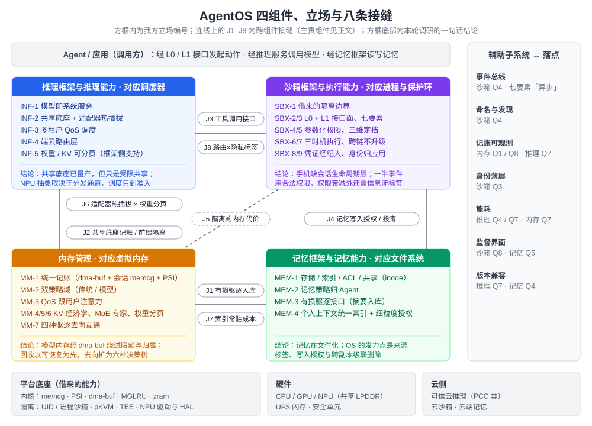

# AgentOS 外部参照全景：四组件调研整合

> **日期**：2026-11-05（第二版）
> **定位**：四份组件调研的整合文档，按 [research-prompt.md](research-prompt.md) 第 9 节「回收与整合」组织。输出五样东西：设计修订单、外部参照全景、组件接口清单、立项差异化论据，以及与 Kimi 调研的对照。
> **第二版的变化**：
> - 拿到了两份设计文档原文 v0.1：[《AgentOS 沙箱系统设计》](kimi调研/AgentOS沙箱系统设计.md)、[《AgentOS 内存管理设计》](kimi调研/AgentOS内存管理设计.md)。第 2 节的修订单已改为按原文章节编排。
> - 对照了另一份独立调研（Kimi，[kimi调研/](kimi调研/)），经核验的内容已合入四份组件文档，对照结论见第 7 节。
> - 两条一手核实改变了第一版的判断：Android 17 NPU Manager、Apple AFM 3 Core Advanced。
>
> **本目录文件**
>
> | 文件 | 内容 |
> |---|---|
> | [research-prompt.md](research-prompt.md) | 调研 Prompt 集 v2（含相对 v1 的 12 项修订说明），可直接交给其他模型复用 |
> | [C1-推理框架与推理能力.md](C1-推理框架与推理能力.md) | 立场 INF-1 至 INF-5；接缝 J3、J6、J8；含推理栈分层图 |
> | [C2-沙箱框架与执行能力.md](C2-沙箱框架与执行能力.md) | 立场 SBX-1 至 SBX-9；接缝 J5；含沙箱能力矩阵、七要素评审、三维定档评审、事件复盘 |
> | [C3-记忆框架与记忆能力.md](C3-记忆框架与记忆能力.md) | 立场 MEM-1 至 MEM-4；接缝 J4、J7；含个人语义索引差距矩阵 |
> | [C4-内存管理.md](C4-内存管理.md) | 立场 MM-1 至 MM-7；接缝 J1、J2；含 KV 谱系、回收成本模型、记账可见性缺口表 |
> | [notes/](notes/) | 8 份子模块调研笔记（C1a–C4b）；4 份 Kimi 对照差异笔记（kimi-delta-C1 至 C4）及其 prompt |
> | [kimi调研/](kimi调研/) | 用户提供的 Kimi 调研全部材料（12 份维度报告、交叉验证、洞察、成稿）与两份设计文档原文 |

---

## 1. 总体结论

**结论一：四个组件的大方向都得到外部证据支持，但没有一条立场可以不加修改地保留。** 25 条立场里，没有一条在方向上被证据否定：
- 14 条需要实质修订：SBX-3、SBX-5、SBX-9、MM-1、MM-4、MM-5、MM-6、MM-7、INF-2、INF-3、INF-4、INF-5、MEM-1、MEM-3。INF-3 是第二版新增的：Android 17 已在 AOSP 落地 NPU 准入与模型级抢占，差异化空间收窄。
- 其余 11 条只需补充条件或调整表述。
- 其中 6 条标为 P0（SBX-5、SBX-7、SBX-9、MM-1、MM-4、MEM-1），会改动架构骨架或跨组件接口，见第 2 节。

两份设计文档 v0.1 比第一版评审时假设的更完整。沙箱设计已有：随数据流过接口的标签、带外执法、「出口代理最高优先级」、策略版本钉住。内存设计已写明 KV 共享与沙箱隔离之间的张力（M9）。修订的重心因此落在三类问题上：
- 跨会话、跨时间的部分；
- 几处承诺需要降级（dry-run、undo、「KV 是纯缓存」）；
- 若干处事实陈述有误（见 2.3）。

**结论二：「会话」应当成为贯穿四个组件的一等对象，而且要带一个统一的「会话档位」。** 四份调研各自独立地走到了同一个抽象上：

| 组件 | 修订后需要的会话属性 | 出处 |
|---|---|---|
| 沙箱 | 系统签发的会话级 Agent 主体；随数据流动并跨会话持久化的标签；挂起 / 恢复生命周期 | SBX-9′、SBX-5′、SBX-6′ |
| 内存管理 | 会话作为 memcg 之上的归属标签；会话状态单元（KV 块或循环状态快照）；沙箱状态对应的内存契约 | MM-1′、MM-4′、C2 §6 J5 |
| 推理 | 会话状态的序列化 / 丢弃 / 重建；会话级前缀缓存（缓存身份含底座与适配器版本） | INF-5′、INF-2′ |
| 记忆 | 记忆条目继承写入会话的主体、完整性等级与数据来源域 | MEM-1′ |

Kimi 的调研从另一个方向得出同一结论（其洞察 I-05）：沙箱按能力组合分档，内存按前台状态，推理按 SLO，路由按任务复杂度，四处各判一次、语义不一致。判断：会话对象应包含「主体 + 标签 + 归属 + 状态单元 + 生命周期」，再加一个「档位」。档位只计算一次，同时驱动四个执行面：隔离强度、内存契约、推理优先级、端云去向。这比四个组件各自定义一套更省接口，也更容易审计；代价是档位变化（升档、降档）要防止来回震荡，需要仿真验证。

**结论三：信息流标签需要跨组件、跨时间传递，「有损驱逐入库」是其中最脆弱的一环。** 相关证据有四条：
- 13 个公开事件里约一半全程使用 Agent 的合法权限，只做权限衰减挡不住（C2 §7.4）；
- 记忆投毒把一次性注入变成持久化注入（C3 Q7）；
- 端云路由需要可靠的敏感度标签（C1 Q5）；
- 摘要会丢失约束，而且可以被注入操纵：Governance Decay 测得 compaction 后的约束违规率从 0% 升到 30%（C3 Q4）。

它们指向同一个机制：
- 标签由沙箱在会话中产生，由记忆框架跨会话持久化，由推理路由层消费；
- 「跨链不升级」要从调用链延伸到时间维度；
- 摘要入库这条边是治理检查点，不是缓存机制：入库记录要带来源、标签与被钉住的约束。

两份调研在这一点上独立得出相同结论。

**结论四：OS 真正的杠杆不在「策略」，而在「准入、记账、标签、分发」。** 四个组件都印证了「机制归 OS、策略归 Agent」：记忆写入决策没有一家交给 OS；NPU 调度的产业现实是准入与模型级抢占（Android 17 NPU Manager），不是细粒度 QoS；回收去向的选择依赖模型和 Agent 才知道的信息；稀疏权重的工作集由模型自己决定（Apple AFM 3 Core Advanced）。OS 能做、别人做不了的是：准入控制（谁能用模型、用多少）、统一记账（模型内存记在谁头上，含共享服务代持部分）、标签（数据从哪来、完整性如何）、分发通道（模型与运行时由谁更新）。NNAPI 的弃用是反面教材：把杠杆放在 HAL 接口上，没有放在分发通道上。

**结论五：端侧的「成本数据」在公开资料里集体空白，这是立项最直接的依据。** 四份调研都有一长串「未找到公开资料」，而且集中在同一类数据：
- 手机上每 token 能耗（J/token）与稳态降频曲线；
- 闪存读写、射频发送的 J/GB；
- 适配器切换延迟、端云切换延迟；
- 会话沙箱的内存、启动、功耗；
- 语义索引的常驻成本；
- 回收去向的质量损失。

Kimi 的调研给出同样的判断，并把它概括为「验证粒度系统性落后于执行粒度」（其洞察 I-08）。这些数据恰好是 OS 设计决策的输入参数，也是设计文档 §7 / §8「负载建模与系统仿真」方向的外部论据（见第 5 节）。

**结论六：两条一手核实改变了第一版的判断。**
1. **Android 17 NPU Manager**（C1 Q2）：系统服务 `npu` 已在 AOSP 中实现模型加载准入（带 size class）、三档优先级和以卸载模型为手段的抢占。第一版写「没有任何厂商公开抢占粒度」，这不成立。INF-3 的差异化要转到 NPU Manager 没有覆盖的部分：跨 CPU / GPU / NPU、会话级抢占、与配额打通。
2. **Apple AFM 3 Core Advanced**（C1 Q4、C4 Q3）：20B 稀疏端侧模型，完整权重存放在 NAND，按请求选定专家集、生成中定期重选，只把需要的专家换入 DRAM。Apple 明说 NAND 带宽不够做逐 token 换专家。第一版写「已出货的是 PLE 而不是 MoE」，这不准确。修订后的判断是：端侧大稀疏模型可以出货，前提是把工作集提到请求级。

两条的线索都来自 Kimi，核实来自 AOSP 与 Apple 官方页面。

---

## 2. 设计修订单（按设计文档章节）

**优先级**：
- **P0**：改动架构骨架或跨组件接口，需先于其他修订；
- **P1**：改动单个组件的接口或机制；
- **P2**：措辞、范围或优先级调整。

**来源列**：「本文」指本目录四份组件文档；「Kimi」指 Kimi 成稿第 6.5 节的修订清单；「双方」指两边独立提出。

### 2.1 《AgentOS 沙箱系统设计》v0.1

| 原文章节 | 原文要点 | 修订动作 | 依据 | 来源 | 优先级 |
|---|---|---|---|---|---|
| §3.4 三维风险模型 | 外部性 × 可逆性 × 敏感度定档；数据标签随数据流过接口，接收不可信内容时自动升档 | 三维与标签流保留。补三件事： ① 标签跨会话持久化——写入记忆或文件时带标签，读出不升级； ② 调用方可信度进入定档； ③ Rule of Two 式的会话级硬升档——同一会话同时出现不可信输入、敏感数据访问、外部副作用时，强制升档或拆会话。 Kimi 主张另设第四维「持久写入」，本文认为作为定档函数的输入即可 | 原文按单次调用升档，挡不住「先读不可信内容、再读敏感数据、最后外发」的多步链；跨会话攻击（记忆投毒、FragFuse）——C2 §7.3 | 双方 | **P0** |
| §3.4 跨链不升级 | 委托链上每跳有效权限不超过链上最小值 | 增加第二条单调规则：数据完整性标签只降不升，并跨会话延伸到记忆 | EchoLeak、GitHub MCP 全程无权限提升；记忆投毒——C2 SBX-7′ | 双方 | **P0** |
| §3.2 身份模型、§2.3 身份薄层 | 主体身份、代表关系、委托令牌归应用自管；OS 只提供 Attestation 原语与跨链规则 | 拆成两层：系统签发、可审计、可撤销的会话级 Agent 主体（审计与撤销的单位）；用户对第三方服务的身份仍归应用 | Entra Agent ID、Windows Agent 账户、AppFunctions `EXECUTE_APP_FUNCTIONS`、鸿蒙 Skill 账号绑定——C2 SBX-9′ | 本文 | **P0** |
| §3.3 接口规格七要素 | dry-run 与 undo 为必备要素 | schema、结构化拒绝、异步任务句柄、幂等键、效果声明为必选；效果声明按观测校正。dry-run、undo 改为可声明能力，未声明的按不可逆定档。undo 分两档：机器级（快照回滚，只覆盖沙箱内状态）和应用级（补偿动作，覆盖外部副作用）。幂等键由系统在会话层去重 | MCP、AppFunctions 均无 dry-run / undo；MCP 2026-07-28 去掉断点续传带来重复执行——C2 §7.2 | 双方 | P1 |
| §3.4 参数化权限（额度递减） | 额度递减、中途撤销在调用时判定 | 额度与速率类参数有状态：会话事件日志 + 回溯窗口 + 在途请求计入；策略来源分人签署、可信上下文生成、模型生成三级 | Dogwood 时序额度；并发请求绕过静态额度（单源）——C2 Q2 | Kimi | P1 |
| §3.4 三时机执行 | 装配、调用、销毁 | 增加「挂起 / 恢复」时机：快照与模板不得含凭证，恢复时重新注入凭证、重评策略；策略服务断连时会话冻结；挂起较久的会话恢复时检查策略版本是否已撤销 | CVE-2026-25725；Blaxel 待机语义；OpenShell 启动与断连规则——C2 SBX-6′ | 双方 | P1 |
| §5 C3、§6 C3 策略系统 | 策略变更前做形式化验证，产出「新增放开项」报告 | 写明可证明的规则子集；子集之外的变更按「证明失败」处理，不默认放行 | OpenShell prover 不建模 GraphQL / MCP / WebSocket / JSON-RPC，规则超过 1,024 条返回 inconclusive——C2 Q2 | Kimi | P1 |
| §5 C4、§6 C4 生命周期 | 快照、AutoPause、分叉克隆；对接 onTrimMemory / Doze | 沙箱状态与内存契约用同一张表：运行用 `memory.low`；待机用 `memory.high` 封顶并允许压缩；快照全部回收并落盘；恢复时按预告预取。该表交内存管理设计 §3.2 对齐 | 云上待机便宜是因为内存不回收，端侧付不起——C2 §6 J5 | Kimi（本文补充落点） | P1 |
| §6 C2 出口代理 | 默认拒绝 + 域名白名单 + DNS 强制劫持 | 保留；补「出口策略覆盖 DNS、TXT 等记录类型，在代理与网络层各设一道，单独审计」；域名白名单只作下限，代理默认不检查 TLS 时宽域名会成为外泄路径 | OpenAI 2026-09 研究 Agent 经 DNS 外联（二手）；Anthropic 白名单域名外泄——C2 Q2 | 双方 | P1 |
| §3.1 第零层、§6 C1 隔离底座 | 借用现有 OS 隔离能力；microVM 首选 | 改为「不自建隔离边界类型，允许自建生命周期层」；写明借用目录与风险档（进程级默认，pVM 用于高风险会话，标机型约束）；边界参数由宿主侧确定性计算，不让模型输出参与 | Docker、Cube、Cloudflare 的自研层；SDK Runtime 退役——C2 SBX-1′ | 双方 | P2 |
| §5 C6、§6 C6 对抗回归 | SEB 是「Agent 合成逃逸载荷」的防御基准 | 改为：SandboxEscapeBench 测的是模型的容器逃逸能力；任何防御声称都要配自适应攻击评测，不只报固定攻击集的成功率 | arXiv 2603.02277；12 个防御在自适应攻击下多数成功率超过 90%——C2 Q5 | 双方 | P1 |
| §3.4 凭证经纪人 | vault + 出口代理按端点 × scope 注入；响应侧脱敏 | 端侧形态为「系统服务持钥并代为请求」；响应脱敏写为「厂商声称、缺独立评测」；增加使用审计与限额 | Keystore / Secure Enclave / HUKS 可用不可导出；Nx 事件——C2 Q3 | 本文 | P2 |
| §3.3 L0 逃生舱 | raw 代码执行，效果必须经接口面流出 | 保留；写明 L0 也受 Rule of Two 与出口策略约束。L0 不含 UI 自动化，与 2027 立项「GUI Agent 不做」不冲突 | C2 SBX-2 | 本文 | P2 |

### 2.2 《AgentOS 内存管理设计》v0.1

| 原文章节 | 原文要点 | 修订动作 | 依据 | 来源 | 优先级 |
|---|---|---|---|---|---|
| §3.1 记账主体会话化 | 以会话为主体「建立 memcg 层级」 | 会话作为 memcg 之上的**归属标签**，不另建 cgroup 层级，以兼容 Android 17 的按进程限额。新增底座原语「代分配归账转移」（recharge-on-behalf）：共享服务在 dma-buf export / heap 分配时声明代谁持有。Android 上接入 NPU Manager 的加载请求（已带 size class 与「可代其他 uid 归账」字段） | Android 17 Memory Limiter 按进程设限；dma-buf RFC 按 pidfd 计到客户端；NPU Manager HAL 字段——C4 Q8、C1 §6 J2 | 双方 | **P0** |
| §5 第 2 条、§7 M1「扩展 PSI」 | 「PSI 扩展模型内存维度——NPU 侧分配压力驱动传统侧回收，反之亦然」 | 列出新增的停顿信号：模型加载停顿、NPU 等待、dma-buf 分配停顿；复用 PSI 的 trigger 语义（阈值 + 窗口 + poll）；说明「传统侧压力 → 设备侧释放」依赖哪条回收原语。做不到就删去「反之亦然」 | 设备缓冲被持有时只能杀持有者，反向没有回收原语——C4 §5 MM-1 | 本文 | **P0** |
| §4.2 KV cache：纯缓存的驱逐经济学 | KV 是纯缓存；四种去向：换出、重算、上云、摘要入库 | 改为「回收」，以可恢复为第一约束。决策树扩为六档：丢弃（仅已知无用）→ 就地降精度 → 换出到闪存 → 重算 → 上云（只传文本）→ 摘要入库。摘要入库是形态转换，Kimi 称之为「物化去向」，不是 KV 的去向：由内存管理发回收事件，记忆框架决定是否摘要；入库记录带来源、标签与被钉住的约束。管理对象抽象为「会话状态单元」 | SCBench 多轮失效；换出比重算快 7–40 倍（估算）；上云传 KV 需 45 秒以上；Governance Decay——C4 Q7、C3 Q4 | 双方 | **P0** |
| §1、§6.1、§6.2（事实更正） | 「dmabuf 可见性近年才由上游补丁补齐」；「上游补丁使 DMA 内存首次可被纳入统一回收」 | 改为：可见性由 Android 的 BPF iterator 提供；memcg 记账仍是上游 RFC；即使合入也只解决归属，可回收需要另外的撤销或迁移原语。§9 落地路线 P0 的「dmabuf memcg 记账」要标为依赖上游的风险项 | 主线 `memory.stat` 无 dmabuf 键；2026-05 RFC——C4 Q1 | 双方 | **P0**（事实更正） |
| §3.2 QoS 双契约 | 交互类映射 `memory.min` 级硬保证；注意力感知升档 | 保护侧首选 `memory.low`，`memory.min` 只给极小的关键集。只有确定性事件（前台、可见、用户正在等待）能进契约；router 预告这类结构性信号只能占「可回收」内存；行为预测只驱动可回收的投机预载。注意力升档的立项冲突见 6.2 | resctl 三层契约（单源）；AppFlow：冷启动 I/O 97.2% 可预测，LLM 预测下一个 App 只有 52%——C4 Q5 | 双方 | P1 |
| §4.2 前缀共享、§7 M9 | 前缀共享限定同信任域；共享块打 ACL 标签 | 方向正确，升为必做：PromptPeek 已是发表的攻击。补「缓存身份」：底座版本、适配器 ID 与版本、量化档位、位置编码方案都进入缓存键 | PromptPeek（NDSS 2025）；llama.cpp 切 LoRA 须清 KV（单源）——C4 §6 J2、C1 Q6 | 双方 | P1 |
| §4.3 MoE 专家管理 | router 预告预取，「驱逐与预取第一次可基于预告」 | 管理对象改为请求级稀疏工作集，由模型或运行时决定；OS 负责容量、记账与闪存读带宽仲裁；不做逐 token 专家换页。预告预取对 batch=1 的手机偏乐观，主要用来界定每层的最小驻留集 | Apple AFM 3 Core Advanced 请求级选专家；iPhone 上逐 token LRU 在 512MiB 命中 0%；WiSP：单流 decode 瓶颈在带宽——C4 Q3 | 双方 | P1 |
| §4.4 权重分页与 LoRA | 层 / 块粒度分页；LoRA 独立驻留集合与热插拔 | 权重分页要求模型提供分页友好的布局；LoRA 先按「常驻 pin + 活跃集限额 + 与底座同账」设计，实测后再决定是否换入 | PLE、PowerInfer-2、Neuralink；IOPS 是瓶颈——C4 Q4 | 本文 | P2 |
| §2、§5 两域接口 | 统一底座 + 两个策略域 | 「账本接口」与「策略接口」显式分开，账本对接 memcg 与 dmem，不自建计数器 | dmem 双计费到 memcg——C4 MM-2 | 本文 | P2 |
| §7 M7 端侧存储约束 | zRAM vs UFS 换出选择；写放大与寿命预算 | 补 `memory.zswap.writeback` 作为「允许压缩、禁止落闪存」的按 cgroup 旋钮 | 内核 cgroup-v2 文档——C4 Q5 | Kimi | P2 |
| §6.2 学界脉络（PowerInfer-2） | 「热神经元驻留 NPU、冷神经元走 CPU」 | 对照论文原文核对描述 | Kimi 与本文的描述不一致，未核 | Kimi | P2 |

### 2.3 设计文档中需要补出处或更正的事实陈述

这些不改架构，但文档对外流转前应处理。

| 文档位置 | 原文 | 核实结果 | 建议 |
|---|---|---|---|
| 内存 §6.1、§6.2 | dmabuf 上游补丁已补齐可见性 / 使 DMA 内存可统一回收 | 不成立（见 2.2） | 改写 |
| 沙箱 §4.3 | 「2026 年 9 月两次最著名的 Agent 逃逸（OpenAI 与 Gemini）均为网络出口配置错误」 | OpenAI 一例有二手来源（CSA 研究笔记转述 OpenAI 2026-09-25 披露）；Gemini 一例本文与 Kimi 都没找到来源 | 补 Gemini 出处，或只写 OpenAI |
| 沙箱 §5 C4 | 「Agent 负载 71%–98% 的时间在等待模型（Vercel 公开数据）；计费模式实际成本差 6–10 倍」 | 两个数字都没找到。Vercel 示例按 10% CPU 利用率估算，且内存按供给计费 | 补出处或改为示例假设 |
| 沙箱 §4.2 | Cube「独立内核冷启动 <60ms、单机 2000+ 实例」 | README 口径：单并发 <60ms，50 并发均值 67ms、P99 137ms；密度写「每节点数千」 | 写明并发条件 |
| 沙箱 §4.1 | HarmonyOS「基于动态沙箱的数据权限管控」 | 本文与 Kimi 都没有取到华为官方页面 | 标「待核实」 |
| 沙箱 §4.1 | SDK Runtime 是「应用之内再分主体」的先例 | 已随 Privacy Sandbox 在 2025-10 退役（媒体报道，Google 一手公告待补） | 写为「历史先例，已退役」 |
| 沙箱 §4.5、§6 C6 | SEB 用「数千自适应合成载荷」做防御基准 | 论文测的是模型逃逸能力，未见「数千载荷」 | 改写 |
| 沙箱 §4.2 | Daytona「2026-06 转闭源，10 月 B 轮 6000 万美元」 | B 轮有多家媒体报道，未见公司公告；转闭源只有单一来源 | 标来源 |

### 2.4 推理组件（设计文档只有 §2.2 四层表中的一行）

原文中推理组件的 OS 机制为：NPU HAL、模型加载 / 分页 / LoRA 热插拔、多租户推理调度与 QoS、token 计量。

| 立场 | 判断 | 修订动作 | 依据 | 优先级 |
|---|---|---|---|---|
| INF-5 权重与 KV 可分页 | KV 侧受挑战；权重侧已有平台先例 | 要求运行时暴露会话状态的「序列化 / 丢弃 / 重建」三态接口，交内存管理调用；权重按「请求级工作集 + 低频重选」设计，运行时上报驻留集大小 | 没有系统服务提供 KV 分页；Apple AFM 3 Core Advanced；移动 NPU 上的 KV 复用原型——C1 Q4 | P1（与 MM-4′ 配套） |
| INF-3 多租户 QoS | 支持，差异化收窄 | 「NPU HAL」与 Android 17 的 `android.hardware.npu` AIDL 对齐；第一层（准入与模型级抢占）不再作为独有缺口；第二层做跨 CPU / GPU / NPU 统一准入与记账、会话级抢占、按阶段选后端、与配额打通 | Android 17 NPU Manager——C1 Q2 | P1 |
| INF-4 端云路由层 | 需修订 | 拆成「OS 策略执行」（允许的端点、证明及其新鲜性、标签对应的可去之处）和「框架选择优化」；隐私写成带有效期的信任档位；标签来自记忆与沙箱，不用模型自评做授权 | 产业界无自动路由；WhatsApp 审计发现证明可重放；PCC 无可复现构建——C1 Q5 | P1 |
| INF-2 适配器热插拔 | 需修订 | 适配器是绑定 `base_model_id + 版本区间` 的受管产物；适配器 ID 与版本进入 KV 缓存身份；默认用「提示 + 结构化输出 + 前缀缓存」满足定制 | Apple 适配器版本一一绑定；Google 不开放第三方适配器——C1 Q6 | P1 |
| INF-1 模型即系统服务 | 支持，需修订 | 「共享底座 + 稳定任务接口 + 受控自带模型旁路」；底座版本进入接口契约；自带模型纳入同一套准入与记账 | Apple `LanguageModel` 协议与 Core AI；Phi Silica 被替换——C1 Q1 | P1 |

### 2.5 记忆组件（设计文档只有 §2.2 四层表中的一行）

原文中记忆组件的 OS 机制为：向量 / 图谱索引、ACL、跨 Agent 共享区、持久化与一致性。

| 立场 | 判断 | 修订动作 | 依据 | 优先级 |
|---|---|---|---|---|
| MEM-1 存储、索引、ACL、共享 | 需修订 | 「向量 / 图谱索引」改为可选的系统索引服务，索引结构由 Agent 决定；OS 托管「记忆对象 + 来源 / 完整性 / 数据域 / 版本元数据 + 读写 ACL + 审计 + 快照 + 级联删除」；共享用标签交集；ACL 主体包含结果接收进程，检查点在检索重组之后 | 记忆文件化；记忆投毒；TotalRecall Reloaded；FragFuse——C3 §5 | **P0** |
| MEM-3 有损驱逐接口 | 需修订 | 只开在上下文文本层，摘要带原文指针；权限与禁令类约束由 OS 钉住、不进摘要；KV 层不做摘要入库 | Governance Decay；Slipstream——C3 Q4 | P1 |
| MEM-2 策略归 Agent | 支持 | 补 OS 职责：写入授权与来源标注、失效标记与版本链原语、物理删除可达 | Memora、STALE——C3 §5 | P2 |
| MEM-4 个人上下文索引 | 支持，需重新表述 | 空白 = 「开放 + 查询时授权 + 跨应用 + 来源可追溯」四者同时满足；donation 为主、capture 受限兜底；补排除权与受约束返回 | PDE、Recall、Magic Cue 均不开放；欧委会拒绝 Apple Trusted System Agent——C3 Q3 | P2 |

---

## 3. 外部参照全景（按成熟度）

完整谱系见各组件文档 §1。下表只列对立场判断起关键作用的代表工作。带「*」的是第二版新增条目。

| 组件 | L4 平台默认 / 量产 | L3 生产可用 | L2 原型 | L1 论文 / 预印本 |
|---|---|---|---|---|
| 推理 | AICore / Gemini Nano（1.4 亿台）；Apple Foundation Models；Windows AI APIs；Apple 2-bit QAT；Windows ML EP；*AFM 3 Core Advanced（稀疏权重存 NAND） | LiteRT NPU accelerator；Gemma 4 MTP drafter；LiteRT-LM 会话保存 / 恢复；结构化输出；Firebase hybrid；*Android 17 NPU Manager（L3–L4） | 三星多 LoRA 运行时输入；DS2D | llm.npu、HeteroInfer、Agent.xpu、PRISM；NPU 阶段级测量；*移动 NPU 跨请求 KV 复用 |
| 沙箱 | Firecracker、gVisor（云）；AVF / pKVM（机型受限）；Chrome Critic + Origin Sets（L3–L4） | 云沙箱（E2B、Cube、AgentCore 等）；凭证出口注入；AgentCore Policy（Cedar）；MCP；*kubernetes-sigs/agent-sandbox | Windows Agent Workspace；OpenShell（*含 policy prover）；Rule of Two；*Dogwood 时序策略 | CaMeL、FIDES、Progent、Conseca、IsolateGPT；SandboxEscapeBench；Aster |
| 记忆 | 商业助手记忆（ChatGPT、Claude、Gemini）；Windows Recall；三星 PDE；Android Private Compute Core；App Intents IndexedEntity | Letta、Mem0、Zep；Anthropic memory tool；context editing | OpenViking；sleep-time compute；*MemOS MemCube 治理属性（论文设计） | Cartridges、Doc-to-LoRA、Memory-R1；记忆投毒攻防；Collaborative Memory；AirGapAgent；*Governance Decay、Slipstream、FragFuse；*LongMemEval-V2、GroupMemBench |
| 内存管理 | Android 17 Memory Limiter；LMKD / PSI；MGLRU（荣耀约 7000 万台）；Gemma 3n PLE；架构级 KV 压缩 | dmem cgroup（*已确认 Linux 6.14 合入）；vLLM / SGLang / LMCache / Mooncake（云）；`memory.reclaim`；*`memory.zswap.writeback` | vAttention；Marconi；KIVI | KVSwap、EStream、Paging the Experts、HCache、CachedAttention（云侧原型）；mzCache；dma-buf memcg 计费 RFC；*AppFlow；*WiSP、NPUMoE |

**读表结论（判断）**：

- 四个组件的 L4 列几乎全是**平台厂商自建、不对第三方开放**的能力：AICore、PDE、Recall、Memory Limiter、PLE、AFM 3 Core Advanced。「OS 级能力」的竞争已经开始，而且是封闭竞争。第二版新增的两条（NPU Manager、AFM 3 Core Advanced）都在加强这个判断：平台方正在把调度与权重分页做进自己的系统服务。
- L1 列集中了我方立场最依赖的机制：信息流控制（CaMeL、FIDES）、端侧 KV 卸载（KVSwap）、记忆投毒防御、摘要的约束保持（Governance Decay）。这些机制有研究支撑，但离产品化还有距离——既是差异化空间，也是交付风险。

---

## 4. 组件接口清单（由 J1–J8 汇成）

| 接缝 | 提供方 → 调用方 | 接口要点 | 数据格式要点 | 当前证据状态 |
|---|---|---|---|---|
| J1 有损驱逐 → 摘要入库 | 内存管理 → 记忆框架 | 内存管理只发「会话状态单元被回收」事件；是否摘要由记忆框架与 Agent 决定；系统提示词、技能前缀、治理约束永不摘要；摘要路径预留异步校验 | 状态单元 ID、原始 token 范围、可重算标志、来源与完整性标签、被钉住的约束 | 学术空白；摘要丢约束已有测量（Governance Decay） |
| J2 共享底座记账与前缀隔离 | 推理服务 ↔ 内存管理（沙箱提供信任域） | 每次请求携带请求方（会话主体）标识；底座权重、会话状态、共享前缀三层归属，经「代分配归账转移」原语记账；含私有内容的前缀只在同一信任域内共享；缓存键含底座与适配器版本 | 请求方标识、归属层级、信任域 ID（= 沙箱会话）、缓存身份 | Android 17 NPU Manager 有加载准入与代归账字段；三平台均无共享服务记账说明；侧信道已有发表攻击 |
| J3 工具调用接口 | 推理服务 ↔ 沙箱 | 推理侧提供受约束采样与「工具调用处暂停 / 恢复」；沙箱把 MCP / AppFunctions 描述翻译成 schema 并做入口校验；注入防护在执行层 | 系统内部统一的 schema 表示（Apple、Chrome、LiteRT-LM 三种格式不互通） | 推理侧能力已成熟（L3–L4）；推理层注入防护无先例 |
| J4 记忆写入授权与投毒 | 沙箱 → 记忆框架 | 写入时携带会话主体、标签、数据来源域；接触过不可信内容的会话写入需确认或进隔离区；读取按「读者权限 ∩ 条目标签」授权，低完整性条目读出仍为低完整性；检查点放在检索重组之后 | 来源标签（不可伪造）、完整性等级、数据域 | 攻击谱系完整（含 FragFuse 分片重组）；防御为 2026 预印本 |
| J5 隔离的内存代价 | 沙箱 → 内存管理 | 隔离单元的内存记入会话归属标签；沙箱状态与内存契约同表（运行 / 待机 / 快照 / 恢复）；pVM 气球回收与 LMKD / PSI 联动 | 会话归属标签、沙箱状态 | 端侧无实测；AVF 气球曾回退；状态映射为推断 |
| J6 适配器热插拔与权重分页 | 推理服务 ↔ 内存管理 | 适配器按底座版本区间管理；适配器页 pin 住并限制活跃集，与底座同账；切换使相关 KV 失效；加载要求签名与来源校验 | `base_model_id + 版本区间`；适配器体积 | 无手机切换延迟数据 |
| J7 语义索引常驻成本 | 记忆框架 → 推理服务、内存管理 | 嵌入模型由推理服务统一提供，纳入模型内存域（可驱逐、按事件加载）；索引文件记账归记忆服务；建索引在充电空闲窗口进行 | 嵌入维度与量化（直接决定体积，相差约 12 倍） | 只有 EmbeddingGemma 一个硬数据点 |
| J8 端云路由与隐私标签 | 记忆框架、沙箱 → 推理路由层 | 请求携带敏感度标签（记忆条目的数据域 + 会话标签）；路由层执行「标签 → 允许的端点集合」硬约束；要求云端证明的新鲜性 | 敏感度标签、信任档位（带有效期） | 无产品使用此类标签；PRISM 为 L1 |

**四条贯穿性约定**（判断）：

1. **标签只有一套。** J2 的信任域、J4 的完整性等级与来源域、J8 的敏感度标签，是同一个会话对象上的属性。沙箱签发，记忆持久化，推理与内存消费。
2. **归属只有一个账本。** J2、J5、J6、J7 的内存都记在 memcg 之上的会话 / 服务归属标签里，不另建计数器；共享服务代持的部分用「代分配归账转移」记到请求方。
3. **档位只算一次。** 会话档位由沙箱的定档函数算出，同时驱动隔离强度、内存契约、推理优先级、端云去向；各组件不各自再分级（结论二）。
4. **事件而非调用。** 跨组件的回收、驱逐、降级都用事件通知，由拥有策略的一方决定动作——这是「机制归 OS、策略归 Agent」在接口上的落地。

---

## 5. 空白点 × 负载建模 / 仿真：立项差异化论据

两份设计文档的 §7（沙箱）与 §8（内存）已经写了负载建模与仿真的结合方式：
- 沙箱侧：覆盖率驱动的接口清单、L0 逃生率、档位的定量化、云上仿真与真机校准；
- 内存侧：「负载模型驱动的内存策略设计与验证」。

本节补的是外部证据：公开资料缺什么、哪些可以先仿真、哪些窗口在关闭。

### 5.1 空白点分类

「仿真可先占位」指可以用负载建模、trace 回放、成本模型先给出参数范围与方案比较；「需真机」指必须测量才能得到的数据。

| 空白点 | 所在组件 | 仿真可先占位 | 需真机校准 | 对应 2027 立项 |
|---|---|---|---|---|
| 手机 J/token 与稳态降频曲线 | C1 | 可：功耗模型 + 热模型 | 是（功耗轨、Perfetto） | S1 云转端评估 |
| NPU / GPU / CPU 各阶段收益之争 | C1 | 部分：按阶段建模算力与带宽 | 是：同设备、同最新基线 | S1、S2 |
| 端云切换延迟 | C1 | 可：网络 + 云端 prefill + RTT | 部分 | S1 |
| 模型级抢占（卸载 + 重载）的体验代价 | C1 / C4 | 可：加载时间 × 抢占频率 | 是 | KT3 |
| 适配器切换延迟、与底座分页的页缓存干扰 | C1 / C4 | 部分 | 是 | KT3 |
| 会话沙箱的内存 / 启动 / 功耗；写时复制共享率 | C2 | 可：按镜像与运行时估算 | 是 | 立项外（新增方向） |
| 沙箱待机的「休眠经济学」（保留内存 vs 恢复延迟 vs 重算） | C2 / C4 | 可：状态迁移 × 内存压力 trace | 部分 | KT1、KT2 |
| 语义索引常驻成本（嵌入模型、索引体积、建索引能耗） | C3 | 可：体积与能耗模型 | 是 | 立项外（与 KT2 相邻） |
| 摘要入库的质量损失与约束丢失 | C3 / C4 | 部分：离线 Agent 任务集评测（可在云侧做） | 否 | 立项外 |
| dma-buf / GPU / NPU 记账缺口的实际规模 | C4 | 否 | 是：BPF 测绘 | KT2、S1 的可观测性 |
| 回收去向的 J/GB、UFS 写入寿命 | C4 | 可：成本模型（C4 Q7 已给公式） | 是 | KT2-B KV Cache |
| 共享服务归属三方案的 LMKD 行为比较 | C4 | 可：内存压力 trace 回放 | 部分 | KT1、KT2 |
| 注意力信号与保护契约的收益；误预测的成本 | C4 | 可：叠加场景 trace 回放；按信号类型分层仿真 | 是 | KT1（但见 6.2 的冲突） |
| 请求级稀疏工作集的命中率与闪存读量 | C4 | 可：路由 trace 回放 | 部分 | KT2-A |
| 手机前缀缓存侧信道 | C4 | 否 | 是：真机实验 | 立项外 |
| 确认疲劳与自动批准的取舍 | C2 | 否：属于用户研究 | — | 立项外 |

### 5.2 立项差异化论据（建议稿）

1. **公开资料的空白恰好落在 OS 设计决策所需的「成本参数」上。** 四个组件的调研都在同一类数据上找不到公开实测：能耗（J/token、J/GB）、切换延迟、隔离开销、索引成本、回收质量。业界的论文和产品发布只报峰值吞吐和相对加速比，不报手机稳态成本。在缺少全量真机数据时，负载建模与仿真是唯一能先给出参数范围、先做方案比较的手段。这直接强化 S1（云转端评估）和 S2（并行化寻优）的立项理由。Kimi 的调研把同一现象概括为「验证粒度落后于执行粒度」，并主张把「可验证性」本身做成产品指标。

2. **模型内存的记账盲区连 Android 17 都没解决，而且缺一条代持原语。** 现状是：
   - Android 17 已把按进程 memcg 限额做成平台默认，但口径只有匿名页 + swap，模型权重和 KV 放进 dma-buf / GPU / NPU 缓冲就同时绕开了限额与归属；
   - 上游的 dma-buf memcg 记账停在 RFC；
   - 共享模型服务代多个客户端持有的内存，在单一属主记账下要么饿死服务、要么冤杀应用。

   结论：先做可观测与「代分配归账转移」（谁占了多少模型内存、该记在谁头上），是 KT2 所有回收策略的前置。这是两份调研共同确认的持久空位，本部门在可观测性上的积累可以先占住这一位置。

3. **回收决策树需要的参数只能靠建模和测量获得。** 六档回收决策树（C4 MM-7′）在量级上自洽，但阈值依赖 J/GB、UFS 写寿命、prefill 速度、复用概率、摘要的质量与约束损失，这些都没有公开数据。服务器上的结论在手机上会反转：服务器重算优于换出，手机反之（C4 Q7）。用仿真先给出参数范围、再用真机校准，是把 KT2 从「策略想法」变成「可落地决策规则」的必经路径。Kimi 把它命名为「驱逐经济学模拟器」，并判断学术空白还剩 1–2 年（推断）。

4. **立项已选的方向得到了新证据支撑。**
   - KT3（模型加载 / 卸载提速）：
     - AICore 首次推理加载约 1 分钟；
     - MediaTek 端侧编译小模型超过 1 分钟；
     - Android 17 NPU Manager 把「卸载模型」当作抢占手段，重载代价从偶发变成常态（C1 Q2、Q3）。
   - KT2-A「MoE 专家缓存泛化为稀疏权重分层」：
     - 第二版更正了事实依据。Apple AFM 3 Core Advanced 已把 20B 稀疏模型放进 NAND、按请求换入专家；
     - 逐 token 换专家在手机上有命中率断崖（C4 Q3）。
     - 结论是方向成立，且有了量产先例；管理对象应是「请求级稀疏工作集」。KT2-A 可以直接以 Apple 的做法为参照，差异化放在 OS 侧的容量、记账与闪存带宽仲裁。
   - KT2-B「KV 管理按架构区分」：混合 / 线性注意力缩小了 KV 体积，但循环状态不能部分前缀命中，对象应抽象为「会话状态单元」（C4 Q2）。

5. **「会话对象」可以作为 Agent OS 总体构想的落点。** 立项的总体构想是「模型内存成为系统的一等公民」。本轮调研显示，模型内存的记账、回收、隔离都需要以会话为单位，而且四个组件的分级可以由一个会话档位统一驱动（结论二）。把总体构想表述为「以会话为单位，统一管理模型内存的记账、回收与隔离」，比单讲「一等公民」更具体，也能与沙箱、记忆的设计对齐。

### 5.3 时间窗口（参考 Kimi 的窗口矩阵，经本文修正）

Kimi 把空白点按「被填上的速度」分档（其洞察 I-07）。这个视角对立项排序有用，但其中的时长是推断。下表保留分档，按本轮证据修正了两处。

| 档位 | 空白点 | 证据 | 对立项的含义 |
|---|---|---|---|
| 已收敛，不宜正面竞争 | 模型即系统服务；凭证经纪人；云端沙箱接口；适配器与底座版本绑定 | 三大平台量产；五家以上同构 | 借用形态，差异化放在记账与接缝 |
| 正在被平台填上（本文新增此档） | NPU 准入与模型级抢占（Android 17 NPU Manager）；系统模型的稀疏权重分页（AFM 3 Core Advanced） | AOSP 与 Apple 官方页 | 与平台对齐，不另起一套；差异化放在平台没覆盖的跨后端、会话粒度 |
| 快关闭窗口 | 端侧语义索引的第三方细粒度授权；驱逐 → 入库接缝 | 欧委会拒绝 Apple 中介方案、监管压力真实，但具体时长是推断；2026 年相关论文密度上升 | 先出原型与基准、先定义问题 |
| 持久空位 | 移动 SoC 统一记账（含代持归账）；沙箱 × 内存契约接缝；手机侧成本参数 | 上游 RFC 停滞、厂商栈私有；两份调研都没找到起步者 | 长期建设，作为护城河 |

---

## 6. 需要确认的问题

### 6.1 需要设计文档作者补充

1. **「扩展 PSI」的具体停顿信号**（内存设计 §5 第 2 条、§7 M1）。原文只给方向，两处措辞也不一致（「模型内存维度」/「DMA 压力维度」）。
2. **「以会话建立 memcg 层级」是指新的 cgroup 层级，还是归属标签**（内存设计 §3.1）。前者与 Android 17 的按进程限额冲突。
3. **注意力升档的判定与防滥用**（内存设计 §10 开放问题 5）。设计文档自己也列了这一问；本文建议只让确定性事件进契约（2.2）。
4. **2.3 节列出的事实陈述出处**。

### 6.2 与 2027 立项范围的冲突

2026-11-03 立项讨论中，以下方向被明确排除。本轮的组件立场与其中两条仍有张力，第三条已因设计文档原文消解：

| 立项排除项 | 本轮相关立场 | 张力 |
|---|---|---|
| 按 Agent 语义调整前后台资源策略 | MM-3「QoS 跟用户注意力而非进程身份」；内存设计 §3.2「注意力感知升档」 | 仍存在。升档依据「用户正在等 Agent 结果」，本质上就是按 Agent 语义调整资源策略 |
| 多 Agent 并发；2028 年前不做端侧后台 Agent | MEM-1「跨 Agent 共享」；SBX-7「多 Agent 调用链」 | 仍存在。共享与跨链规则主要服务多 Agent 场景；单 Agent 场景下可降级为「Agent 与系统应用之间」的共享 |
| GUI Agent（明确不做） | SBX-2 的 L0 兜底 | **已消解**：沙箱设计 §3.3 的 L0 是代码执行，不含 UI 自动化 |

判断：组件设计文档面向更长期的架构，立项面向 2027 年的交付，两者范围不同是合理的。建议在设计文档中把前两项标为「2028+ 能力」，接口预留、不进入 2027 交付，同时不让它们出现在立项材料的关键技术里。

### 6.3 证据层面的主要遗留

各组件文档 §8 列出了全部待核实项。对结论影响最大的五条：

1. Android 17 Memory Limiter 是否计入 dma-buf / GPU 内存：AOSP 文档没有说明，影响 MM-1 的缺口判断。
2. NPU Manager 的机型覆盖、第三方权限、与 AICore 配额的关系：影响 INF-3 的差异化落点。
3. AFM 3 Core Advanced 的 DRAM 预算、专家重选频率、出货机型：影响 MM-5′ 与 KT2-A 的参照。
4. AICore 与 Apple Foundation Models 守护进程的内存归属：影响 J2 方案。
5. HarmonyOS 2026 年的推理、沙箱、记忆、内存机制。四个组件在鸿蒙上都只有零散资料，Kimi 的调研也只有媒体级数据。

---

## 7. 与 Kimi 调研的对照

### 7.1 方法与覆盖

| 项 | 本文 | Kimi |
|---|---|---|
| 拆分方式 | 4 组件 × 2 子模块，8 份笔记 | 4 组件 × 3 维度，12 份维度报告 |
| 质检 | 证据等级 A–D、成熟度 L1–L4，待核实清单约 70 条 | 交叉验证报告：High 28 / Medium 35 / Low 14 / Conflict 10，并自标疑似虚构条目 |
| 强项 | 平台一手文档（AOSP、Apple、Microsoft、MCP 规范）、事件复盘、成本估算、与 2027 立项的衔接 | 学术论文清单更全；跨维度推断（十条洞察）；云沙箱厂商与策略工具链的 2026 下半年材料 |
| 短板 | 检索额度中途耗尽，漏掉 NPU Manager 与 AFM 3 Core Advanced | 较多依赖二手媒体与聚合站；HarmonyOS 同样薄弱；部分数字与来源不符 |

对照过程：四个 sonnet 子 Agent 按 [kimi-delta-prompt](notes/kimi-delta-prompt.md) 逐条比对，每个最多抓取 10 次一手来源核验；本文另行重读了 Apple 官方页。逐条结果见 notes/kimi-delta-C1 至 C4。

### 7.2 两份调研独立得出的相同结论

这些结论因两份调研独立得出而置信度提高：

1. 会话是贯穿四组件的一等对象，并应统一分级（本文结论二 / Kimi I-02、I-05）。
2. 有损驱逐入库是治理检查点，入库记录要带来源、标签与约束（本文结论三 / Kimi I-06）。
3. 移动 SoC 统一记账是结构性空位，dma-buf memcg 记账未合入主线（本文 C4 / Kimi 交叉验证 C2、I-09）。
4. 摘要入库与换出、重算不是同一类去向（本文「形态转换」/ Kimi「3+1」）。
5. dry-run、undo 应降承诺、分档声明（本文 SBX-3′ / Kimi S2、S3）。
6. 端侧会话级沙箱、端侧个人语义索引的第三方授权是空白。
7. 端侧成本参数与验证手段的缺失，正是负载建模与仿真的立项依据。

### 7.3 从 Kimi 吸收的内容

- **经一手核实后改变本文结论的**：
  - Android 17 NPU Manager（C1）；
  - Apple AFM 3 Core Advanced：线索来自 Kimi 的媒体来源，本文重读 Apple 官方页确认（C1、C4）；
  - OpenShell policy prover 存在，及其建模边界：第一版写「未找到」（C2）；
  - dmem 在 Linux 6.14 合入（C4）。
- **经核实后补充的证据**：
  - Governance Decay、Slipstream、MemCube 治理属性、LongMemEval-V2、GroupMemBench、欧委会拒绝 Trusted System Agent（C3）；
  - AppFlow / MAPLE 数据、`memory.zswap.writeback`、QNN 只接受 DMA-BUF、WiSP（C4）；
  - Dogwood、Cube 分并发口径、agent-sandbox 四个 CRD、OpenAI DNS 事件（二手）（C2）；
  - 移动 NPU 跨请求 KV 复用（C1）。
- **采纳为设计规则、但证据仍是 Kimi 单源或推断的**（正文已标注）：
  - 缓存键代数（I-01）；
  - 预测信号分层（I-04）；
  - 代分配归账转移（I-09）；
  - 沙箱状态与内存契约映射（I-02）；
  - 时间窗口矩阵（I-07）。

### 7.4 没有采纳或做了更正的 Kimi 条目

| 条目 | 处理 | 原因 |
|---|---|---|
| AMemBench、OSDN | 不采纳 | Kimi 自标疑似虚构 / 未核实。其中 OSDN 的编号 2607.05475 实为本文 C1 A26 的论文，是 Kimi 维度报告错配 |
| 「dma-buf memcg 已在 Linux 6.5 合入」 | 不采纳 | Kimi 自己的交叉验证已证伪；主线 `memory.stat` 无 dmabuf 键 |
| 「lmkd 新增 memory.pressure_level」 | 不采纳 | AOSP 文档未提及 |
| 「Llama-3-8B 每 token KV 0.5MB」 | 不采纳 | 0.5MB 对应 MHA 7B；GQA 的 Llama-3-8B 约 0.125MB |
| Android 17 Memory Limiter「硬上限、超限终止、默认静默」 | 更正 | AOSP 文档：超限先节流与回收，极端情况才终止；本文口径正确 |
| 「同一基准不同 harness 分差 45 分」 | 不采纳 | 引用论文摘要不含该数字，两边 reader 模型也不同 |
| FragFuse 的 arXiv 编号 | 更正 | 应为 2606.15609；Kimi 原稿与 AgentPoison 的编号混在一起 |
| 「端侧语义索引窗口 12–24 个月」 | 只作推断引用 | 来源只证明方案被拒，不证明窗口长度 |
| NPU Manager「best-effort」「@SystemApi」 | 不采纳 | 只见二手 wiki，官方页未出现 |
| MemexRL 34%、VectorTune、MCP registry 47,879、Sereno、CVE-2026-1104 等 | 不采纳 | 维度报告中无出处，或只有单一媒体 / 线索列表 |
| AICore 逆向细节（LoRA registry、卸载 40MB 约 200ms、底座常驻 4GB+） | 不采纳 | 单一逆向博客，Kimi 自标低置信 |
