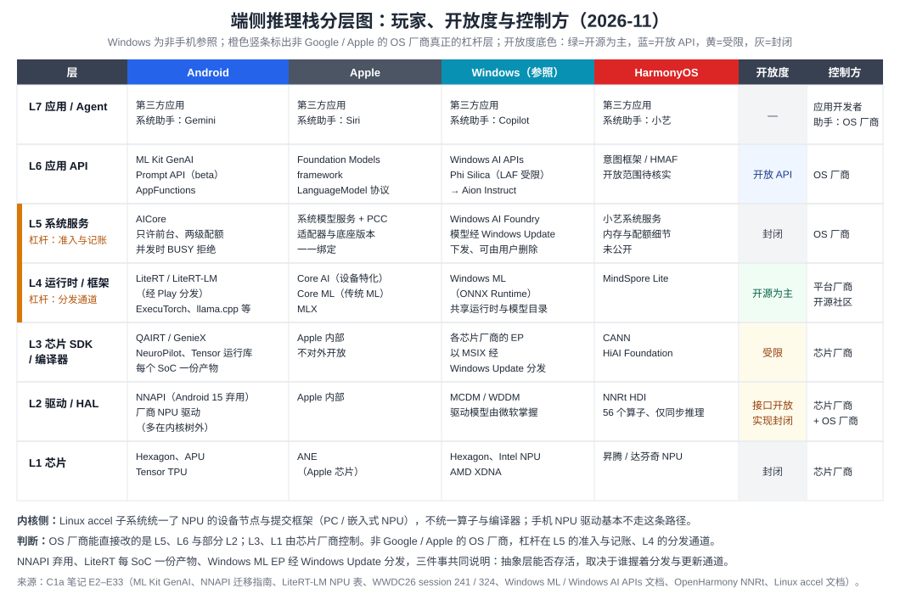

# AgentOS 组件调研 C1：推理框架与推理能力

> **调研日期**：2026-11-05
> **调研依据**：[research-prompt.md](research-prompt.md) 第 4 节（Prompt 1）；子模块笔记 [C1a 系统模型服务与 NPU 栈](notes/C1a-model-service-npu.md)、[C1b 推理加速、端云路由与适配器](notes/C1b-accel-routing-adapter.md)。
> **评审对象**：立场 INF-1 至 INF-5；主责接缝 J3（工具调用接口）、J6（适配器热插拔）、J8（端云路由与隐私标签）。
> **检索说明**：两个子模块的联网检索额度都在中途耗尽，后半段只能直读已知页面。国内手机厂商、HarmonyOS 2026 年现状、三星 Galaxy AI 的开放 API 留有空白，见 §8。
> **修订说明（2026-11-05 第二版）**：
> - 吸收了另一份独立调研（Kimi，见 [kimi调研/](kimi调研/)）中经过核验的内容，对照与取舍见 [kimi-delta-C1](notes/kimi-delta-C1.md)。
> - 两条一手核实改变了第一版的结论：
>   - **Android 17 NPU Manager**：OS 级 NPU 加载准入与卸载式抢占已进入 AOSP。第一版说「没有任何厂商公开抢占粒度」，这一说法不成立。
>   - **Apple AFM 3 Core Advanced**：20B 稀疏端侧模型，完整权重放在 NAND，按请求选择专家载入 DRAM。第一版说「没有任何系统服务支持分页」，需要限定为 KV 部分。
> - 新增内容用 `[K*]` 引用。设计文档原文对推理组件只有 §2.2 四层表中的一行（OS 机制：NPU HAL、模型加载 / 分页 / LoRA 热插拔、多租户推理调度与 QoS、token 计量）。
> **标注约定**：
> - 证据等级 A–D、成熟度 L1–L4 的定义见 research-prompt 第 3.2、3.3 节；
> - 引用 `[A*]` 来自 C1a 笔记（对应笔记内 E 编号），`[B*]` 来自 C1b 笔记（对应笔记内 R 编号），`[K*]` 来自 Kimi 调研或本轮补充核实，完整列表见 §8；
> - 「判断：」开头的句子是本文的分析结论。
>
> **本库相关文档**：[AI 原生 OS 与 Agent](../../surveys/ai-native-os-agent-CN.md)、[端侧内存带宽与异构调度](../../insight/N+1/memory-bandwidth-and-scheduling/memory-bandwidth-and-scheduling-CN.md)、[2027 立项 D2 基础能力演进笔记](../2027-agentos-ai-graphics/notes/D2-foundation-evolution.md)。

---

## §0 摘要

1. **共享底座在三大平台都已量产，但它是「受限共享」，不是编解码器式的共享。**
   - Gemini Nano 已装在超过 1.4 亿台设备上 [A7]。
   - AICore 只允许前台应用推理，后台（包括前台服务）一律返回 `BACKGROUND_USE_BLOCKED`；配额分短、长两个窗口；并发时直接返回 `BUSY` 拒绝，而不是排队；首次推理加载约 1 分钟 [A2][A5]。
   - Android 17 在 AOSP 中新增 NPU Manager。客户端先申请加载许可（带模型 size class 与优先级），资源紧张时系统要求客户端卸载模型；优先级分 background / normal / opportunistic 三档 [K1]。
   - 判断：业界的现实起点是**准入控制 + 以卸载为手段的模型级抢占**，不是细粒度调度 QoS。
2. **「底座共享」正在变成「接口共享、模型可换」。** Apple 在 WWDC26 把系统模型做成 `LanguageModel` 协议的一种实现，第三方模型、PCC 上的模型、经 Core AI 自带的开源模型可以互换 [A11][A13]；Google 也推荐用 LiteRT-LM 自带微调模型 [A7]；Windows 宣布 2027-01 用 Aion Instruct 替换 Phi Silica [A20]。编解码器类比的缺口在于：编解码器的输出稳定，LLM 的输出随版本变化。
3. **NNAPI 的失败说明：抽象层能否存活，取决于 OS 厂商是否掌握分发与更新通道，而不在 HAL 接口本身。** NNAPI 在 Android 15 弃用，Google 的理由是模型栈需要频繁更新 [A4]。接替者 LiteRT 仍要每个 SoC 一份预编译产物：同一个 Gemma3-1B，在 Qualcomm、MediaTek、Tensor 上分别约 0.66GB、0.99GB、1.7GB [A9]。Windows ML 的执行提供程序（EP）经 Windows Update 分发，是目前最干净的样板 [A15][A16]。
4. **模型升级的代价由开发者承担。** Apple 每个适配器约 160MB，只对一个系统模型版本有效，系统模型每次更新都要重训；其开发者页还写着工具包 26.0.0 是最后一版、不兼容 OS 27 及以后 [A14]。Windows 换模型时要求重训 LoRA [A20]。AICore 要求开发者对每个 Gemini Nano 版本重新测试提示词 [A2]。三家都没有做到适配器跨底座版本迁移。
5. **NPU 不一定更快，也不一定更省。** 2026-05 的预印本测得 prefill 阶段 CPU 最多比 NPU 快 1.6 倍，NPU 卸载越多，能耗最多升高 51% [A25]；2026-07 的测量研究（SIGMETRICS 2027 接收）则认为 NPU 最适合 prefill，但框架之间差距可达 10 倍 [A26]。Google 官方模型卡里手机行只有 CPU 和 GPU，S26 Ultra 的 GPU prefill 已达 3808 tok/s、TTFT 0.3 秒；唯一的 NPU 数据点来自 Qualcomm IoT 开发板 [B3]。
6. **峰值吞吐对 Agent 长任务没有意义，稳态才是设计输入。** 持续负载下，iPhone 16 Pro 两轮迭代内吞吐损失近半；S24 Ultra 因系统强制 GPU 频率下限而终止推理 [B30]。手机上每 token 能耗（J/token）没有找到公开实测。
7. **投机解码已进入官方运行时，但收益取决于任务类型。** Gemma 4 的 MTP drafter 在 S26 Ultra GPU 上最高 2.2 倍：摘要任务约 1.8 倍，自由生成约 1.3 倍；在 CPU 上，代码任务反而变慢 [B3][B4][B5]。
8. **产业界没有「OS 自动按隐私、成本、延迟路由」。** 现有形态是三种：开发者显式选模式（Firebase hybrid）、用户逐请求发起（Meta Private Processing）、厂商不公开的内部决策（Apple、Google）[B10][B13][B1]。自动路由只出现在学术工作里（PRISM，AAAI 2026）[B19]。云侧隐私是「可审计的承诺」：Trail of Bits 审计 WhatsApp Private Inference 发现 28 项问题（8 项高危），其中包括证明报告可被重放 [B15]；对 Apple PCC 的逆向研究称其二进制没有可复现构建 [B8]。
9. **结构化输出和工具调用已由推理侧提供，注入防护没有。** Apple guided generation、Chrome `responseConstraint`、LiteRT-LM 受约束解码都在推理侧，三者格式互不相通 [B4][B7][B18]；检索范围内没有任何端侧推理服务在服务层做注入防护。这与 C2 的结论一致：注入防护应放在执行层。
10. **系统模型已经开始把权重放在闪存里。** Apple 在 WWDC26 发布 AFM 3 Core Advanced：20B 稀疏端侧模型，每次请求激活 1–4B，完整模型存放在 NAND。它在 prefill 阶段选定一组专家，生成过程中定期重选，按需把专家换入 DRAM。Apple 明确说，NAND 到 DRAM 的带宽不够做逐 token 换专家 [K2]。判断：「权重分页」已经由平台方在系统模型内部产品化，粒度是「请求级专家集」而不是逐 token 换页；KV 侧仍没有任何系统服务提供分页。
11. **立场结论**：
    - INF-1 支持：改为「共享底座 + 稳定任务接口 + 受控自带模型旁路」；
    - INF-2 需修订：适配器加底座版本契约，适配器 ID 与版本进入 KV 缓存身份；
    - INF-3 支持但拆两层：准入与模型级抢占已由 Android 17 NPU Manager 落地，差异化转到跨后端统一准入与记账、会话级抢占；
    - INF-4 需修订：拆成 OS 策略执行与框架选择优化；
    - INF-5 在 KV 侧受到挑战：没有系统服务提供 KV 分页，要自己定义接口；权重侧已有 Apple 的产品先例。

---

## §1 技术谱系表

| 路线 | 代表工作 | 机构 | 时间 | 一句话贡献 | 成熟度 | 端侧可迁移性 |
|---|---|---|---|---|---|---|
| 系统服务式共享模型 | AICore + ML Kit GenAI（Prompt API 等） | Google | 2023 起；Prompt API 仍为 beta [A3] | 系统服务持有模型，应用共享一份，配额与前台限制由服务执行 | L4（装机量）/ L3（Prompt API） | 端侧方案 |
| 系统服务式共享模型 | Foundation Models framework（`LanguageModel` 协议、PCC 模型） | Apple | 2025 引入，WWDC26 扩展 [A11] | guided generation、tool calling、适配器；本地与服务器模型可互换 | L4 | 端侧方案 |
| 系统服务式共享模型 | Windows AI APIs（Phi Silica → Aion Instruct） | Microsoft | 2024 起 [A19][A20] | NPU 预装模型；Limited Access Feature 解锁 | L4（Copilot+ PC） | 需改造：PC 内存与散热预算更宽 |
| 系统服务式共享模型 | Chrome Prompt API | Google | Chrome 148 开放给网页 [A19b] | 浏览器托管模型；需 16GB 内存、22GB 空闲存储 | L3 | 明确不支持 Android / iOS |
| 系统服务式共享模型 | 盘古端侧模型、小艺、意图框架 / HMAF | 华为 | 2024 起 [A29] | 系统级智能体，向第三方开放意图框架 | 待核实 | 端侧方案 |
| 跨厂商 NPU 抽象（HAL 层） | NNAPI | Google | 2017 引入，Android 15 弃用 [A4] | 统一接口但不统一行为 | 已失败 | — |
| 跨厂商 NPU 抽象（HAL 层） | NNRt | OpenHarmony | 持续 [A22] | 北向 Native 接口 + 南向 HDI；56 个算子、只支持同步推理 | L3 | 端侧方案 |
| OS 级 NPU 仲裁 | NPU Manager（系统服务 `npu` + `android.hardware.npu` AIDL HAL） | Google | Android 17（AOSP tag android-17.0.0_r1，2026-06）[K1] | 模型加载准入（带 size class）；资源紧张时要求客户端卸载；三档模型优先级；后台高优先级任务被下调以保护前台图形 | L3–L4（已进 AOSP，机型覆盖待核实） | 端侧原生 |
| 系统模型的稀疏权重闪存驻留 | AFM 3 Core Advanced | Apple | WWDC26（2026-06）[K2] | 20B 稀疏、每请求激活 1–4B；完整模型存 NAND，请求级选专家、生成中定期重选 | L4（官方发布；出货机型待核实） | 端侧原生 |
| 跨厂商 NPU 抽象（运行时层） | LiteRT + NPU accelerator | Google + 芯片厂商 | 2025-12 至 2026-01 [A8][A10] | 每 SoC 预编译，经 Play 分发，缺失时回退 GPU / CPU | L3 | 端侧方案 |
| 跨厂商 NPU 抽象（运行时层） | Windows ML + ONNX Runtime EP | Microsoft | 2025-09 GA [A15][A17] | EP 以 MSIX 形式经 Windows Update 分发，应用不再打包厂商 SDK | L4 | 需改造：驱动模型不同 |
| 跨厂商 NPU 抽象（内核层） | Linux accel 子系统 | Linux 社区 | 2022 起 [A23] | 统一设备节点与提交框架，不统一算子与编译器 | L3 | 手机 NPU 驱动多在树外 |
| 芯片厂商栈 | QAIRT / GenieX、NeuroPilot、CANN / HiAI Foundation | Qualcomm、MediaTek、华为 | 持续 [A24b][A10] | 图编译、context binary、算子实现 | L3 | 端侧方案 |
| 厂商推理框架 | Core AI（`.aimodel`，设备与 OS 版本绑定的特化产物） | Apple | WWDC26 [A13] | 在设备上特化并缓存；可在同一 app group 内共享缓存 | L4（系统内部） | 端侧方案 |
| 开源推理框架 | ExecuTorch 1.0、llama.cpp、MNN、MLC-LLM、MLX | Meta 等 | 2025-10 GA（ExecuTorch）[A33] | 面向边缘的运行时，多后端 | L3 | 端侧方案 |
| 量化 | Apple 2-bit QAT + KV 共享 | Apple | 2025-07 [B7] | 端侧 3B 模型量产使用 2-bit QAT | L4 | 端侧原生 |
| 投机解码 | Gemma 4 MTP drafter | Google | 2026-05 [B3][B4][B5] | 约 74M 参数 drafter，共享 KV；GPU 最高 2.2 倍 | L3 | 端侧原生（CPU / GPU） |
| 投机解码 | DS2D（无 drafter 的树式自投机）；sd.npu | 三星；北大等 | 2025–2026 [B17][B20] | 最高 2.3 倍；用 NPU 空闲算力做投机 | L1–L2 | 端侧原生 |
| prefill 上 NPU / 异构 | llm.npu、HeteroInfer、PowerInfer-2 | 北大 / 北邮、上海交大 | 2024–2025 [A28][A28b][B23] | NPU prefill 或 GPU + NPU 协同 | L1 | 端侧原生 |
| 异构调度 | Agent.xpu | 北大 | 2025-06 [A26b] | NPU–iGPU 协同 + 细粒度抢占，reactive 延迟至少降 91% | L1 | 需改造 |
| 会话级 KV 复用 | LiteRT-LM session save / restore；Chrome `session.clone()`；AICore Prefix Caching | Google | 2026 [B4][B18][A6] | 序列化 KV、分叉会话、显式前缀缓存 | L3 | 端侧原生 |
| 多适配器 | Apple adapters；ML Kit 功能专属 LoRA；三星「LoRA 作为运行时输入」 | Apple；Google；三星 | 2025–2026 [A14][B12][B16][B17] | 与底座版本绑定的适配器；免重编译切换 | L2–L4 | 端侧原生 |
| 端云路由（隐私云） | Apple PCC；Google Private AI Compute；Meta Private Processing | Apple / Google / Meta | 2024–2026 [B1][B6][B13] | TEE + 远程证明 + 匿名中继 + 透明日志 | L3–L4 | 云侧机制；客户端验证逻辑可参考 |
| 端云路由（开发者 API） | Firebase AI Logic hybrid | Google | 2025–2026 [B10] | 四种模式：PREFER / ONLY × ON_DEVICE / IN_CLOUD | L3 | 只支持 Chrome 桌面 Web |
| 端云路由（出口代理） | NVIDIA OpenShell `inference.local` | NVIDIA | 2026-03 随 NemoClaw 首次亮相，2026-09 正式发布（Kimi 交叉验证口径）[B26] | 统一推理端点，剥离沙箱凭证、注入真实凭证 | L2–L3 | 概念可迁移 |
| 端云路由（学术） | RouteLLM；Hybrid LLM；PRISM | UC Berkeley；Microsoft 等；ZJU 等 | 2024–2025 [B19][B24][B25] | 按质量、成本、隐私敏感度选模型 | L1–L2 | PRISM 需端侧常驻打分器 |
| 结构化输出 | Apple guided generation；Chrome `responseConstraint`；LiteRT-LM 受约束解码 | Apple / Google | 2025–2026 [B4][B7][B18] | 推理侧强制 schema 或语法 | L3–L4 | 端侧原生 |

---

## §2 关键数据

| 指标 | 数值 | 条件 | 来源 | 日期 | 证据等级 |
|---|---|---|---|---|---|
| Gemini Nano 装机量 | 超过 1.4 亿台 | Google 口径 | [A7] | 2026-04 | B |
| AICore 准入 | 非前台一律拒绝（含前台服务）；短窗口 `BUSY`、长窗口 `PER_APP_BATTERY_USE_QUOTA_EXCEEDED` | ML Kit GenAI API | [A2] | 2026-11 抓取 | A |
| AICore 首次推理加载 | 约 1 分钟 | 开发者预览 | [A5] | 2026-11 抓取 | A |
| Prompt API 上下文 | 输入不超过约 4000 token | Gemini Nano | [A3] | 2026-11 抓取 | A |
| AICore 前缀缓存 | 1000 token 前缀 + 100 token 后缀：2.11 秒降到 0.5 秒；缓存加密存放在**应用私有存储** | Pixel 9（文档标为估算） | [A6] | 2026-11 抓取 | A / B |
| 同模型不同 SoC 的 NPU 产物 | Gemma3-1B：Qualcomm 约 657MB、MediaTek 约 985MB、Tensor 约 1704MB | LiteRT-LM | [A9] | 2026-11 抓取 | A |
| MediaTek NPU | Gemma 3n E2B：prefill 超过 1600 tok/s，decode 28 tok/s；Gemma 3 270M 端侧编译超过 1 分钟 | 天玑 9500 | [A10] | 2025-12 | B |
| Gemma 4 E2B（S26 Ultra） | GPU：prefill 3808 tok/s、TTFT 0.3 秒；CPU：prefill 557 tok/s、TTFT 1.8 秒；GPU decode 约 52 tok/s | 1024 prefill + 256 decode | [B3][B4] | 2026 | A |
| Gemma 4 E2B 物理内存 | GPU 约 676MB；iPhone CPU 约 607MB（模型文件 2.58GB，PLE 不进内存） | — | [B3][B4] | 2026 | A / B |
| MTP 分任务（GPU） | 基线 51.5 → 摘要 91.7、代码 84.4、改写 87.4、自由生成 66.5 tok/s | S26 Ultra | [B3] | 2026 | A |
| MTP 分任务（CPU） | 基线 40.7 → 代码 36.3（变慢）、自由生成 38.1 | S26 Ultra | [B3] | 2026 | A |
| NPU 阶段级对比 | prefill：CPU 最多快 1.6 倍；decode：NPU 只快 1.05–1.2 倍；NPU 卸载能耗最多升 51% | 芯片未在摘要中写明 | [A25] | 2026-05 | C |
| 框架间差距 | NPU 上最大 10 倍；能耗导向配置可使 NPU 后端能耗降 53.2% | 5 个框架、3 个后端 | [A26] | 2026-07 | C |
| 持续负载降频 | iPhone 16 Pro 两轮迭代内吞吐损失近半；S24 Ultra 推理被终止 | Qwen2.5-1.5B 4-bit，20 轮热态迭代 | [B30] | 2026-03 | C |
| Apple 适配器 | 每个约 160MB；只对一个系统模型版本有效 | 工具包页面（2025 起口径）；2024 技术报告口径为 rank-16、数十 MB 的功能适配器，二者指代不同 | [A14] | 2026 | A |
| AFM 3 Core Advanced | 20B 稀疏，每请求激活 1–4B；完整模型存 NAND，专家按需换入 DRAM | Apple 官方 | [K2] | 2026-06 | A |
| 移动 NPU 上的跨请求 KV 复用 | TTFT 比无复用和仅前缀缓存降 40%–60% | NPU 静态图内选择性重算；NPU / CPU / Flash 三层 KV | [K3] | 2026-09 | A（预印本） |
| 三星多 LoRA（NPU） | 多流解码延迟最多降 6 倍；INT4 + 架构优化综合改善 4–6 倍；**没有切换延迟数据** | Galaxy S24 / S25 | [B17] | 2026-04 | C |
| WhatsApp Private Inference 审计 | 28 项问题，8 项高危；16 项完全修复 | Trail of Bits | [B15] | 2026-04 | B |
| Hybrid LLM | 大模型调用最多减少 40%，质量不降 | ICLR 2024 | [B25] | 2024 | A |
| PRISM | 能耗与延迟降到基线的 40%–50% | AAAI 2026，自报 | [B19] | 2025-11 | A |
| 端云切换延迟 | 未找到公开资料 | Apple、Google、Meta、Firebase、三星都没有 | — | — | — |
| 手机 J/token | 未找到公开实测 | — | — | — | — |

---

## §3 逐问题分析

### Q1 系统级端侧模型服务的现状

| 平台 | 形态 | 开放与限制 | 版本与生命周期 | 证据 |
|---|---|---|---|---|
| Android AICore | 系统服务持有 Gemini Nano，ML Kit GenAI 的任务 API 和 Prompt API 共享同一个底座 | 只允许前台调用；两级配额；`BUSY` 拒绝而不是排队；Prompt API 仍为 beta，要求 bootloader 未解锁 | 设备分 nano-v2 / v3 / v4 三档；要求开发者用 `getBaseModelName()` 检查版本并分别测试 | [A2][A3][A5] |
| Apple Foundation Models | 系统模型是 `LanguageModel` 协议的一种实现；PCC 模型、Anthropic / Google 的 Swift 包、Core AI 本地开源模型都可以互换 | 首次下载量少于 200 万的开发者免 PCC 费用；整个核心框架开源 | 适配器与系统模型版本一一绑定 | [A11][A13][A14] |
| Windows AI APIs | Copilot+ PC 上 NPU 预装模型 | Phi Silica 是 Limited Access Feature，需解锁令牌，在中国不可用 | 2026-11 起 Aion Instruct 进 Insider，2027-01 从零售设备移除 Phi Silica，开发者须重训 LoRA | [A19][A20] |
| Chrome | 浏览器托管 Gemini Nano，网页经 Prompt API 调用 | 需 16GB 内存、22GB 空闲存储；空闲存储低于 10GB 时模型被移除 | 模型独立于浏览器下载 | [A19b] |
| HarmonyOS | 小艺 + 意图框架 / HMAF | 2025-06 称向第三方开放；HDC 2026 的会议报道称 AI 子系统开放 20 余项能力、日调用 36.8 亿次，小艺改为可接入多个模型的底座（媒体口径，无 API 文档与配额说明，经 Kimi 转引） | — | [A29] |

**两个动向。**

- **系统服务在向「托管 Agent 循环」扩展。** 2026-10 的 Android Dev Summit 宣布 ML Kit 的 Agentic API 进入 alpha：内置函数自动执行、对话历史保存、编排循环与护栏 [A7b]。Apple 也推出了 Dynamic Profiles 与 skill API [A11]。判断：推理服务正在吸收原本属于 Agent 框架的职责，这与 INF-1 同向，也和 C2 的接口面、C3 的会话记忆直接相关。
- **ML Kit GenAI 的官方设备列表已覆盖荣耀、OnePlus、OPPO、vivo、小米、三星等** [A2]。Google 的服务正在成为 Android 阵营事实上的共享底座；国内厂商自家端侧模型对第三方的开放 API 没有查到。

**谁持有模型内存。** AICore 文档强调「不在内存中加载多份」，但同时说明首次推理要约一分钟载入内存，`BUSY` 提示可能意味着另一个大模型正在使用 [A5]。判断：服务一次只常驻一个大模型，用拒绝而不是排队处理竞争。内存记在谁头上，文档没有说明（见 [C4](C4-内存管理.md) J2）。

**反方：自带模型。** 没有找到「主流应用中有多少自带模型或运行时」的公开数据。侧面证据：Google 自己推荐「高度定制或小众场景」用 LiteRT-LM 自带微调模型 [A7]；Apple 开放 Core AI 让开发者自带大模型 [A13]。判断：平台把「定制模型」这条路保留给了自己的旁路。INF-1 要覆盖的不只是共享，还包括对自带模型的记账与准入——否则自带模型会绕过共享，把重复占用带回来。

### Q2 NPU 的编程与调度模型

**编译方式：都落到「AOT 预编译为主、端侧编译为辅」。**

- LiteRT：AOT 适合已知目标 SoC 的大模型，减少初始化时间和启动内存；端侧 JIT 适合小模型广泛分发，但首次运行慢——Gemma 3 270M 端侧编译超过 1 分钟 [A8][A10]。
- Apple Core AI：随包分发源表示，在用户设备上特化，产物与设备和 OS 版本绑定并缓存；官方建议不要在交互流程中特化 [A13]。
- NNRt：构图后编译（可跨硬件但首次加载慢），或直接加载硬件专用的离线模型（快但不可移植）[A22]。
- QAIRT：GenieX 的 QAIRT 运行时只加载 AI Hub 预编译、预量化的模型 [A24b]。

**内存模型。** NNRt 支持在驱动上申请共享内存做零拷贝 [A22]；LiteRT 通过 `AHardwareBuffer` 和 OpenGL / OpenCL 缓冲实现零拷贝 [A10]；Core AI 支持有状态模型（如 KV cache）原地更新 [A13]。dma-buf、VTCM 等细节见 C4。

**多会话、优先级与抢占：Android 17 已经做了模型级的一层。**

- **Android 17 NPU Manager**（第一版漏掉，经 Kimi 线索、官方页与 AOSP 仓库核实）[K1]：
  - 系统服务 `npu` 把模型加载准入与优先级从厂商守护进程收回平台：客户端先调 `requestCanLoadModel`（带 size class 与优先级），获批后才加载；
  - 资源紧张（前台请求、热峰值）时，系统回调 `onRequestUnloadModel` 要求客户端卸载，任务可被标为 `PAUSED` 或 `CANCELLED_SYSTEM`；
  - 模型优先级分 background / normal / opportunistic；后台应用的高优先级任务会被下调，以保护前台图形；
  - HAL 为 `android.hardware.npu` AIDL，调度配置含 uid、优先级区间、是否可代其他 uid 归账（`canAttributeOtherUid`）；
  - 官方页没有给出时延上限或时间片保证，也没说第三方应用能否获得同等权限；Kimi 二手来源所说的「best-effort」「@SystemApi」，官方页未出现。
- NNRt 文档列有优先级与性能模式，但「并发编译和执行取决于底层驱动」，目前只支持同步推理 [A22]。
- AICore 在应用侧只暴露 `BUSY` 和配额错误码，调度策略不公开 [A2]；NPU Manager 与 AICore 配额是否打通，没有资料。
- 算子级抢占与上下文切换开销仍没有任何厂商公开。高通 QNN 有 8 级 context priority，但只是提示（Kimi 引 ONNX Runtime QNN EP 文档，未核实）。
- 学术侧：Agent.xpu（L1）做 NPU–iGPU 协同 + 细粒度抢占，reactive 延迟至少降 91% [A26b]；Kimi 另列 Pantheon（MobiSys 2024，移动 GPU 可抢占多 DNN）和 V10（ISCA 2023，硬件辅助 NPU 多租户，面向云端）（未核实）。

判断：Google 已在 OS 层落地「准入 + 优先级 + 以卸载模型为手段的抢占」，粒度是模型，不是算子；它只覆盖 NPU，不覆盖 CPU / GPU。INF-3 的差异化空间因此收窄，落在 NPU Manager 没有覆盖的部分：
- 跨 CPU / GPU / NPU 的统一准入与记账；
- 会话或 token 粒度的抢占（卸载整个模型的代价，是 AICore 首次加载约 1 分钟那样的重载成本）；
- 按阶段（prefill / decode）选择后端；
- 与配额、前台限制打通。

非 Google 的 OS 厂商还要面对一个现实：自建同层机制，就要承担与 AOSP 上游分叉的成本。

**跨厂商抽象层的成败。**

| 层 | 代表 | 结果 | 原因 |
|---|---|---|---|
| HAL 层 | NNAPI | Android 15 弃用 | 模型栈需要按月更新，HAL 更新太慢；接口统一了，行为没统一 [A4][A30] |
| HAL 层 | NNRt | 仍在维护，成熟度低于 LiteRT | 56 个算子、同步推理、无 CPU 回退 [A22] |
| 用户态运行时 | LiteRT | 当前 Android 主路径 | Play 分发模型与运行时；代价是每 SoC 一份产物 [A8][A9] |
| 用户态运行时 | Windows ML EP | 最干净的样板 | EP 经 Windows Update 分发；Microsoft 掌握驱动模型（WDDM / MCDM）[A15][A16] |
| 内核 | Linux accel | 统一设备节点与提交框架 | 不统一算子与编译器 [A23] |

**这说明什么。** NPU 栈的控制权在分发通道，不在接口。OS 厂商要影响 NPU，先要握住模型与运行时的更新通道。PC 上 Microsoft 有这个控制力，手机上 Google 的控制力弱于 Microsoft，其他 OS 厂商更弱。

**NPU 的真实收益存在分歧。** 厂商口径是 NPU 比 GPU 快至多 10 倍 [A8]；两篇 2026 年的独立预印本对 prefill 的结论方向相反 [A25][A26]，但都认为「框架实现质量决定一切」。官方运行时的选择更接近质疑派：LiteRT-LM 在 S26 Ultra 上用 GPU 就把 TTFT 压到 0.3 秒 [B3]。判断：NPU 在手机上的主要卖点正在从「速度」退化为「能耗」和「不占 GPU」（把 GPU 留给图形与 UI）——而能耗这一点也有争议（NPU 卸载越多能耗最多升 51%）。

### Q3 端侧推理框架格局与重复占用

**格局。** Android 默认路径是 LiteRT / LiteRT-LM（NPU 支持 Qualcomm、MediaTek、Tensor）[A9]；ExecuTorch 1.0 在 2025-10 GA，Meta 称已支撑 Facebook、Instagram、WhatsApp 等应用 [A33]；Apple 在 Core ML 之外新增面向大模型的 Core AI [A13]；Qualcomm 的 GenieX 同时支持 llama.cpp（含 Hexagon HTP）和 QAIRT 两套运行时 [A24b]。llama.cpp、MNN、MLC-LLM、MLX 的内存管理细节本轮没有逐项核实。

**多框架重复占用的四种解法。**

1. **系统服务化**：AICore、Foundation Models、Windows AI APIs。代价是开放度受限。
2. **共享运行时**：Windows ML 让所有应用共享同一份运行时并经 Windows Update 演进 [A15]；Android 的 LiteRT in Play services 同理 [A4]。
3. **共享模型缓存**：Windows ML 为库和 SDK 作者提供跨应用共享模型目录 [A15]；Apple 的 AIModelCache 只限同一 app group [A13]；Android 应用私有存储天然隔离，没有找到跨应用共享同一权重文件 page cache 的官方机制。
4. **框架无关的记账**：没有找到任何平台在记账上区分「共享模型」与「应用私有模型」。

**重复占用估算**（下界，只算权重，不含运行时库和 KV）：

| 场景 | 计算 | 常驻量 | 占 12GB 手机 |
|---|---|---|---|
| 系统服务共享 1 份 2B 模型，3 个应用调用 | 1 × 2.6GB | 约 2.6GB | 约 22% |
| 系统服务 2B + 3 个应用各 1 个适配器（Apple 模式） | 2.6GB + 3 × 0.16GB | 约 3.1GB | 约 26% |
| 3 个应用各自带 1B 模型 | 3 × 0.66–1.0GB | 约 2.0–3.0GB | 约 17%–25% |
| 系统服务 2B + 2 个应用各自带 2B | 3 × 2.6GB | 约 7.8GB | 约 65% |

输入数据来自 [A9][A14]，结果为估算。第二行与第四行相差约 4.7GB，这就是共享底座的内存价值：每多一个自带 2B 模型的应用，多占约 2.6GB。判断：实际情况更可能是「被 LMKD 杀掉后冷启动重新加载」，而不是「同时驻留」——重复成本被换成了时间成本（AICore 首次推理加载约 1 分钟）。这条证据同时支持 2027 立项中「模型加载 / 卸载提速」（KT3）的价值。

### Q4 推理加速在端侧的落地水平

**量化。** Apple 是唯一把 2-bit QAT 做进量产系统模型的厂商 [B7]。Qualcomm 宣称 8 Elite Gen 5 支持 INT2 / FP8，本地 LLM 约 220 tok/s，但测试配置不明 [B29]。判断：手机上的量产主流仍是 4-bit；2-bit 依赖自研模型和 QAT 训练管线，不掌握训练管线的 OS 厂商无法复制。

**投机解码。** 2026 年发生了实质变化：Gemma 4 的 MTP drafter 约 74M 参数、共享 KV，在 LiteRT-LM 中两行配置即可开启 [B4][B5]。但收益强依赖任务（见 §2），Google 官方建议 GPU 上全任务开启、E2B 在 CPU 上选择性开启 [B5]；服务器 GPU 上「最高 3 倍」的数字不能外推到手机。三星的 DS2D 无需草稿模型，最高 2.3 倍 [B17]。EAGLE、LayerSkip 在手机 NPU 上的落地没有找到公开证据。判断：投机解码在 GPU 上是 L3，在 NPU 上仍是 L1–L2；OS 若暴露开关，应由模型包按任务类型给默认值，而不是全局开启。

**KV 复用。** 能核实的端侧证据都是**会话级**的：LiteRT-LM 支持序列化 KV 的保存与恢复 [B4]；Chrome 的 `session.clone()` 可分叉对话，上下文溢出时丢弃最旧的提示–响应对，但永不丢系统提示 [B18]；AICore 的 Prefix Caching 把缓存加密存放在应用私有存储 [A6]。「系统提示词 KV 作为系统服务跨应用共享」在手机上没有任何公开实现——这既回避了侧信道问题，也放弃了共享收益（见 C4 J2）。学术侧，2026-09 的一篇预印本首次在移动 NPU 的静态图内实现前缀与非前缀 KV 复用，用图内选择性重算、跨图 chunk 合并减少 padding，并设计 NPU / CPU / Flash 三层 KV 存储与成本感知驱逐，TTFT 比无复用和仅前缀缓存降 40%–60% [K3]。它是原型而不是系统服务，但说明 KV 持久化与分层在 NPU 路径上可以实现；核心矛盾是动态复用与静态图形状的冲突。

**权重分页已有平台先例。** Apple 的 AFM 3 Core Advanced 把完整的 20B 稀疏模型存放在 NAND，在 prefill 阶段选定一组专家，生成中定期重选，只把需要的路由专家换入 DRAM [K2]。Apple 的理由是 NAND 到 DRAM 的带宽不够做逐 token 换专家。这与 C4 引用的 iPhone 实验（逐 token 的 LRU 在 512MiB 预算下命中率为 0）方向一致。判断：端侧稀疏权重分页的可行粒度是「请求级工作集 + 低频重选」，不是逐 token 换页。这部分由平台在模型内部完成，OS 看到的仍只是一个系统服务。

**prefill 上 NPU。** 支持派：llm.npu 报告 prefill 快 22.4 倍、节能 30.7 倍 [A28]；HeteroInfer 在 GPU + NPU 协同下达到 1092 tok/s [B22]。质疑派：阶段级研究称 CPU 在 prefill 上反而更快 [A25]。关键问题是基线：论文用的是 llama.cpp、MNN 的旧版 CPU / GPU 实现，与官方 GPU 实现差距很大。2026-07 的测量研究（SIGMETRICS 2027，v2 于 2026-10-16 修订）还给出 decode 侧结论：CPU 在访存受限的 decode 上胜过其他后端，NPU 的优势集中在计算受限的 prefill [A26]。Kimi 引用的 ExecuTorch 论文（Galaxy S25 Ultra）方向相同：QNN prefill 约为 XNNPACK 的 5 倍，decode 反而略低（未核实）。判断：要用最新 GPU 基线、同一设备、含能耗重新测量，才能回答「prefill 是否值得放 NPU」；如果 OS 要暴露后端选择，单位应是阶段，而不是芯片。

**这说明什么。** 端侧加速的「可用档」已经由 GPU + 4-bit + MTP 达成；NPU 的收益没有被官方数据证实，能耗结论也有争议。OS 级推理子系统的设计约束应是**稳态功耗与热降频**，而不是峰值吞吐。

### Q5 端云路由

见 §7.2 对比表。三个结论：

1. **产业界的路由不是自动的。** 用户逐请求发起（Meta）、开发者选模式（Firebase，且只支持 Chrome 桌面 Web）、用户总开关（三星「仅在设备上处理」）、厂商内部决策且不公开（Apple、Google）[B10][B13][B34][B1][B31]。Google 只说 Private AI Compute 用于「比端侧需要更多推理或算力的任务」，首批用例是 Pixel 10 的 Magic Cue 和录音机摘要 [B1]。
2. **云侧隐私的强度取决于实现质量。** Meta 公开了完整设计（RA-TLS、OHTTP、第三方透明日志、匿名凭证、无状态）[B13][B14]，但 Trail of Bits 的审计发现证明报告缺少客户端新鲜性（可被重放）、环境变量与 ACPI 表未被度量 [B15]；对 Apple PCC 的逆向研究称其二进制不透明、无可复现构建 [B8]。判断：OS 路由层应把隐私保证建模为**带有效期、可撤销的信任档位**，而不是布尔值，并要求证明的新鲜性（与握手绑定的 nonce）。
3. **NVIDIA OpenShell 的「Privacy Router」本质是凭证与出口治理。** 沙箱内代码调用 `inference.local`，路由器剥离沙箱自带凭证、注入真实凭证；一个网关只配置一个 provider [B26]。它对应 J8 的「出口 + 凭证」半边，和 C2 的凭证经纪人是同一机制，不对应「按敏感度选模型」。

**学术路由。** RouteLLM、Hybrid LLM 只做质量与成本，不含隐私 [B24][B25]；PRISM 在端侧做实体级敏感度打分，软门控选择云、端或协同路径，能耗与延迟降到基线的 40%–50% [B19]。但 PRISM 自己指出：二元阈值路由会误判，要么压垮端侧、要么泄漏隐私——敏感度打分器本身就是单点风险。另一条路径是任务分解：MinionS 让本地模型读全文、云端只拿子任务，Kimi 引其成本降 5.7 倍、恢复 97.9% 的性能（未核实）。这条路径不要求打分器判断敏感度，而是让原文本身不出端。

**延迟数据是公开资料空白**：没有任何一家公开端云切换延迟。所以「路由依据含延迟」在产业界没有公开证据。

### Q6 LoRA 与适配器生态

| 平台 | 开放对象 | 版本关系 | 体积 / 延迟 | 证据 |
|---|---|---|---|---|
| Apple | 第三方（上架前需 entitlement） | 每个适配器只兼容一个系统模型版本，须逐版本重训；工具包 26.0.0 是最后一版、不兼容 OS 27 及以后（是否终止路线待核实） | 每个约 160MB（工具包口径；rank-32 来自第三方逆向）；2024 技术报告中的功能适配器为 rank-16、数十 MB；建议经 Background Assets 下载 | [A14][B11][B35] |
| Google | 不开放第三方 | Google 按功能自训 LoRA，随 Nano 版本同步发布 | — | [B12] |
| Windows | 第三方 LoRA 微调 | 换底座（Aion Instruct）时须重训 | — | [A20] |
| 三星（研究） | — | LoRA 权重作为运行时输入送入同一张冻结的编译图，免重编译 | 「无额外内存开销」，但**没有切换延迟数据** | [B16][B17] |
| EdgeLoRA（学术） | — | 适配器缓存 + 池化 + 批量 LoRA | 对 llama.cpp 吞吐最高 4 倍；8–64GB 设备，非手机 | [B27] |

**这说明什么。** 平台实际上把适配器当作「与底座同版本的编译产物」，真实成本在**版本兼容**，不在切换延迟。热插拔延迟反而是次要问题，而且没有手机实测。Google 选择用 Prefix Caching + Structured Output 覆盖第三方场景，而不开放适配器 [A6][A7a]——这是一个值得认真考虑的替代方案：成本更低，不受版本绑定。

**适配器还会改变 KV 的身份。** Kimi 的调研给出两条工程证据（本轮未核实）：llama.cpp 服务端热切换 LoRA 时必须清空 KV；SGLang 把 adapter 标识写入前缀缓存键。判断：只要 LoRA 作用于 K / V 投影，系统服务的前缀缓存就要把底座版本、适配器 ID 与版本、量化档位放进缓存键，否则切换适配器后会静默产出错误结果。并非所有 LoRA 都作用于 K / V，取决于 target modules。Kimi 还列了 MobiLoRA、DroidSpeak 等跨适配器 delta 复用工作（未核实），这类复用可以作为可选优化，默认仍应隔离。

### Q7 模型生命周期

- **下发**：AICore 按需下载，`checkStatus()` 有四种状态，需 Wi-Fi [A3][A5]；Windows 的 GPU 路径首次调用时经 Windows Update 后台下载数 GB，用户可在设置里删除，应用须先征得用户同意 [A19][A20]；Apple 建议适配器经 Background Assets 下发 [A14]。**模型差分更新**：没有找到任何一家的公开机制。
- **版本升级的破坏与缓解**：三家的缓解手段都是「给开发者时间和工具」——Apple 按版本发布工具箱和 Evaluations 框架，Google 提供开发者预览通道与 `getBaseModelName()`，Microsoft 提供并行测试的注册表键和重训工具链 [A2][A11][A20]。判断：生命周期问题已经变成平台与开发者之间的**合同问题**——谁为底座升级造成的适配器失效买单。目前的答案是开发者。
- **能耗与热**：Android 有 `getThermalHeadroom`，能预测未来若干秒的热余量，但面向游戏等通用负载，调用间隔不得少于 10 秒 [A27]。没有找到任何平台向应用暴露每 token 能耗或推理期热状态。AICore 的长窗口配额以电量命名（`PER_APP_BATTERY_USE_QUOTA_EXCEEDED`），说明 Google 以电量作为配额单位 [A2]。

### Q8 推理服务对 Agent 的接口（J3）

| 能力 | Apple | Chrome | LiteRT-LM | AICore |
|---|---|---|---|---|
| 结构化输出 | guided generation（Swift 类型驱动） | JSON Schema 作为 `responseConstraint`，schema 占上下文窗口 | 受约束解码，可强制 JSON schema 或语法 | Structured Output（宣布中） |
| 工具调用 | constrained tool calling | — | 函数调用时暂停执行、返回结构化请求，工具结果到来后恢复 | Agentic API alpha（内置函数自动执行） |
| 会话管理 | 会话 + cached token 计数 | `clone()`、`contextUsage`、溢出事件 | KV 会话保存 / 恢复 | Prefix Caching（显式 API） |
| 注入防护 | 未找到 | 文档未讨论 | 未找到 | 未找到 |

来源：[A6][A7][A7b][A11][B4][B7][B18]。

**这说明什么。** 格式正确性（J3 的一半）已由推理服务提供；安全性（另一半）没有任何平台在推理层提供。三家格式互不相通。判断：推理侧应提供「schema / 语法 → 受约束采样」和「暂停于工具调用、恢复」两个最小原语；把 MCP、AppFunctions 的工具描述翻译成 schema 是接口面（沙箱）的事；注入防护放在执行层（见 [C2](C2-沙箱框架与执行能力.md) §6 J3）。

---

## §4 趋势判断

**正在收敛的方向**

1. 三大平台都提供系统级共享模型，并分「任务级 API」和「会话级 API」两层暴露。
2. 系统托管提示前缀状态（AICore Prefix Caching、Apple cached token 计数）。
3. 「预编译 + 设备特化 + 缓存」成为 NPU 部署主路径。
4. 跨厂商抽象放在用户态运行时、由 OS 厂商控制分发（LiteRT、Windows ML EP），而不是 HAL。
5. 系统服务向「托管 Agent 循环」扩展（AICore Agentic API、Apple Dynamic Profiles）。
6. 端侧量产基线是 GPU + 4-bit；MTP 投机解码以「可选开关 + 按任务建议」的形式进入官方运行时。
7. 结构化输出与函数调用由推理侧提供。
8. 云侧隐私模板：TEE 证明 + 无状态 + 匿名中继 + 透明日志。
9. 适配器与底座版本绑定。

**公认的空白点**

1. 跨 CPU / GPU / NPU 的统一准入，以及比「卸载整个模型」更细的抢占：Android 17 NPU Manager 只覆盖 NPU、只到模型级 [K1]，算子级抢占与切换开销仍无公开数据。
2. 适配器跨底座版本的兼容与迁移。
3. 每 token 能耗、稳态降频曲线的遥测与向应用暴露。
4. 模型差分更新。
5. Android / iOS 上跨应用共享同一份权重文件的平台机制。
6. 跨应用共享系统提示词 KV 的平台级前缀缓存；NPU 路径上的 KV 持久化与分层只有学术原型 [K3]。
7. 多适配器切换延迟、端云切换延迟的手机实测。
8. 推理服务层的注入防护。
9. 来自记忆 / 权限系统的敏感度标签（J8）：没有产品公开使用。
10. 第三方自带模型的采用率与原因。

**仍有分歧的问题**

1. NPU 是否值得：厂商口径与独立测量在 prefill 与能耗上不一致。
2. 系统服务是否开放第三方模型：Apple 可插拔，Google 保留旁路，Microsoft 用 LAF 受限。
3. 路由是否应当自动化：产业界选显式信任档位，学术界做自动路由。
4. 云侧隐私能否独立验证。
5. 适配器是否值得向第三方开放。
6. 共享底座在中低端机上是否成立：nano-v4 目前只覆盖少数旗舰。

---

## §5 立场评审

### 5.1 评审表

| 立场 ID | 判断 | 关键证据 | 最强反方证据 | 修订建议 | 置信度 |
|---|---|---|---|---|---|
| INF-1 模型即系统服务 | **支持，需修订** | 三大平台均已量产 [A2][A7][A19] | Apple 把系统模型变成可插拔协议之一、开放 Core AI 自带模型 [A11][A13]；Google 推荐自带微调模型 [A7]；Phi Silica 被替换说明底座本身会更换 [A20]；LLM 输出随版本变化，不像编解码器那样稳定 | 改为「共享底座 + 稳定任务接口 + 受控的自带模型旁路」；底座版本进入接口契约（类似 `getBaseModelName`）；自带模型纳入同一套记账与准入 | 高 |
| INF-2 共享底座 + 适配器热插拔 | **需修订** | 三星把 LoRA 作为运行时输入，免重编译 [B16][B17]；Google 用功能专属 LoRA 保持 Nano 跨版本质量 [B12] | Apple 适配器与单一底座版本绑定，须逐版本重训 [A14]；Google 不开放第三方适配器 [B12]；没有手机切换延迟数据 | ① 适配器定义为带 `base_model_id + 版本区间` 的受管产物，由 OS 负责匹配、下载、淘汰；② 默认路径是「提示 + 结构化输出 + 前缀缓存」，适配器作为专业场景扩展；③ 拿到手机实测前，不承诺「毫秒级热插拔」；④ 底座升级的兼容策略要先于接口设计；⑤ 适配器 ID 与版本进入 KV 缓存身份，切换适配器默认使相关 KV 失效（Kimi 线索，机制有推理依据） | 中 |
| INF-3 多租户 QoS 调度 | **支持，拆两层（差异化收窄）** | Android 17 NPU Manager 证明 OS 级 NPU 仲裁是平台方向 [K1]；Agent.xpu 证明抢占对 reactive 延迟收益大 [A26b] | Google 已在 AOSP 落地准入、三档优先级与卸载式抢占 [K1]，OS 厂商自建同层机制要承担与上游分叉的成本；产业用「前台限制 + 配额 + BUSY」的粗粒度准入已够当前场景 [A2]；NPU 调度开销与回退可能抵消卸载收益 [A25] | 第一层：对齐并扩展 NPU Manager 的准入与模型级抢占，不再作为独有缺口；第二层（差异化）：跨 CPU / GPU / NPU 的统一准入与记账、会话或 token 粒度抢占、按阶段选后端、与配额和前台限制打通。QoS 以稳态功耗与热为约束 | 中 |
| INF-4 端云路由层 | **需修订** | Apple 用统一 API 覆盖端侧、PCC 与第三方服务端模型 [B31]；Firebase 四种显式模式 [B10]；PRISM 端侧实体打分 [B19] | Chrome 承诺不外发 [B18]；Meta 由用户逐请求发起 [B13]；三星只有总开关 [B34]；审计显示云侧隐私依赖实现质量 [B8][B15] | ① 拆成「策略执行」（OS：允许哪些端点、要求什么证明、携带什么标签）和「选择优化」（框架 / 应用：质量与成本）；② 隐私保证写成带有效期的信任档位，要求证明新鲜性；③ 敏感度标签来自记忆 / 权限系统，不用模型自评做授权依据；④ 延迟暂不进入 OS 策略 | 中 |
| INF-5 权重与 KV 可分页（框架侧） | **KV 侧挑战；权重侧已有平台先例** | 运行时已能让常驻集小于模型（Gemma 4 E2B 物理内存约 607MB，文件 2.58GB）[B4]；会话级 KV 可序列化 [B4]；Apple AFM 3 Core Advanced 完整模型存 NAND、请求级换入专家 [K2]；移动 NPU 上的 KV 复用与分层有学术原型 [K3] | 没有任何系统服务提供 KV 分页；AICore 首次推理要把模型整个载入，约 1 分钟 [A5]；唯一的 KV 持久化先例（Prefix Caching）落在应用私有存储 [A6]；Apple 的权重分页在模型内部完成，对 OS 不可见 | 要求运行时暴露「可序列化 / 可丢弃 / 可重建」三态接口，交给内存管理接管（对应 C4 的会话状态单元）；以 Prefix Caching 的显式缓存 API（create / list / get / delete）作接口样板；权重分页按「请求级工作集 + 低频重选」设计，并要求运行时上报驻留集大小 | 中 |

### 5.2 修订后的立场表述（建议稿）

- **INF-1′** 底座模型作为系统服务共享，对外提供稳定的任务级接口；底座版本是接口契约的一部分。同时为自带模型提供受控旁路，自带模型与共享底座使用同一套准入与记账。
- **INF-2′** 适配器是绑定底座版本区间的受管产物，由系统负责匹配、分发与淘汰；适配器 ID 与版本是 KV 缓存身份的一部分。默认用「提示 + 结构化输出 + 前缀缓存」满足定制需求，适配器作为专业场景的扩展。
- **INF-3′** 推理调度分两层：
  - 第一层是准入控制、优先级与模型级抢占，在 Android 上与 NPU Manager 对齐，并扩展到 CPU / GPU 后端；
  - 第二层是会话级抢占、按阶段的后端选择，以及与配额记账打通（研究项）。

  调度目标是稳态体验，约束是功耗与热。
- **INF-4′** 端云路由分两层：OS 执行硬约束（允许的端点、所需证明及其新鲜性、数据敏感度标签对应的可去之处）；框架在约束内按质量与成本做选择。
- **INF-5′** 推理运行时向系统暴露会话状态的三种操作——序列化、丢弃、重建——由内存管理决定何时调用；权重的稀疏驻留由运行时按请求级工作集管理，并向系统上报驻留集大小。

---

## §6 接缝发现

**J3 工具调用 / 结构化输出 ↔ 接口面（主责）**

- 推理侧提供两个最小原语：`generate(schema | grammar)` 的受约束采样；在工具调用处暂停、拿到结果后恢复（LiteRT-LM 已有）[B4]。
- schema 占上下文窗口是真实代价（Chrome 提供 `measureContextUsage()` 测量）[B18]。
- 工具元数据（MCP、AppFunctions）到 schema 的翻译归接口面；注入防护归执行层。见 [C2](C2-沙箱框架与执行能力.md) §6。
- 缺口：Apple、Chrome、LiteRT-LM 的格式互不相通；系统需要一个统一的内部 schema 表示。

**J6 适配器热插拔与权重分页（主责）**

- 三星的「适配器作为运行时输入」让适配器成为不进入编译图的小张量文件，J6 因此变成普通的权重分页问题，可以与底座权重统一记账 [B16][B17]。
- 但 Apple 的适配器约 160MB 且按底座版本隔离，存储与内存侧需要「底座版本 × 适配器」两级管理 [A14]。
- 切换延迟与内存开销没有手机实测，需要仿真与真机补数。内存机制见 [C4](C4-内存管理.md) Q4。
- 适配器切换与 KV 缓存身份：缓存键包含底座版本、适配器 ID 与版本、量化档位（见 Q6）。
- 安全前置条件（Kimi 线索，未核实）：vLLM 文档警告运行时加载 LoRA 的接口只能用于隔离的可信环境。端侧的适配器加载要有签名与来源校验，Apple 用 entitlement + Background Assets + 版本锁定闭环。

**J8 端云路由与隐私标签（主责）**

- 没有任何产品公开使用「来自记忆 / 权限系统的敏感度标签」做路由。最接近的是 PRISM 的端侧实体打分（L1）[B19]。
- 建议：标签作为请求元数据由调用方携带，来源是记忆条目的数据域标签和沙箱会话的污染状态（见 [C3](C3-记忆框架与记忆能力.md) §6 J8、C2 SBX-5′）；路由层只做「标签 → 允许的端点集合」的硬约束；模型自评只作兜底提示，不作授权依据。
- OpenShell 把凭证注入和端点治理放在出口代理，可以与沙箱的凭证经纪人复用同一机制 [B26]。

**J2 共享底座的记账与前缀隔离（协同，主责内存管理）**

- AICore 的前缀缓存放在应用私有存储，不跨应用共享 [A6]——侧信道被回避，共享收益也放弃了。Windows ML 的共享模型目录允许跨应用共享，侧信道未讨论 [A15]。
- NPU Manager 的加载请求带 size class，HAL 配置里有「可代其他 uid 归账」的字段 [K1]。判断：NPU 模型内存在 Android 17 上已有一个准入与归账的入口，C4 的统一记账应接在这里，而不是另起一套。另一面是卸载被当作抢占手段，重新加载的代价会转嫁给用户。

---

## §7 组件特有输出

### 7.1 端侧推理栈分层图

**读图结论（判断）**：

- OS 厂商能直接改的只有 L5（系统服务）、L6（应用 API）和部分 L2（HAL）；L3（芯片 SDK / 编译器）和 L1（芯片）由芯片厂商控制；L4（运行时）对 Google、Apple、Microsoft 是自家产品，对其他 OS 厂商是可选依赖。
- 不是 Google / Apple 的 OS 厂商，真正的杠杆点有两个：L5 的**准入与记账**，以及 L4 的**分发通道**。
- NNAPI 被弃用说明，把杠杆放在 L2 不可持续。

### 7.2 端云路由方案对比表

| 方案 | 路由依据 | 决策方 | 隐私机制 | 延迟数据 | 证据等级 | 端侧可迁移性 |
|---|---|---|---|---|---|---|
| Apple PCC + Foundation Models | 官方未披露；统一 API 可选端侧 / PCC / 第三方模型（媒体称 WWDC26 的编排器按复杂度、隐私敏感度、延迟、热状态路由，未见官方原文） | 开发者选模型；端云细则未披露 | 无状态、证明、透明日志、研究环境与赏金；逆向称二进制不透明 [B8] | 未找到 | B / A | 客户端验证逻辑可参考 |
| Google Private AI Compute | 「需要更多推理或算力的任务」，细则未披露 | 厂商（Pixel 功能） | TPU + Titanium Intelligence Enclaves、远程证明 [B1] | 未找到 | B | 云侧不可迁移 |
| Meta WhatsApp Private Processing | 用户逐请求发起；只发送所需数据 | 用户 | CVM、RA-TLS、OHTTP、匿名凭证、第三方透明日志、无状态；审计 28 项问题 [B13][B15] | 工程文章未给 | B | 客户端协议可参考 |
| Firebase AI Logic hybrid | 模型可用性；四种模式由代码指定 | 应用开发者 | 无额外机制 | 未找到 | A | 只支持 Chrome 桌面 Web |
| Chrome Prompt API | 不路由 | 浏览器 | 承诺不向 Google 或第三方发送数据 | — | A | 桌面专属 |
| 三星 Galaxy AI | 用户开关：仅设备处理 / 允许云 | 用户 | 未找到官方说明 | 未找到 | C | 待核实 |
| NVIDIA OpenShell | 网络策略 + 配置的单一 provider | 管理员 | 剥离沙箱凭证、注入真实凭证 | 未找到 | A（据检索摘要） | 概念可迁移到手机出口代理 |
| RouteLLM | 偏好数据学习的质量 / 成本路由 | 路由模型 | 无隐私维度 | 成本降 2 倍以上 | A | 路由器小，可迁移 |
| Hybrid LLM | 预测查询难度，质量阈值可调 | 路由模型 | 无 | 大模型调用最多减 40% | A | 可迁移 |
| PRISM | 实体级敏感度 → 云 / 端 / 协同 | 端侧打分器 | 本地差分隐私 | 能耗与延迟降到 40%–50% | A（自报） | 需改造：打分器要常驻 |

### 7.3 多框架重复占用估算

见 §3 Q3。

---

## §8 参考资料与待核实清单

### 参考资料

**A 系列**（来自 C1a 笔记，编号同笔记 E 编号）

| 编号 | 标题 | URL | 日期 |
|---|---|---|---|
| A2 | Overview of the ML Kit GenAI APIs | https://developers.google.com/ml-kit/genai | 2026-11 抓取 |
| A3 | ML Kit GenAI Prompt API get started | https://developers.google.com/ml-kit/genai/prompt/android/get-started | 2026-11 抓取 |
| A4 | NNAPI Migration Guide | https://developer.android.com/ndk/guides/neuralnetworks/migration-guide | 2026-11 抓取 |
| A5 | AICore Developer Preview | https://developers.google.com/ml-kit/genai/aicore-dev-preview | 2026-11 抓取 |
| A6 | Prompt API Prefix Caching | https://developers.google.com/ml-kit/genai/prompt/android/prefix-caching | 2026-11 抓取 |
| A7 | Gemma 4: the new standard for local agentic intelligence | https://android-developers.googleblog.com/2026/04/gemma-4-new-standard-for-local-agentic-intelligence.html | 2026-04-02 |
| A7a | Top AI on Android updates from Google I/O 26 | https://developer.android.com/blog/posts/top-ai-on-android-updates-for-building-intelligent-experiences-from-google-i-o-26 | 2026-05-26 |
| A7b | Agentic and Flexible: A next era of Android development | https://developer.android.com/blog/posts/build-it-your-way-a-next-era-of-android-development | 2026-10-28 |
| A8 | LiteRT: The Universal Framework for On-Device AI | https://developers.googleblog.com/litert-the-universal-framework-for-on-device-ai/ | 2026-01-28 |
| A9 | Run LLMs using LiteRT-LM（NPU 支持表） | https://developers.google.com/edge/litert/next/litert_lm_npu | 2026-11 抓取 |
| A10 | MediaTek NPU and LiteRT | https://developers.googleblog.com/mediatek-npu-and-litert-powering-the-next-generation-of-on-device-ai/ | 2025-12-08 |
| A11 | What's new in the Foundation Models framework（WWDC26 session 241） | https://developer.apple.com/videos/play/wwdc2026/241 | 2026-06 |
| A13 | Meet Core AI（WWDC26 session 324） | https://developer.apple.com/videos/play/wwdc2026/324/ | 2026-06 |
| A14 | Foundation Models framework adapter toolkit | https://developer.apple.com/apple-intelligence/foundation-models-adapter/ | 2026-11 抓取 |
| A15 | What is Windows ML? | https://learn.microsoft.com/en-us/windows/ai/new-windows-ml/overview | 2026-09 更新 |
| A16 | Windows ML execution providers | https://learn.microsoft.com/en-us/windows/ai/new-windows-ml/supported-execution-providers | 2026-10 更新 |
| A17 | Windows ML is generally available | https://blogs.windows.com/windowsdeveloper/2025/09/23/windows-ml-is-generally-available | 2025-09-23 |
| A19 | What are Windows AI APIs? | https://learn.microsoft.com/en-us/windows/ai/apis/ | 2026-10 |
| A19b | Chrome Prompt API 文档 | https://developer.chrome.com/docs/ai/prompt-api | 2026 |
| A20 | Get started with Phi Silica（含 Aion Instruct 过渡时间线） | https://learn.microsoft.com/en-us/windows/ai/apis/phi-silica | 2026-10-19 更新 |
| A22 | Neural Network Runtime Kit 简介（OpenHarmony） | https://gitcode.com/openharmony/docs/blob/OpenHarmony_feature_20250328/zh-cn/application-dev/ai/nnrt/Neural-Network-Runtime-Kit-Introduction.md | 2025-03 分支 |
| A23 | Compute Accelerators introduction（Linux 内核文档） | https://docs.kernel.org/accel/introduction.html | — |
| A24b | GenieX FAQ | https://geniex.aihub.qualcomm.com/en/resources/faq | 2026-11 抓取 |
| A24c | Hybrid inference and new AI models are coming to Android | https://android-developers.googleblog.com/2026/04/Hybrid-inference-and-new-AI-models-are-coming-to-Android.html | 2026-04-17 |
| A25 | When NPUs Are Not Always Faster: A Stage-Level Analysis of Mobile LLM Inference | https://arxiv.org/abs/2605.27435 | 2026-05-22 |
| A26 | Is Your NPU Ready for LLMs?（SIGMETRICS 2027） | https://arxiv.org/abs/2607.05475 | 2026-07（v2 2026-10-16） |
| A26b | Agent.xpu: Efficient Scheduling of Agentic LLM Workloads on Heterogeneous SoC | https://arxiv.org/abs/2506.24045 | 2025-06 |
| A27 | ADPF Thermal API | https://developer.android.com/games/optimize/adpf/thermal | — |
| A28 | Fast On-device LLM Inference with NPUs（llm.npu） | https://arxiv.org/abs/2407.05858 | 2024-07 |
| A28b | Characterizing Mobile SoC for Accelerating Heterogeneous LLM Inference（HeteroInfer） | https://arxiv.org/abs/2501.14794 | 2025-01 |
| A29 | Huawei unveils HarmonyOS 6 beta at HDC 2025 | https://technode.com/2025/06/23/huawei-unveils-harmonyos-6-beta-at-hdc-2025-mate-80-series-likely-to-feature-it-in-q4 | 2025-06-23 |
| A30 | It's been 8 years of phone AI chips and they're still wasting their potential（第三方评论） | https://ccstartup.com/blog/2026/01/18/its-been-8-years-of-phone-ai-chips-and-theyre-still-wasting-their-potential | 2026-01-18 |
| A33 | Introducing ExecuTorch 1.0 | https://pytorch.org/blog/introducing-executorch-1-0/ | 2025-10 |

**B 系列**（来自 C1b 笔记，编号同笔记 R 编号）

| 编号 | 标题 | URL | 日期 |
|---|---|---|---|
| B1 | Private AI Compute | https://blog.google/technology/ai/google-private-ai-compute/ | 2025-11-11 |
| B3 | gemma-4-E2B-it-litert-lm 模型卡 | https://huggingface.co/litert-community/gemma-4-E2B-it-litert-lm | 2026 |
| B4 | Blazing fast on-device GenAI with LiteRT-LM | https://developers.googleblog.com/blazing-fast-on-device-genai-with-litert-lm/ | 2026-05-19 |
| B5 | Accelerating Gemma 4: faster inference with multi-token prediction drafters | https://blog.google/innovation-and-ai/technology/developers-tools/multi-token-prediction-gemma-4/ | 2026-05 |
| B6 | PCC 三支柱综述（二手） | https://bitboom.github.io/2025-12-31/pcc-three-pillars | 2025-12 |
| B7 | Apple Intelligence Foundation Language Models Tech Report 2025 | https://arxiv.org/abs/2507.13575 | 2025-07 |
| B8 | Unlocking Apple's Private Cloud Compute（WiSec 2026） | https://arxiv.org/abs/2605.24239 | 2026-05-22 |
| B10 | Hybrid on-device inference（Firebase AI Logic） | https://firebase.google.com/docs/ai-logic/hybrid-on-device-inference | 2026 |
| B11 | Foundation Models adapter training toolkit | https://developer.apple.com/apple-intelligence/foundation-models-adapter | 2026 |
| B12 | The latest Gemini Nano with on-device ML Kit GenAI APIs | https://android-developers.googleblog.com/2025/08/the-latest-gemini-nano-with-on-device-ml-kit-genai-apis.html | 2025-08 |
| B13 | Building Private Processing for AI tools on WhatsApp | https://engineering.fb.com/2025/04/29/security/building-private-processing-for-ai-tools-on-whatsapp/ | 2025-04-29 |
| B14 | WhatsApp Private Processing | https://engineering.fb.com/2025/04/29/security/whatsapp-private-processing/ | 2025-04-29 |
| B15 | What we learned about TEE security from auditing WhatsApp's Private Inference | https://blog.trailofbits.com/2026/04/07/what-we-learned-about-tee-security-from-auditing-whatsapps-private-inference/ | 2026-04-07 |
| B16 | Quantization with Unified Adaptive Distillation to enable multi-LoRA on edge | https://arxiv.org/abs/2603.29535 | 2026-03-31 |
| B17 | Unlocking the Edge deployment and on-device acceleration of multi-LoRA enabled one-for-all foundational LLM | https://arxiv.org/abs/2604.18655 | 2026-04 |
| B18 | Prompt API（Chrome for Developers） | https://developer.chrome.com/docs/ai/prompt-api | 2026 |
| B19 | PRISM: Privacy-Aware Routing for Adaptive Cloud-Edge LLM Inference（AAAI 2026） | https://arxiv.org/abs/2511.22788 | 2025-11-27 |
| B20 | Accelerating Mobile Language Model via Speculative Decoding and NPU-Coordinated Execution | https://arxiv.org/abs/2510.15312 | 2025-10 |
| B22 | Characterizing Mobile SoC for Accelerating Heterogeneous LLM Inference | https://arxiv.org/pdf/2501.14794 | 2025-01 |
| B23 | PowerInfer-2: Fast Large Language Model Inference on a Smartphone | https://arxiv.org/abs/2406.06282 | 2024-06 |
| B24 | RouteLLM: Learning to Route LLMs with Preference Data | https://arxiv.org/abs/2406.18665 | 2024-06 |
| B25 | Hybrid LLM: Cost-Efficient and Quality-Aware Query Routing（ICLR 2024） | https://arxiv.org/abs/2404.14618 | 2024-04 |
| B26 | About Inference Routing（OpenShell 文档，直读 404，据检索摘要） | https://docs.nvidia.com/openshell/latest/inference/index.html | 2026 |
| B27 | EdgeLoRA: An Efficient Multi-Tenant LLM Serving System on Edge Devices | https://arxiv.org/abs/2507.01438 | 2025-07 |
| B29 | Snapdragon 8 Elite Gen 5 发布报道（媒体） | https://www.neowin.net/amp/qualcomm-announces-snapdragon-8-elite-gen-5-with-major-ai-and-video-upgrades/ | 2025-09 |
| B30 | LLM Inference at the Edge: Mobile, NPU, and GPU Performance Efficiency Trade-offs Under Sustained Load | https://arxiv.org/abs/2603.23640 | 2026-03 |
| B31 | Apple Outlines Major AI and Developer Tool Updates at 2026 Platforms State of the Union（MacRumors） | https://www.macrumors.com/2026/06/09/apple-outlines-major-ai-and-developer-tool-updates/ | 2026-06-09 |
| B32 | Introducing the third generation of Apple Foundation Models | https://machinelearning.apple.com/research/introducing-third-generation-of-apple-foundation-models | 2026-06-08 |
| B34 | Galaxy AI 隐私开关说明（媒体） | https://gadgets.beebom.com/guides/samsung-galaxy-ai-explained | 待核实 |
| B35 | Adapter Toolkit LoRA Adapter Incompatible with macOS 26 Beta 4 Base Model（开发者论坛） | https://developer.apple.com/forums/thread/794839 | 2025 |

**K 系列**（来自 Kimi 调研线索或本轮补充核实，见 [kimi-delta-C1](notes/kimi-delta-C1.md)）

| 编号 | 标题 | URL | 日期 | 核验 |
|---|---|---|---|---|
| K1 | NPU manager（AOSP 文档）；`platform/packages/modules/NpuManager`，tag android-17.0.0_r1 | https://source.android.com/docs/core/perf/npu-manager | 2026-06（tag 创建日期） | 已抓官方页与 AOSP 仓库；时延保证与第三方权限未见说明 |
| K2 | Introducing the third generation of Apple Foundation Models（AFM 3 Core Advanced 段落） | https://machinelearning.apple.com/research/introducing-third-generation-of-apple-foundation-models | 2026-06-08 | 本轮直接重读官方页（即 B32）；第一版漏读该段 |
| K3 | 移动 NPU 上的跨请求 KV 复用（上海交大） | https://arxiv.org/abs/2609.34727 | 2026-09-28 | 已抓 abs 页；TTFT 40%–60% 已核，其余数字未核 |

Kimi 交叉验证把 arXiv 2607.05475 标为「搜索零结果」。实际原因是 Kimi 的 dim07 把这个编号错配成了 OSDN；本文 A26 就是该论文，存在且已收录。

### 待核实清单

1. 国内手机厂商（荣耀、OPPO、vivo、小米）与三星 Galaxy AI 的端侧模型对第三方的开放 API 与配额。
2. HarmonyOS 2026 年现状：HiAI Foundation、MindSpore Lite、盘古端侧模型对第三方的开放程度；NNRt 是否有大模型新路径；HarmonyOS 的适配器、路由与结构化输出能力。
3. 第三方应用自带模型或运行时的占比与原因。
4. QAIRT context binary 的内存与多会话行为；Hexagon VTCM 的并发使用；Qualcomm 多 LoRA 切换机制与延迟。
5. Apple 适配器工具包「26.0.0 是最后一版、不兼容 OS 27+」的含义（路线终止、由 Core AI 接替，还是页面未更新）。
6. Apple guided generation 是后训练约束还是运行时约束解码；Apple 是否跨请求复用系统提示词 KV。
7. AICore 的内存归属、并发语义、模型更新机制；Private AI Compute 是否向第三方开放、Gemini Nano 是否有云回退。
8. WWDC26 中 Foundation Models 在端侧、PCC、第三方模型之间的路由决策方与规则。
9. Private AI Compute 技术简报原文（TPU 代际、SEV-SNP 中间层、IP blinding relays）。
10. 三星「仅在设备上处理」开关的覆盖范围。
11. llm.npu、HeteroInfer、PowerInfer-2、Agent.xpu 的正式发表会议与年份。
12. 「When NPUs Are Not Always Faster」使用的芯片与模型。
13. 手机 NPU 上 EAGLE、LayerSkip 的公开实现；LiteRT-LM 在 Android 手机 NPU 上的官方 tok/s。
14. Gemma 4 模型卡中 S26 Ultra CPU 基线 46.9 与 40.7 tok/s 的口径差异。
15. NVIDIA OpenShell 推理路由文档原文（直读 404）。
16. AICore、Apple Foundation Models、HarmonyOS 推理服务层是否提供注入防护。
17. C1b 笔记 §8 第 16 条所列 arXiv 编号凭记忆列出，引用前需复核；其中 CaMeL 的正确编号以 C2b 核实的 2503.18813 为准。
18. NPU Manager：哪些机型启用；第三方应用能否申请调度优先级（官方页提到以 `android.hardware.npu` 特性声明申请）；与 AICore 配额是否打通；Kimi 二手来源所称「best-effort」「@SystemApi」。
19. AFM 3 Core Advanced 的出货机型、内存预算、专家重选频率与 NAND 读写量；是否对第三方开放（Foundation Models framework 中可否选用）。
20. 缓存键代数的两条工程证据：llama.cpp issue #10377（切换 LoRA 须清 KV）、SGLang 把 adapter 写入前缀缓存键（Kimi 单源；SGLang 文档页未提）。
21. LLMaaS、mzCache、NPUGen、ElastiLM、MobiLoRA、DroidSpeak、Pantheon、V10、MinionS 的数字（均为 Kimi 单源）。
22. HarmonyOS HDC 2026 的媒体口径数据（AI 子系统开放 20 余项能力、日调用 36.8 亿次、多模型插座）的官方出处。
