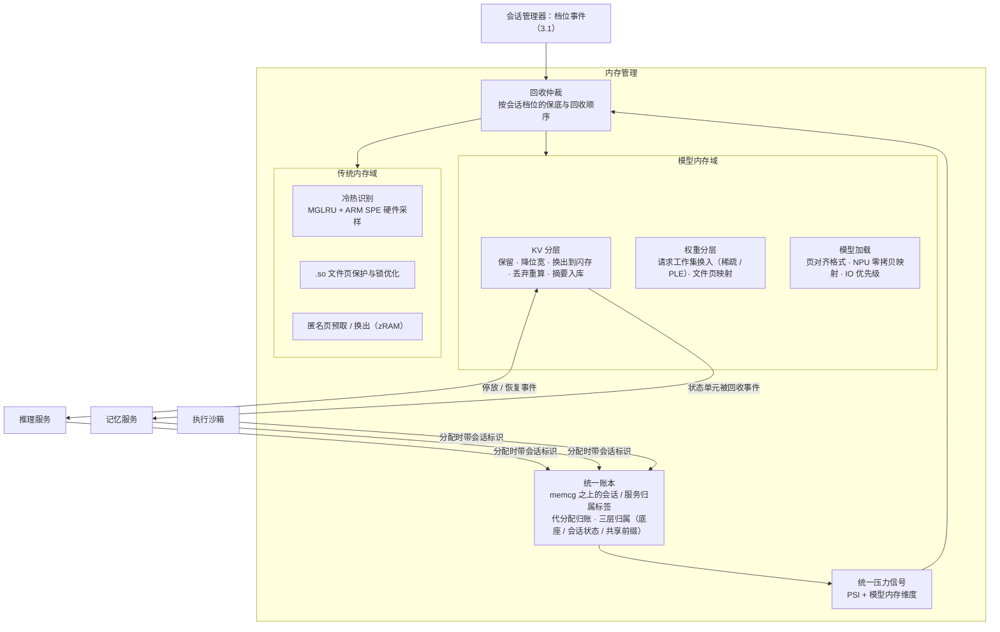

# 第三部分 · 内存管理

> 本文件是第三部分的一节，前面的总体架构见 [3-架构与关键技术.md](3-架构与关键技术.md)。负载与瓶颈见 [第二部分](2-场景与负载瓶颈.md) 2.2.5 和 2.4.4。
> 关键技术三、四沿用 2027 立项调研的 KT1、KT3 方案，详细的业界扫描、难点与依据见 [M2](../../2027-agentos-ai-graphics/notes/M2-system-memory.md) 和 [M3](../../2027-agentos-ai-graphics/notes/M3-model-memory.md)。本文只写与四组件架构的衔接，以及在参考负载下的目标。
> 文中的「目标」都是建议值：依据写在旁边，需用立项后的实测校准。

---

## 3.2 内存管理的目标架构

### 3.2.1 定位：让模型内存成为可记账、可回收、可分层的一等公民

**为什么 Agent OS 的内存管理必须重做？** 第二部分给出三点：

- **峰值有缺口。** 在参考负载的峰值时刻，Agent 侧要驻留 5.2GB（基线配置），12GB 机型扣除系统与前台后只剩约 4.0GB，缺约 1.2GB。
- **内存在账外。** 这 5.2GB 中，权重与 KV 有相当部分在 dma-buf、NPU 缓冲里，LMKD 和 memcg 看不见。共享推理服务代多个会话持有的内存，又全部记在服务名下。
- **回收手段不对。** 现有的回收手段是杀进程。但 KV 换出恢复只要 0.2–0.9 秒，丢弃重算却要 6–14 秒；杀掉推理服务，等于让所有会话一起重来。

**内存管理承担的角色**：

| 角色 | 做什么 |
|---|---|
| 统一记账 | 权重、KV、适配器、沙箱、记忆索引都在一本账上，并归属到正确的会话 |
| 按档位供给 | 用户在等的会话保底，后台会话弹性，回收顺序跟着会话档位走 |
| 模型内存分层 | KV 与权重按语义在 DRAM、压缩区、闪存之间分层，按请求工作集换入 |
| 与 App 共存 | Agent 调起 App 时，App 的冷启动和后台存活不被拖垮 |

**结构：一个底座加两个策略域**，参照设计文档 v0.1 的划分，按本轮评审修订：

- **底座**：统一记账与压力信号；
- **传统内存域**：App 与 Agent 进程的匿名页、文件页；
- **模型内存域**：权重、KV、适配器、专家，主要在 dma-buf / NPU 路径上。

### 3.2.2 架构

**四项关键技术在架构上的位置**：

| 关键技术 | 在架构中的位置 |
|---|---|
| 统一记账底座 | 「统一账本」与「统一压力信号」，是其余三项的前提 |
| 模型内存分层回收 | 模型内存域的 KV 分层与权重分层，加上「回收仲裁」 |
| 应用内存智能化 | 传统内存域（2027 立项 KT1-a/b/c） |
| 模型加载 IO 与零拷贝 | 模型内存域的「模型加载」（2027 立项 KT3） |

**会话档位与回收顺序**（细化 3.1.4 的契约表）：

内存压力上升时，回收依次进行：

1. 批作业的临时内存；
2. 挂起会话的 KV 与沙箱，已落盘的直接释放；
3. 待机会话：KV 降位宽或换出，沙箱冻结并压缩；
4. 缓存的后台 App，由 SPE 冷热识别决定换出哪些页；
5. 后台活跃会话：KV 换出，不丢弃；
6. 前台 App 与交互会话：保底，不回收。

只有前 5 级都耗尽时，才允许杀进程，而且先杀已快照的。

---

## 3.3 关键技术

### 关键技术一：统一记账底座

**对应的负载与瓶颈**：

- 峰值 5.2GB 的 Agent 侧内存中，权重与 KV 有相当部分在 dma-buf 或 NPU 缓冲里；
- 3–4 个会话的 KV 由同一个推理服务持有；
- Android 17 的限额只计匿名页和 swap，dma-buf 的 memcg 计费仍是 RFC；
- 按进程单一属主记账，服务要么撞上限额，要么被整体杀掉（第二部分 2.4.4 瓶颈一、二）。

**问题与挑战**：

1. **可见性。**
   - dma-buf heap、GPU、NPU 私有内存各走各的分配路径，芯片厂商的 NPU 内存模型互不统一；
   - dmem cgroup 面向独立显存，不适用于手机的统一内存架构。
2. **归属。** 共享服务代分配的内存应记到请求方，但内核按「谁分配记给谁」。上游的 pidfd 计费方案被维护者指出不适用于中心化的分配器。
3. **三层归属。**
   - 底座权重被所有会话共享，记在服务名下；
   - 会话状态（KV、沙箱）记到会话；
   - 共享前缀按信任域记账。
4. **开销。** 记账不能拖慢分配热路径。

**技术目标（建议值）**：

| 指标 | 目标 | 依据 |
|---|---|---|
| 模型内存（dma-buf / GPU / NPU）能归属到会话或服务的比例 | ≥95% | 现状：限额口径不含，或口径不明 |
| 代分配归账误差 | ≤5% | — |
| 记账带来的分配路径额外开销 | CPU 开销 ≤1% | — |
| 压力信号 | 模型内存的分配压力能驱动传统域回收，反之亦然 | 设计文档 v0.1 的方向，需补具体信号定义 |
| 对 Android 17 Memory Limiter 的兼容 | 推理服务在豁免名单内；会话级限额由本账本执行 | 第二部分 2.2.5 |

**模块级方案**：

1. **会话归属标签。**
   - 在 memcg 之上加一层归属标签，不另建计数器。
   - 推理服务、沙箱、记忆服务分配内存时携带会话标识，由账本记入对应会话。
2. **代分配归账原语。** 推理服务为某个会话分配 KV 时，经该原语把记账从服务转到会话。实现路径参照 2026-05 的 dma-buf memcg 计费 RFC（「计到客户端 cgroup」的语义），按 cgroup 句柄而非 PID 传递。
3. **dma-buf / NPU 记账钩子。**
   - 在 dma-buf heap 分配与导出处挂钩；
   - NPU HAL 侧上报私有内存，Android 17 NPU Manager 已有代归账字段；
   - 匿名页与 shmem 用已有的 memcg 路径。
4. **统一压力信号。** 在 PSI 之上增加模型内存维度，采集 dma-buf heap 水位、NPU 分配失败与等待，供回收仲裁使用。
5. **账本查询接口。**
   - 供回收仲裁、会话管理器和调试工具使用，回答「谁占了多少、该记在谁头上」；
   - 也是部门仿真与可观测工作的数据入口。

**细节技术点**：

- **先做可观测，再做控制。** 第一阶段只记账、不限额。用真机数据确认归属的准确性，再接入回收仲裁。这一步本身就是立项论据中「先占住可观测位置」的落地。
- **芯片厂商中立的 NPU 内存抽象。** 与推理服务的 NPU HAL 共用一层封装，屏蔽不同 SoC 的内存模型差异。

### 关键技术二：模型内存分层回收

**对应的负载与瓶颈**：

- 12GB 机型峰值缺约 1.2GB，可分层的约 1.7GB 必须在 1 秒内可恢复；
- KV 换出恢复 0.2–0.9 秒，丢弃重算 6–14 秒；
- 重配置下 KV 达 5.4GB，两档机型都放不下；
- LMKD 不认识「停放的 KV」，只会杀进程；
- Android 17 只按可见与不可见分档，有天花板没有保底（第二部分 2.4.4 瓶颈三、四）。

**问题与挑战**：

1. **每块 KV 的去向。** 被驱逐的 KV 有五种去向：保留、降位宽、换出到闪存、丢弃重算、摘要后写入记忆服务。决策依据有三项：
   - 重算代价（prefill 时间）；
   - 换出代价（写入时间、闪存寿命）与恢复概率；
   - 信息损失。
2. **写入代价与闪存寿命。**
   - 读回极快：换出比重算快 31–215 倍。
   - 写出要付代价：停放一个长程会话要写约 0.86GB，每天停放 5 次，一年约 1.6TB。闪存寿命约束待核实。
3. **权重分层。**
   - 稀疏模型的完整权重在闪存（5–10GB，估算），按请求换入工作集；
   - 逐 token 换入专家不可行，Apple 已明确放弃；
   - 换入与前台 App 的冷启动争用闪存带宽。
4. **按档位供给。** 用户在等的会话要保底，切走的会话要先让，但现有机制不认识会话，也不认用户注意力。

**技术目标（建议值）**：

| 指标 | 目标 | 依据 |
|---|---|---|
| 12GB 机型峰值时刻 | 不杀前台 App 与交互会话；缺口由分层吸收 | 第二部分 2.2.5：缺约 1.2GB，可分层约 1.7GB |
| 停放会话的 KV 恢复 | ≤1 秒（换入 0.2–0.9 秒） | 重算 6–14 秒 |
| 常驻 KV 压缩 | 停放 KV ≥2.5 倍压缩；任务质量回归 ≤1 个百分点 | 2027 立项 KT2-B；KIVI 峰值内存降 2.6 倍 |
| 换出决策 | 仅当恢复概率高于盈亏点（约 6%）才写出 | 第二部分 2.2.5 推导 |
| 闪存写入 | 设日写入上限，例如 ≤5GB/天，计入会话账本 | 长程会话每次约 0.86GB |
| 稀疏权重专家命中率 | 同容量下较 LRU 提升 ≥30%；decode 较 mmap 基线 ≥1.5 倍 | 2027 立项 KT2-A；FlashMoE、ProMoE |

**模块级方案**：

1. **KV 块池。** KV 按定长块管理，块是记账、换出、降位宽的最小单位。与推理服务的前缀树缓存共用块格式。
2. **在线去向决策。**
   - 对每个停放会话估计恢复概率，依据档位、用户历史、任务进度；
   - 按「重算时间、换出写入时间、恢复概率、闪存预算」选择去向；
   - 共享前缀永不丢弃。
3. **换出与预取。**
   - **写出**：在后台空闲时进行，大块对齐，并带写入预算；
   - **恢复**：由会话档位升级事件触发，与沙箱恢复、App 工作集预取并行，由会话管理器协调。
4. **权重工作集管理。**
   - 稀疏模型按请求选专家并周期性重选，参照 AFM 3 的做法；
   - 驻留集合动态调整，冷专家可降位宽；
   - 稠密模型的权重以文件页映射，可回收，由关键技术四提供映射。
5. **回收仲裁。** 按 3.2.2 的回收顺序执行；会话档位决定保底与回收的先后。前台 App 的保底由传统内存域执行。

**细节技术点**：

- **盈亏点与上下文长度无关。** 换出更快的条件是 prefill 速度低于「闪存读带宽 ÷ 每 token KV 字节」。基线配置下该值约为 12 万 token/秒，远高于端侧实测的 557–3808 token/秒，所以读回永远划算，需要决策的只是写不写。
- **KV 体积随模型变化 14 倍。** 盈亏点、预算分配都要按当前模型配置动态标定，不能用固定水位。
- **与记忆服务的连接。** 当会话被判定为不会再恢复时，内存管理只发「状态单元被回收」事件，由记忆服务和 Agent 决定是否写摘要。

### 关键技术三：应用内存智能化

> 沿用 2027 立项调研 KT1-a、KT1-b、KT1-c，详见 [M2 第四部分](../../2027-agentos-ai-graphics/notes/M2-system-memory.md)。

**对应的负载与瓶颈**：

- 跨应用事务会连续拉起多个 App；
- Agent 与 App 叠加时，共享库的文件页被逐出、冷启动反复缺页；
- 后台 App 被回收后切回要重新冷启动；
- 峰值时刻前台 App 与 Agent 争内存（第二部分 2.4.4 瓶颈五）。

**问题与挑战**：

| 子项 | 问题 |
|---|---|
| .so 文件页锁优化（KT1-a） | 多进程同时缺页同一批共享库；内存压力下文件页被逐出。公开数据显示重负载下 kswapd 等 rmap 锁可达 300 毫秒以上 |
| 基于 SPE 的匿名页预取（KT1-b） | zRAM 换入是按需的、无冷热区分；软件冷热信号的精度与扫描开销互相制约；SPE 硬件采样在手机上没有公开实测 |
| 基于同一冷热识别的匿名页换出（KT1-c） | 误换出热页导致 refault 与解压开销；压力顶满时 LMKD 杀进程 |

**技术目标（沿用 2027 立项 M2 的建议区间）**：

| 指标 | 目标 |
|---|---|
| 叠加场景应用冷启动时延 | −15%～−30% |
| 回收路径 rmap 锁最长等待 | P99 <50 毫秒 |
| 后台应用切回前台时延（匿名页部分） | −20%～−40% |
| 预取命中率 | ≥70% |
| SPE 采样 CPU 占用与功耗增量 | 均 ≤1% |
| 同等内存下后台存活应用数 | +30%～+80% |
| 误换出率（换出后 5 秒内被重新访问） | ≤10% |
| 叠加场景 LMKD 杀进程次数 | −30% 以上 |

**模块级方案**：

1. **感知。** 缺页跟踪与冷启动 .so 访问画像；用 ARM SPE 采样识别匿名热页，访问位与 DAMON 提供冷证据；PSI 与内存余量。
2. **决策。** 关键 .so 页集合与预算；预取触发（应用切换、Agent 唤起应用的事件）与恢复集选择；冷候选清单与换出配额。
3. **执行。** 文件缺页并行化与 rmap trylock 批处理；批量 zRAM 解压换入；`memory.reclaim` 换出到 zRAM，不可压页限额回写。
4. **反馈。** 冷启动时延、major fault、预取命中率、refault 率、LMKD 杀进程次数、闪存写入量。

**与四组件架构的衔接**：

- **共用账本与压力信号。** App 的匿名页与模型内存在同一本账、同一组压力信号下仲裁，见关键技术一。
- **接收 Agent 的意图。** 「Agent 即将调起某 App」是比历史访问更强的预取信号：在跨应用事务的规划阶段，就把将要调用的 App 的热页预取进来。
- **共用冷热识别。** 2027 立项讨论中，SPE 冷热识别的作用范围定为 App 与 Agent 的非模型匿名内存，与本文件关键技术二的模型内存分层分开。

### 关键技术四：模型加载 IO 与零拷贝

> 沿用 2027 立项调研 KT3，详见 [M3 第四部分](../../2027-agentos-ai-graphics/notes/M3-model-memory.md)。

**对应的负载与瓶颈**：

- 夜间卸载、早晨重载，以及内存压力后的重载，都要重读权重：基线 1.7GB 需 0.4–1.7 秒；
- 稀疏模型按请求换入专家；
- 权重在文件、页缓存、框架缓冲、NPU 缓冲之间多份拷贝；
- 这些 IO 与前台 App 冷启动争用闪存（第二部分 2.4.4 瓶颈五）。

**问题与挑战**：

1. **多份拷贝。** NPU 路径需要预编译的上下文二进制、反量化重排与缓冲注册，权重常常同时存在两三份。
2. **大块连续内存分配慢。** 有数据称 8GB CMA 分配约 6.4 秒，mmap 约 0.56 秒，该数据待核实。
3. **IO 争用。** 加载和换入与前台冷启动共用闪存带宽，现有 IO 调度不区分优先级。

**技术目标（沿用 2027 立项 M3 的建议，按 UFS 4.1 约 4.3GB/s 换算）**：

| 指标 | 目标 |
|---|---|
| 冷加载时间 | 达到闪存顺序读理论值的 60%–70%：基线 1.7GB 约 0.6–0.65 秒 |
| NPU 路径的权重额外拷贝 | 0 份 |
| 加载期间峰值内存 | 较多份拷贝降低约一份权重大小 |
| 加载 IO 与前台 App 冷启动 IO | 优先级区分：前台冷启动不因模型加载劣化 |

**模块级方案**：

1. **页对齐的权重文件格式。** 权重按页对齐、按层或专家分段存放，可直接文件映射，并能按需缺页。
2. **NPU 零拷贝映射。** 文件页经 IOMMU 直接映射给 NPU，避免「文件 → 页缓存 → 框架缓冲 → NPU 缓冲」的多次拷贝。QNN 只接受 dma-buf 内存，所以映射需落到 dma-buf 上，并由关键技术一记账。
3. **批量预读与加载顺序。** 按推理所需的层顺序预读，大块对齐读，应对闪存小块随机读的 IOPS 瓶颈。
4. **IO 优先级。** 模型加载与换入标为可让步 IO；前台 App 冷启动时让出带宽。

**与四组件架构的衔接**：

- 加载出来的权重页是模型内存域的「可回收文件页」，由关键技术二的权重工作集管理决定驻留；
- 映射关系记在统一账本上。
