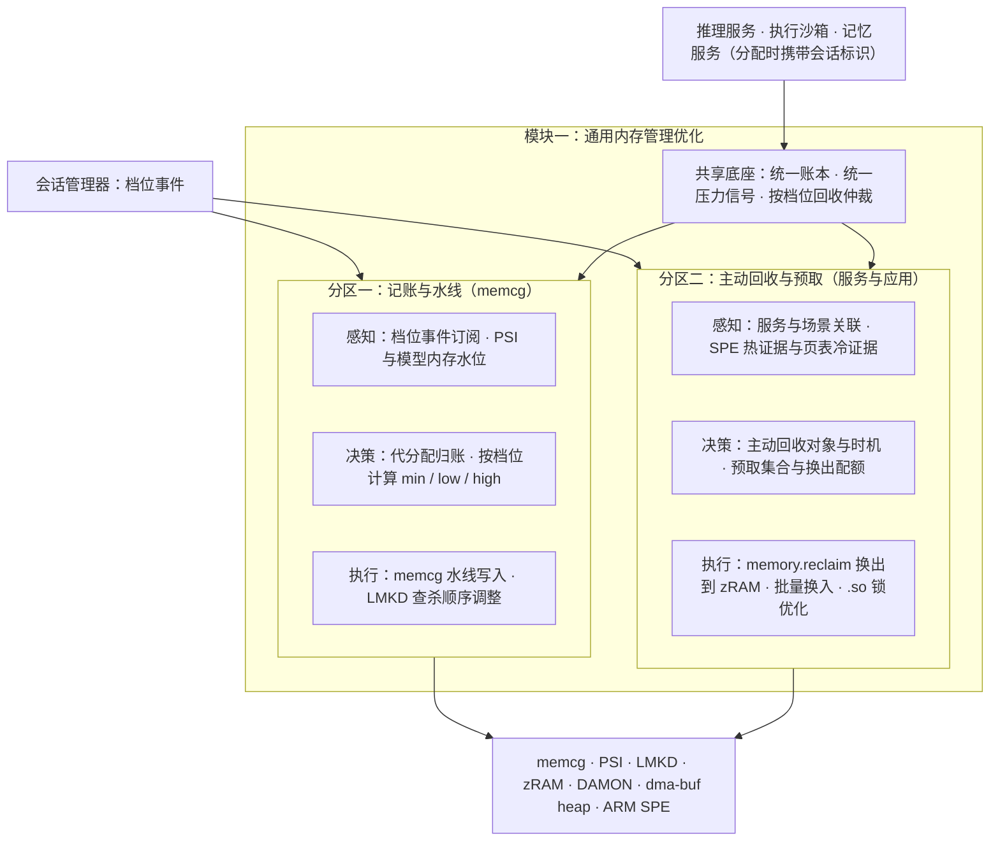
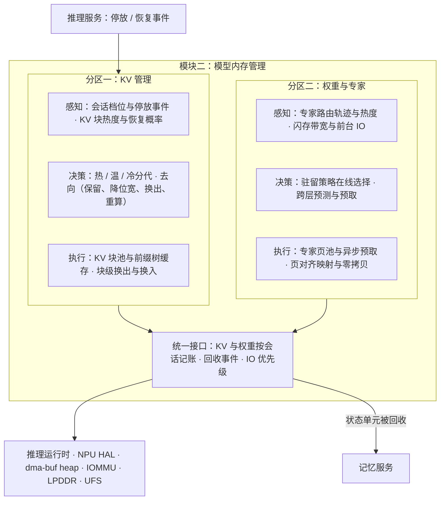

# 第三部分 · 内存管理

> 本文件是第三部分的一节，前面的总体架构见 [3-架构与关键技术.md](3-架构与关键技术.md)。负载与瓶颈见 [第二部分](2-场景与负载瓶颈.md) 2.2.5 和 2.4.4。
> **2026-11-08 结构调整**：内存管理分为两个模块。
> - **模块一 通用内存管理优化**：面向 Agent 与应用共存，涉及系统服务、memcg 与匿名页预取。
> - **模块二 模型内存管理**：面向 Agent 内部的 KV、专家与权重。
>
> 两个模块各有一张目标架构和三项关键技术。
> 模块一关键技术三沿用 2027 立项调研 KT1，详细的业界扫描、难点与依据见 [M2](../../2027-agentos-ai-graphics/notes/M2-system-memory.md)。模块二关键技术二、三沿用 KT2-A 与 KT3，见 [M3](../../2027-agentos-ai-graphics/notes/M3-model-memory.md)。
> 文中的「目标」都是建议值：依据写在旁边，需用立项后的实测校准。

---

## 3.2 内存管理的目标架构

### 3.2.1 定位：使模型内存可记账、可回收、可分层，并与应用内存共存

**为什么 Agent OS 的内存管理需要重构？** 第二部分给出三点：

- **峰值超出预算。** 在参考负载的峰值时刻，Agent 侧需要驻留 5.2GB（基线配置）。12GB 机型扣除系统与前台后只剩约 4.0GB，缺约 1.2GB。
- **模型内存未纳入统一记账。**
  - 这 5.2GB 中，权重与 KV 有相当部分位于 dma-buf、NPU 缓冲，LMKD 和 memcg 无法统计。
  - 共享推理服务代多个会话持有的内存，全部计入服务进程。
- **回收手段不匹配。**
  - 现有回收以终止进程为主，但 KV 换出恢复只需 0.2–0.9 秒，丢弃后重算需 6–14 秒。
  - 终止推理服务意味着所有会话同时重来。

**两个模块的划分**：

| 模块 | 面向 | 管理对象 | 主要内核与运行时机制 | 关键技术 |
|---|---|---|---|---|
| 模块一 通用内存管理优化 | Agent 常驻服务与前台、后台应用共存 | 会话与服务的记账、memcg 水线、系统服务与应用进程的匿名页和文件页 | memcg、PSI、LMKD、zRAM、DAMON、ARM SPE | 会话级记账与 memcg 水线自适应；系统服务与常驻进程的主动回收；匿名页冷热识别与预取换出 |
| 模块二 模型内存管理 | Agent 内部 | KV、稀疏专家与权重、模型加载路径 | 推理运行时、NPU HAL、dma-buf heap、IOMMU、UFS | KV 分页与冷热分代管理；专家与权重工作集管理；模型加载 IO 与零拷贝 |

两个模块共用三样东西，划分边界因此清晰：

- 一个账本：模块一关键技术一；
- 一组压力信号；
- 一张按会话档位的回收顺序：见 3.2.4。

模块二只发出「停放、恢复、被回收」事件，并按块或专家执行语义动作。

### 3.2.2 模块一：通用内存管理优化

| 关键技术 | 在架构中的位置 |
|---|---|
| 一、会话级记账与 memcg 水线自适应 | 共享底座的统一账本；分区一的代分配归账与水线决策 |
| 二、系统服务与常驻进程的主动回收 | 分区二的场景关联与主动回收决策 |
| 三、匿名页冷热识别与预取换出 | 分区二的 SPE 与页表证据、预取与换出执行（2027 立项 KT1-a/b/c） |

### 3.2.3 模块二：模型内存管理

| 关键技术 | 在架构中的位置 |
|---|---|
| 一、KV 分页与冷热分代管理 | 分区一的分代与去向决策、KV 块池 |
| 二、专家与权重工作集管理 | 分区二的驻留策略选择与跨层预取（2027 立项 KT2-A） |
| 三、模型加载 IO 与零拷贝 | 分区二的页对齐映射与零拷贝、统一接口的 IO 优先级（2027 立项 KT3） |

### 3.2.4 会话档位与回收顺序

细化 3.1.4 的联动表。内存压力上升时，回收依次进行：

1. 批作业的临时内存；
2. 挂起会话的 KV 与沙箱，已落盘的直接释放；
3. 待机会话：KV 降位宽或换出，沙箱冻结并压缩；
4. 缓存的后台应用，由冷热识别决定换出哪些页；
5. 后台活跃会话：KV 换出，不丢弃；
6. 前台应用与交互会话：保底，不回收。

只有前 5 级都耗尽时，才允许终止进程，并优先终止已快照的进程。

---

## 3.3 模块一：通用内存管理优化的关键技术

### 关键技术一：会话级记账与 memcg 水线自适应

**对应的负载与瓶颈**：

- 峰值 5.2GB 的 Agent 侧内存中，权重与 KV 有相当部分位于 dma-buf 或 NPU 缓冲；3–4 个会话的 KV 由同一个推理服务持有。
- Android 17 的限额只统计匿名页和 swap，dma-buf 的 memcg 计费仍是 RFC。
- Android 17 只按「可见 / 不可见」设上限，缺少保底（第二部分 2.4.4 瓶颈一、二、四）。

**问题与挑战**：

1. **可见性。**
   - dma-buf heap、GPU、NPU 私有内存各走各的分配路径，各 SoC 内存模型不统一；
   - dmem cgroup 面向独立显存，不适用于手机统一内存架构。
2. **归属。** 共享服务代分配的内存应记入请求方，但内核按分配者记账。上游的 pidfd 计费方案被维护者指出不适用于中心化分配器。
3. **三层归属。** 底座权重计入推理服务，会话状态（KV、沙箱）计入会话，共享前缀按信任域记账。
4. **水线与回收代价的平衡。** 保底过多会挤压前台应用，保底过少则交互会话被回收。

**技术目标（建议值）**：

| 指标 | 目标 | 依据 |
|---|---|---|
| 模型内存（dma-buf / GPU / NPU）可归属到会话或服务的比例 | ≥95% | 现状：限额口径不含，或口径不明 |
| 代分配归账误差 | ≤5% | — |
| 记账带来的分配路径额外开销 | CPU 开销 ≤1% | — |
| 12GB 峰值下前台应用与交互会话 | 零回收 | 第二部分 2.2.5 |
| 与 Android 17 Memory Limiter 的兼容 | 推理服务在豁免名单内，会话级限额由本账本执行 | 第二部分 2.2.5 |

**模块级方案**：

1. **会话归属标签**：在 memcg 之上加一层归属标签，不另建计数器。推理服务、沙箱、记忆服务分配内存时携带会话标识。
2. **代分配归账原语**：推理服务为某个会话分配 KV 时，经该原语把记账从服务转到会话。实现上参照 2026-05 的 dma-buf memcg 计费 RFC，即「计入客户端 cgroup」的语义，按 cgroup 句柄而非 PID 传递。
3. **dma-buf / NPU 记账钩子**：
   - 在 dma-buf heap 的分配与导出处挂钩；
   - NPU HAL 侧上报私有内存，Android 17 NPU Manager 已有代归账字段。
4. **按档位的 memcg 水线**：
   - 交互会话与前台应用设 `memory.min` 保底；
   - 后台活跃会话设 `memory.low` 软保护；
   - 挂起会话设 `memory.high` 压制；
   - 水线随 PSI 与档位在线调整，并同步调整 LMKD 的查杀顺序。
5. **统一压力信号与账本查询**：在 PSI 之上增加模型内存维度，包括 dma-buf heap 水位、NPU 分配失败与等待。账本查询接口供回收仲裁、会话管理器和可观测工具使用。

**细节技术点**：

- **先记账、后限额。** 第一阶段只记账、不限额，用真机数据确认归属准确性后，再接入水线与回收仲裁。
- **芯片厂商中立的 NPU 内存抽象。** 与推理服务的 NPU HAL 共用一层封装，屏蔽不同 SoC 的内存模型差异。

### 关键技术二：系统服务与常驻进程的主动回收

**对应的负载与瓶颈**：

- Agent OS 新增推理、沙箱、记忆、会话管理等常驻系统服务，以及辅助小模型；
- 沙箱实例存活期内的空闲比例为 60%–90%（第二部分 2.2.3，估算），后台分拣由事件触发；
- 嵌入模型与索引约 0.4GB，LoRA 与辅助小模型约 0.6GB，均可回收、可重建（第二部分 2.2.5）；
- 现有回收在内存压力出现后才被动触发，按 LRU 选择页面，峰值时容易回收即将使用的页并触发查杀。

**问题与挑战**：

1. **服务与场景关联的建模。** 常驻服务的使用由会话与事件驱动，不同于传统应用的前后台状态，仅依据 LRU 年龄无法判断服务是否即将被使用。
2. **回收时机。** 压力出现后才回收，会与前台争用 CPU 和 IO；过早回收又会造成刚回收即被访问的误回收。
3. **驻留模型的驱逐与重建。** 嵌入模型重建需 0.05–0.2 秒，辅助小模型约 70 毫秒，频繁驱逐会抬高调用时延。

**技术目标（建议值）**：

| 指标 | 目标 | 依据 |
|---|---|---|
| 待机时段常驻服务内存 | 降低 ≥0.8GB（估算） | 空闲沙箱冻结压缩、嵌入模型与索引、辅助小模型驱逐（第二部分 2.2.5） |
| 主动回收的误回收率（回收后 5 秒内被访问） | ≤10% | 与 2027 立项 KT1-c 误换出率口径一致 |
| 预加载后首次调用时延 | ≤200 毫秒 | 嵌入模型重建 0.05–0.2 秒 |
| 主动回收的 CPU 开销 | ≤1% | — |

**模块级方案**：

1. **感知**：订阅会话档位事件、场景切换、屏幕与充电状态；为各常驻服务建立画像，包括匿名页、驻留模型与访问时间；离线统计服务与场景的关联矩阵。
2. **决策**：服务与当前场景关联度低且处于空闲窗口时，列入主动回收清单；即将使用的服务列入预加载清单；交互会话涉及的服务不回收。
3. **执行**：以 `memory.reclaim` 与 DAMOS 为执行入口，把冷页换出到 zRAM，不修改核心回收路径。嵌入模型与辅助小模型空闲驱逐，依据会话档位升级与任务规划提前加载。
4. **反馈**：回收量、误回收率、首次调用时延、查杀次数，回流校准关联矩阵。

**与其他技术的衔接**：

- 驱逐与回收计入会话账本，与关键技术一的回收仲裁协同；
- 沙箱实例的冻结与快照由执行沙箱关键技术一负责，本技术只负责其空闲期的内存回收策略。

### 关键技术三：匿名页冷热识别与预取换出

> 沿用 2027 立项调研 KT1-a、KT1-b、KT1-c，详见 [M2 第四部分](../../2027-agentos-ai-graphics/notes/M2-system-memory.md)。

**对应的负载与瓶颈**：

- 跨应用事务会连续拉起多个应用，Agent 与应用叠加时，共享库的文件页被逐出，冷启动反复缺页；
- 后台应用被回收后，切回时要重新冷启动；
- 峰值时刻前台应用与 Agent 争用内存（第二部分 2.4.4 瓶颈五）。

**问题与挑战**：

| 子项 | 问题 |
|---|---|
| .so 文件页锁优化（KT1-a） | 多进程同时缺页同一批共享库；内存压力下文件页被逐出。公开数据显示，重负载下 kswapd 等 rmap 锁等待可达 300 毫秒以上 |
| 基于 SPE 的匿名页预取（KT1-b） | zRAM 换入按需进行、无冷热区分；软件冷热信号的精度与扫描开销相互制约；SPE 硬件采样在手机上没有公开实测，量产 SoC 是否开放亦无公开资料 |
| 基于同一冷热识别的匿名页换出（KT1-c） | 采样只能证明热、不能证明冷；误换出热页导致 refault 与解压开销 |

**技术目标（沿用 2027 立项 M2 的建议区间）**：

| 指标 | 目标 |
|---|---|
| 叠加场景应用冷启动时延 | −15%～−30% |
| 回收路径 rmap 锁最长等待 | P99 <50 毫秒 |
| 后台应用切回前台时延（匿名页部分） | −20%～−40% |
| 预取命中率 | ≥70% |
| SPE 采样 CPU 占用与功耗增量 | 均 ≤1% |
| 同等内存下后台存活应用数 | +30%～+80% |
| 误换出率（换出后 5 秒内被重新访问） | ≤10% |

**模块级方案**：

1. **感知**：
   - ARM SPE 采样提供热证据；
   - 页表 Accessed 位与 MGLRU / DAMON 年龄提供冷证据，页面分为热、冷、未知三态；
   - Agent 规划阶段的「即将调起某应用」作为意图信号。
2. **决策**：预取只用热证据，换出必须有冷证据；确定预取集合、冷候选清单与换出配额。
3. **执行**：
   - 批量 zRAM 解压换入；
   - `memory.reclaim` 换出到 zRAM，不可压页限额回写；
   - 文件缺页并行化与 rmap trylock 批处理。
4. **反馈**：冷启动时延、major fault、预取命中率、refault 率、查杀次数、闪存写入量。

**细节技术点**：

- 将 SPE 作为 DAMON 的硬件访问源对接上游；DAMON 硬件采样接口目前为 RFC。SPE 不可用的机型以软件信号驱动同一套预取与换出。
- 作用范围限定为应用与 Agent 的非模型匿名内存，与模块二的模型内存分层分开。

---

## 3.4 模块二：模型内存管理的关键技术

### 关键技术一：KV 分页与冷热分代管理

**对应的负载与瓶颈**：

- 峰值时 3–4 个会话的 KV 合计 1.3GB，重配置下达 5.4GB，驻留在 dma-buf 与 NPU 缓冲中，不在 LRU 与回收路径上；
- 12GB 机型峰值缺约 1.2GB，可分层的约 1.7GB 必须在 1 秒内可恢复；
- KV 换出恢复 0.2–0.9 秒，丢弃重算 6–14 秒（第二部分 2.4.4 瓶颈三）。

**问题与挑战**：

1. **每块 KV 的去向。** 被驱逐的 KV 有五种去向：保留、降位宽、换出到闪存、丢弃重算、摘要后写入记忆服务。决策依据为重算代价、换出代价（写入时间、闪存寿命）与恢复概率，以及信息损失。
2. **写入代价与闪存寿命。** 读回极快，换出恢复比重算快 31–215 倍；但停放一个长程会话要写约 0.86GB，每天停放 5 次，一年约 1.6TB，闪存寿命约束待核实。
3. **降位宽的质量回归。** 端侧小模型对 KV 精度更敏感，压缩后长程任务的正确率可能下降。

**技术目标（建议值）**：

| 指标 | 目标 | 依据 |
|---|---|---|
| 12GB 机型峰值时刻 | 不终止前台应用与交互会话；缺口由分层吸收 | 第二部分 2.2.5：缺约 1.2GB，可分层约 1.7GB |
| 停放会话的 KV 恢复 | ≤1 秒（换入 0.2–0.9 秒） | 重算 6–14 秒 |
| 停放 KV 压缩 | ≥2.5 倍；任务质量回归 ≤1 个百分点 | 2027 立项 KT2-B；KIVI 峰值内存降低 2.6 倍 |
| 换出决策 | 仅当恢复概率高于盈亏点（约 6%）才写出 | 第二部分 2.2.5 推导 |
| 闪存写入 | 设日写入上限，例如 ≤5GB/天，计入会话账本 | 长程会话每次约 0.86GB |

**模块级方案**：

1. **KV 块池**：KV 按定长块管理，块是记账、换出、降位宽的最小单位，与推理服务的前缀树缓存共用块格式。
2. **三代老化**：
   - 热：活跃会话，钉住；
   - 温：停放会话，可降位宽；
   - 冷：长期未恢复，换出到 UFS 或丢弃重算。
   - 共享前缀不丢弃，交互会话的 KV 不回收。
3. **在线去向决策**：对每个停放会话估计恢复概率，依据档位、切回历史与任务进度；再按「重算时间、换出写入时间、恢复概率、闪存预算」选择去向。
4. **换出与恢复**：
   - 写出在后台空闲时进行，大块对齐，并受写入预算约束；
   - 恢复由会话档位升级事件触发，与沙箱恢复、应用工作集预取并行，由会话管理器协调。

**细节技术点**：

- **盈亏点与上下文长度无关。** 当 prefill 速度低于「闪存读带宽 ÷ 每 token KV 字节」时，换出更快。基线配置下该值约为 12 万 token/秒，远高于端侧实测的 557–3808 token/秒。因此读回恒快于重算，决策只需判断是否写出。
- **KV 体积随模型变化 14 倍。** 盈亏点与预算分配需按当前模型配置动态标定，不能使用固定水位。
- **与记忆服务的衔接。** 会话被判定不会再恢复时，模型内存管理只发出「状态单元被回收」事件，由记忆服务和 Agent 决定是否写摘要。

### 关键技术二：专家与权重工作集管理

> 沿用 2027 立项调研 KT2-A，详见 [M3 第四部分](../../2027-agentos-ai-graphics/notes/M3-model-memory.md)。

**对应的负载与瓶颈**：

- 稀疏模型（如 AFM 3 Core Advanced）的完整权重存放于闪存，估算为 5–10GB，每次请求激活 1–4B；
- 逐 token 换入专家受闪存小块随机读带宽限制，Apple 已放弃该路径；
- 专家换入与前台应用冷启动争用闪存读带宽（第二部分 2.4.4 瓶颈三、五）。

**问题与挑战**：

1. **命中率对容量与负载高度敏感。** iPhone 上 Qwen3.6-35B-A3B 实测，512MiB 时 LRU 命中率为 0%，576MiB 升至 38.58%（预印本）。Agent 任务切换使路由分布漂移。
2. **预取需要在闪存带宽内按时到达。** 单个专家为 2–3MB 级随机读，且只有前层门控输出后才能确定后层专家。命中率为 0% 时，30B 级 A3B 模型每 token 约需 1.1GB IO，解码上限约 5 token/秒（估算）。
3. **与前台 IO 的争用。** 现有 IO 调度不区分优先级。

**技术目标（建议值，依据 2027 立项 M3）**：

| 指标 | 目标 | 依据 |
|---|---|---|
| 同容量下专家缓存命中率 | 较 LRU 提升 ≥30% | FlashMoE 相对 LRU / LFU 命中率最高提升 51%（桌面平台，预印本） |
| decode 速度 | 较 mmap 基线 ≥1.5 倍 | ProMoE decode 1.34–1.79 倍 |
| 专家换入对前台冷启动的影响 | 不劣化 | 与关键技术三共用 IO 优先级 |

**模块级方案**：

1. **感知**：采集各层专家路由轨迹与请求类型，感知闪存读带宽与前台 IO 负载；建立专家热度模型，覆盖访问频率、最近使用与跨层相关性。
2. **决策**：
   - 在 LRU、频率与学习型策略之间按负载在线选择；
   - 请求级选定专家集合，生成过程中低频重选；
   - 跨层预测下一层专家并发起预取。
3. **执行**：热专家驻留在 DRAM 专家页池，冷专家降位宽，按簇打包的存储布局支持大块预取；换入标记为可让步 IO。稠密模型的权重以文件页映射，可回收。
4. **反馈**：命中率、预取准确率与提前量、decode 速度、热状态。

### 关键技术三：模型加载 IO 与零拷贝

> 沿用 2027 立项调研 KT3，详见 [M3 第四部分](../../2027-agentos-ai-graphics/notes/M3-model-memory.md)。

**对应的负载与瓶颈**：

- 夜间卸载、早晨重载以及内存压力后的重载都要重读权重，基线 1.7GB 需 0.4–1.7 秒；Android 17 NPU Manager 也以卸载模型作为抢占手段；
- 权重在文件、页缓存、框架缓冲、NPU 缓冲之间存在多份拷贝；
- 加载 IO 与前台应用冷启动争用闪存（第二部分 2.4.4 瓶颈五）。

**问题与挑战**：

1. **多份拷贝。** NPU 路径需要预编译的上下文二进制、反量化重排与缓冲注册，权重常常同时存在两到三份。
2. **大块连续内存分配慢。** 有数据称 8GB CMA 分配约 6.4 秒、mmap 约 0.56 秒，该数据待核实。
3. **IO 争用。** 加载和换入与前台冷启动共用闪存带宽，现有 IO 调度不区分优先级。

**技术目标（沿用 2027 立项 M3 的建议，按 UFS 4.1 约 4.3GB/s 换算）**：

| 指标 | 目标 |
|---|---|
| 冷加载时间 | 达到闪存顺序读理论值的 60%–70%：基线 1.7GB 约 0.6–0.65 秒 |
| NPU 路径的权重额外拷贝 | 0 份 |
| 加载期间峰值内存 | 较多份拷贝降低约一份权重大小 |
| 加载 IO 与前台应用冷启动 IO | 区分优先级，前台冷启动不因模型加载劣化 |

**模块级方案**：

1. **页对齐的权重文件格式**：权重按页对齐、按层或专家分段存放，可直接文件映射，并能按需缺页。
2. **NPU 零拷贝映射**：文件页经 IOMMU 直接映射给 NPU，避免「文件 → 页缓存 → 框架缓冲 → NPU 缓冲」的多次拷贝。QNN 只接受 dma-buf 内存，映射需落在 dma-buf 上，并由模块一的统一账本记账。
3. **批量预读与加载顺序**：按推理所需的层顺序预读、大块对齐读，应对闪存小块随机读的 IOPS 瓶颈。
4. **IO 优先级**：模型加载与专家换入标为可让步 IO，前台应用冷启动时让出带宽。

**与其他技术的衔接**：

- 加载出的权重页是可回收的文件页，由关键技术二的工作集管理决定驻留；
- 映射关系记在模块一的统一账本上。
