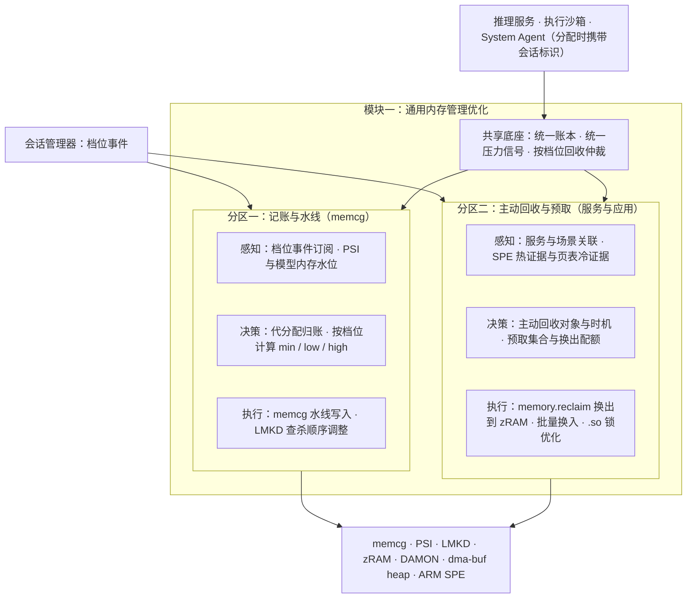
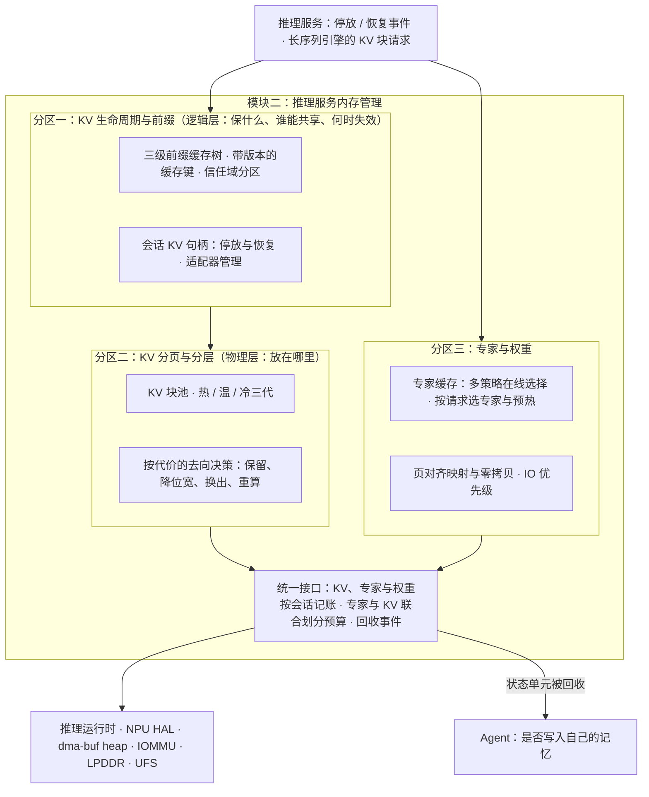

# 第三部分 · 内存与资源

> 本文件是第三部分的一节，前面的总体架构见 [3-架构与关键技术.md](3-架构与关键技术.md)。负载见[第二部分](2-场景与负载瓶颈.md) 2.2.5，体验问题见 2.3.3，瓶颈见 2.5.3。
> 内存与资源分为两个模块：
> - **模块一 通用内存管理优化**：面向 Agent 与应用共存，涉及系统服务、memcg 与匿名页预取，三项关键技术。
> - **模块二 推理服务内存管理**：面向推理服务内部的前缀与 KV、MoE 专家与权重、模型加载，四项关键技术（2026-11-09 改版）。
>
> 模块一关键技术三沿用 2027 立项调研 KT1，详细的业界扫描、难点与依据见 [M2](../../2027-agentos-ai-graphics/notes/M2-system-memory.md)。模块二关键技术三、四沿用 KT3 与 KT2-A，见 [M3](../../2027-agentos-ai-graphics/notes/M3-model-memory.md)。
> 文中的「目标」都是建议值：依据写在旁边，需用立项后的实测校准。

---

## 3.2 内存与资源的目标架构

### 3.2.1 定位：使模型内存可记账、可回收、可分层，并与应用内存共存

**体验与商业问题**（详见 2.3.3）：

- 加内存的路被价格堵死：移动 DRAM 合约价约每 GB 20 美元，约为 2024 年的 4 倍，2027 年不会明显回落。
- Agent 叠加在应用之上，冷启动变慢、切回卡顿、后台被杀一起恶化，而且都会被归咎于 Agent。
- 每多出 1GB 等效可用内存，约等于每台省下 20 美元 DRAM；不加 DRAM 也能撑起叠加，Agent 就能下探到更多机型。

**为什么 Agent OS 的内存管理需要重构？** 第二部分给出三点：

- **峰值超出预算。** 在参考负载的峰值时刻，Agent 侧需要驻留 5.2GB（基线配置）。12GB 机型扣除系统与前台后只剩约 4.0GB，缺约 1.2GB。
- **模型内存未纳入统一记账。**
  - 这 5.2GB 中，权重与 KV 有相当部分位于 dma-buf、NPU 缓冲，LMKD 和 memcg 无法统计。
  - 共享推理服务代多个会话持有的内存，全部计入服务进程。
- **回收手段不匹配。**
  - 现有回收以终止进程为主，但 KV 换出恢复只需 0.2–0.9 秒，丢弃后重算需 6–14 秒。
  - 终止推理服务意味着所有会话同时重来。

**两个模块的划分**：

| 模块 | 面向 | 管理对象 | 主要内核与运行时机制 | 关键技术 |
|---|---|---|---|---|
| 模块一 通用内存管理优化 | Agent 常驻服务与前台、后台应用共存 | 会话与服务的记账、memcg 水线、系统服务与应用进程的匿名页和文件页 | memcg、PSI、LMKD、zRAM、DAMON、ARM SPE | 会话级记账与 memcg 水线自适应；系统服务与常驻进程的主动回收；匿名页冷热识别与预取换出 |
| 模块二 推理服务内存管理 | 推理服务内部 | 前缀与 KV、MoE 专家与权重、模型加载路径 | 推理运行时、NPU HAL、dma-buf heap、IOMMU、UFS | KV Cache 生命周期管理与前缀缓存命中率提升；KV Cache 分页与冷热分层管理；模型加载 IO 零拷贝优化；MoE 专家命中率提升 |

两个模块共用三样东西，划分边界因此清晰：

- 一个账本：模块一关键技术一；
- 一组压力信号；
- 一张按会话档位的回收顺序：见 3.2.4。

模块二只发出「停放、恢复、被回收」事件，并按块或专家执行语义动作。

### 3.2.2 模块一：通用内存管理优化

| 关键技术 | 在架构中的位置 |
|---|---|
| 一、会话级记账与 memcg 水线自适应 | 共享底座的统一账本；分区一的代分配归账与水线决策 |
| 二、系统服务与常驻进程的主动回收 | 分区二的场景关联与主动回收决策 |
| 三、匿名页冷热识别与预取换出 | 分区二的 SPE 与页表证据、预取与换出执行（2027 立项 KT1-a/b/c） |

### 3.2.3 模块二：推理服务内存管理

| 关键技术 | 在架构中的位置 |
|---|---|
| 一、KV Cache 生命周期管理与前缀缓存命中率提升 | 分区一 |
| 二、KV Cache 分页与冷热分层管理 | 分区二 |
| 三、模型加载 IO 零拷贝优化 | 分区三的页对齐映射与零拷贝、统一接口的 IO 优先级（2027 立项 KT3） |
| 四、MoE 专家命中率提升 | 分区三的专家缓存，以及统一接口的专家与 KV 联合划分（2027 立项 KT2-A） |

### 3.2.4 会话档位与回收顺序

细化 3.1.4 的联动表。内存压力上升时，回收依次进行：

1. 批作业的临时内存；
2. 挂起会话的 KV 与沙箱，已落盘的直接释放；
3. 待机会话：KV 降位宽或换出，沙箱冻结并压缩；
4. 缓存的后台应用，由冷热识别决定换出哪些页；
5. 后台活跃会话：KV 换出，不丢弃；
6. 前台应用与交互会话：保底，不回收。

只有前 5 级都耗尽时，才允许终止进程，并优先终止已快照的进程。

---

## 3.3 模块一：通用内存管理优化的关键技术

### 关键技术一：会话级记账与 memcg 水线自适应

**对应的负载与瓶颈**：

- 峰值 5.2GB 的 Agent 侧内存中，权重与 KV 有相当部分位于 dma-buf 或 NPU 缓冲；3–4 个会话的 KV 由同一个推理服务持有。
- Android 17 的限额只统计匿名页和 swap，dma-buf 的 memcg 计费仍是 RFC。
- Android 17 只按「可见 / 不可见」设上限，缺少保底（第二部分 2.5.3 瓶颈一、二、四）。

**问题与挑战**：

1. **可见性。**
   - dma-buf heap、GPU、NPU 私有内存各走各的分配路径，各 SoC 内存模型不统一；
   - dmem cgroup 面向独立显存，不适用于手机统一内存架构。
2. **归属。** 共享服务代分配的内存应记入请求方，但内核按分配者记账。上游的 pidfd 计费方案被维护者指出不适用于中心化分配器。
3. **三层归属。** 底座权重计入推理服务，会话状态（KV、沙箱）计入会话，共享前缀按信任域记账。
4. **水线与回收代价的平衡。** 保底过多会挤压前台应用，保底过少则交互会话被回收。

**技术目标（建议值）**：

| 指标 | 目标 | 依据 |
|---|---|---|
| 模型内存（dma-buf / GPU / NPU）可归属到会话或服务的比例 | ≥95% | 现状：限额口径不含，或口径不明 |
| 代分配归账误差 | ≤5% | — |
| 记账带来的分配路径额外开销 | CPU 开销 ≤1% | — |
| 12GB 峰值下前台应用与交互会话 | 零回收 | 第二部分 2.2.5 |
| 与 Android 17 Memory Limiter 的兼容 | 推理服务在豁免名单内，会话级限额由本账本执行 | 第二部分 2.2.5 |

**模块级方案**：

1. **会话归属标签**：在 memcg 之上加一层归属标签，不另建计数器。推理服务、沙箱、System Agent 分配内存时携带会话标识。
2. **代分配归账原语**：推理服务为某个会话分配 KV 时，经该原语把记账从服务转到会话。实现上参照 2026-05 的 dma-buf memcg 计费 RFC，即「计入客户端 cgroup」的语义，按 cgroup 句柄而非 PID 传递。
3. **dma-buf / NPU 记账钩子**：
   - 在 dma-buf heap 的分配与导出处挂钩；
   - NPU HAL 侧上报私有内存，Android 17 NPU Manager 已有代归账字段。
4. **按档位的 memcg 水线**：
   - 交互会话与前台应用设 `memory.min` 保底；
   - 后台活跃会话设 `memory.low` 软保护；
   - 挂起会话设 `memory.high` 压制；
   - 水线随 PSI 与档位在线调整，并同步调整 LMKD 的查杀顺序。
5. **统一压力信号与账本查询**：在 PSI 之上增加模型内存维度，包括 dma-buf heap 水位、NPU 分配失败与等待。账本查询接口供回收仲裁、会话管理器和可观测工具使用。

**细节技术点**：

- **先记账、后限额。** 第一阶段只记账、不限额，用真机数据确认归属准确性后，再接入水线与回收仲裁。
- **芯片厂商中立的 NPU 内存抽象。** 与推理服务的 NPU HAL 共用一层封装，屏蔽不同 SoC 的内存模型差异。

### 关键技术二：系统服务与常驻进程的主动回收

**对应的负载与瓶颈**：

- Agent OS 新增推理、沙箱、记忆、会话管理等常驻系统服务，以及辅助小模型；
- 沙箱实例存活期内的空闲比例为 60%–90%（第二部分 2.2.3，估算），后台分拣由事件触发；
- 嵌入模型与索引约 0.4GB，LoRA 与辅助小模型约 0.6GB，均可回收、可重建（第二部分 2.2.5）；
- 现有回收在内存压力出现后才被动触发，按 LRU 选择页面，峰值时容易回收即将使用的页并触发查杀。

**问题与挑战**：

1. **服务与场景关联的建模。** 常驻服务的使用由会话与事件驱动，不同于传统应用的前后台状态，仅依据 LRU 年龄无法判断服务是否即将被使用。
2. **回收时机。** 压力出现后才回收，会与前台争用 CPU 和 IO；过早回收又会造成刚回收即被访问的误回收。
3. **驻留模型的驱逐与重建。** 嵌入模型重建需 0.05–0.2 秒，辅助小模型约 70 毫秒，频繁驱逐会抬高调用时延。

**技术目标（建议值）**：

| 指标 | 目标 | 依据 |
|---|---|---|
| 待机时段常驻服务内存 | 降低 ≥0.8GB（估算） | 空闲沙箱冻结压缩、嵌入模型与索引、辅助小模型驱逐（第二部分 2.2.5） |
| 主动回收的误回收率（回收后 5 秒内被访问） | ≤10% | 与 2027 立项 KT1-c 误换出率口径一致 |
| 预加载后首次调用时延 | ≤200 毫秒 | 嵌入模型重建 0.05–0.2 秒 |
| 主动回收的 CPU 开销 | ≤1% | — |

**模块级方案**：

1. **感知**：订阅会话档位事件、场景切换、屏幕与充电状态；为各常驻服务建立画像，包括匿名页、驻留模型与访问时间；离线统计服务与场景的关联矩阵。
2. **决策**：服务与当前场景关联度低且处于空闲窗口时，列入主动回收清单；即将使用的服务列入预加载清单；交互会话涉及的服务不回收。
3. **执行**：以 `memory.reclaim` 与 DAMOS 为执行入口，把冷页换出到 zRAM，不修改核心回收路径。嵌入模型与辅助小模型空闲驱逐，依据会话档位升级与任务规划提前加载。
4. **反馈**：回收量、误回收率、首次调用时延、查杀次数，回流校准关联矩阵。

**与其他技术的衔接**：

- 驱逐与回收计入会话账本，与关键技术一的回收仲裁协同；
- 沙箱实例的冻结与快照由执行沙箱关键技术一负责，本技术只负责其空闲期的内存回收策略。

### 关键技术三：匿名页冷热识别与预取换出

> 沿用 2027 立项调研 KT1-a、KT1-b、KT1-c，详见 [M2 第四部分](../../2027-agentos-ai-graphics/notes/M2-system-memory.md)。

**对应的负载与瓶颈**：

- 跨应用事务会连续拉起多个应用，Agent 与应用叠加时，共享库的文件页被逐出，冷启动反复缺页；
- 后台应用被回收后，切回时要重新冷启动；
- 峰值时刻前台应用与 Agent 争用内存（第二部分 2.5.3 瓶颈五）。

**问题与挑战**：

| 子项 | 问题 |
|---|---|
| .so 文件页锁优化（KT1-a） | 多进程同时缺页同一批共享库；内存压力下文件页被逐出。公开数据显示，重负载下 kswapd 等 rmap 锁等待可达 300 毫秒以上 |
| 基于 SPE 的匿名页预取（KT1-b） | zRAM 换入按需进行、无冷热区分；软件冷热信号的精度与扫描开销相互制约；SPE 硬件采样在手机上没有公开实测，量产 SoC 是否开放亦无公开资料 |
| 基于同一冷热识别的匿名页换出（KT1-c） | 采样只能证明热、不能证明冷；误换出热页导致 refault 与解压开销 |

**技术目标（沿用 2027 立项 M2 的建议区间）**：

| 指标 | 目标 |
|---|---|
| 叠加场景应用冷启动时延 | −15%～−30% |
| 回收路径 rmap 锁最长等待 | P99 <50 毫秒 |
| 后台应用切回前台时延（匿名页部分） | −20%～−40% |
| 预取命中率 | ≥70% |
| SPE 采样 CPU 占用与功耗增量 | 均 ≤1% |
| 同等内存下后台存活应用数 | +30%～+80% |
| 误换出率（换出后 5 秒内被重新访问） | ≤10% |

**模块级方案**：

1. **感知**：
   - ARM SPE 采样提供热证据；
   - 页表 Accessed 位与 MGLRU / DAMON 年龄提供冷证据，页面分为热、冷、未知三态；
   - Agent 规划阶段的「即将调起某应用」作为意图信号。
2. **决策**：预取只用热证据，换出必须有冷证据；确定预取集合、冷候选清单与换出配额。
3. **执行**：
   - 批量 zRAM 解压换入；
   - `memory.reclaim` 换出到 zRAM，不可压页限额回写；
   - 文件缺页并行化与 rmap trylock 批处理。
4. **反馈**：冷启动时延、major fault、预取命中率、refault 率、查杀次数、闪存写入量。

**细节技术点**：

- 将 SPE 作为 DAMON 的硬件访问源对接上游；DAMON 硬件采样接口目前为 RFC。SPE 不可用的机型以软件信号驱动同一套预取与换出。
- 作用范围限定为应用与 Agent 的非模型匿名内存，与模块二的模型内存分层分开。

---

## 3.4 模块二：推理服务内存管理的关键技术

> 2026-11-09 改版：模块二改为四项关键技术。前缀与 KV 复用从推理服务移入本模块（关键技术一）；KV 分页的标题去掉 LRU，改为按代价分层（关键技术二）；2027 年确定上 MoE，专家一项聚焦命中率（关键技术四）。
> 关键技术一与二的边界：**关键技术一管「保什么、谁能共享、何时失效」**，属于逻辑层；**关键技术二管「放在哪里」**，即热层钉在内存、温层降位宽、冷层换到闪存，属于物理层。

### 关键技术一：KV Cache 生命周期管理与前缀缓存命中率提升

**对应的体验问题、负载与瓶颈**：

- **体验与商业问题**（2.3.1）：前缀缓存命中后，云成本降到不复用时的 25%–27%；端侧同理，前缀不命中，首 token 与能耗都会翻倍。
- **负载**：
  - 每次调用都带约 2K 的系统提示与工具定义，复用与不复用的全天 prefill 量相差 7–10 倍；
  - 前台首 token 只有前缀命中才稳定 ≤1 秒；
  - 长程任务上下文 23–32K，切走后 KV 丢失要 6–14 秒重建；每个适配器约 160MB，与底座版本强绑定。
- **瓶颈**（2.5.3 瓶颈六）：前缀缓存放在应用私有存储，不跨应用共享；缓存身份不含底座与适配器版本；会话的 KV 没有停放与恢复的接口。

**问题与挑战**：

1. **共享与隔离的张力。** 系统提示与工具定义适合全局共享；含用户私有内容的前缀一旦跨应用共享，就有计时侧信道风险。云端已审计出 7 家供应商存在跨用户共享，对命中前缀长度的判断准确率达 87% [W30][R5]。
2. **缓存身份。** 权重版本、量化方式、tokenizer、KV 精度、RoPE 参数、适配器、系统提示的字节，任何一项变化都使旧 KV 不可用；缓存键缺任何一项，都会错用旧缓存。底座 OTA 升级后，整棵前缀树要作废并重建。
3. **前缀布局决定命中率。** 前缀只能精确匹配：skill 提示之前出现任何变量，或者用户的情景记忆排在静态前缀之前，分支缓存就整体失效。
4. **复用越多，驻留越多。** 基线每个会话的 KV 为 0.1–1.07GiB，峰值合计 1.3GB，必须与关键技术二的分层协同。

**技术目标（建议值）**：

| 指标 | 目标 | 依据 |
|---|---|---|
| 系统提示与工具定义的前缀命中率 | ≥90% | 云端实测 84.6%–99.5% |
| Agent 多轮的前缀命中率（按 token 加权） | ≥90% | 24K 前缀加每轮新增 0.5–2K，估算为 92%–98% [R5] |
| 前缀命中时的首 token | ≤0.3 秒；停放会话恢复（含换入）≤1 秒 | 第二部分 2.2.2；重建要 6 秒以上 |
| 缓存错用（版本不匹配） | 0 次 | 缓存键包含全部版本要素 |
| 跨信任域共享私有前缀 | 0 次 | 计时侧信道 |
| 底座升级后常用前缀的重建 | 后台完成，单个共享前缀 ≤2 秒，不阻塞交互 | 系统前缀约数千 token |
| 适配器切换 | ≤200 毫秒 | 160MB 在 1–4.3GB/s 下需 37–160 毫秒 |

**模块级方案**：

1. **三级前缀缓存树。** 根是系统提示，分支是 skill 与工具集，叶是会话尾部。按块哈希索引，块格式与 KV 块池一致（参照 PagedAttention 与 RadixAttention，下沉到系统服务）。根与高频分支常驻内存，其余交给关键技术二分层。
2. **带版本的缓存键。** 键为「权重版本 + 量化方式 + tokenizer + KV 精度 + RoPE 参数 + 适配器 + 信任域 + 前缀字节」的哈希。系统更新或模型切换时整树作废，在后台按热度重建。
3. **信任域分区。** 不含用户数据的系统提示与工具定义全局共享；含用户私有内容的前缀只在同一信任域（同一执行沙箱会话）内共享；对外接口不暴露细粒度的命中时延。
4. **会话 KV 句柄：停放与恢复。** 每个会话的 KV 有句柄，由会话档位事件驱动「停放」与「恢复」两个操作；停放时交给关键技术二决定去向，恢复时与沙箱恢复、应用预取并行。
5. **适配器管理。** 适配器按「底座 ID + 版本区间」登记；活跃集限额，活跃适配器钉住、与底座同账；切换时让相关 KV 失效；加载前校验签名与来源。

**细节技术点**：

- **前缀布局规范**：skill 提示之前不得有任何变量；用户的情景记忆排在所有静态前缀之后。对 Agent 开发者以规范与检查工具的形式提供。
- **工具定义精简**：MCP 式的工具定义每个约 740–1900 token（二手），8 个工具可超过 6K；系统层把工具定义规范成精简格式（约 200 token/个），直接缩小共享前缀。
- **系统提示钉住**：全局共享前缀常驻、不参与回收；被换出后重算 2K 要 0.5–3.7 秒，会使前台首 token 超标。
- **底座升级的兼容策略**：适配器声明兼容的底座版本区间；升级时先在后台验证行为回归，失败的适配器标为不可用，而不是静默错用。

### 关键技术二：KV Cache 分页与冷热分层管理

**对应的体验问题、负载与瓶颈**：

- **体验问题**（2.3.3）：内存紧张时 Agent 的长任务被终止、从头再来；切回时等待重算。
- **负载**：峰值时 3–4 个会话的 KV 合计 1.3GB，重配置下达 5.4GB，驻留在 dma-buf 与 NPU 缓冲中，不在回收路径上；12GB 机型峰值缺约 1.2GB，可分层的约 1.7GB 必须在 1 秒内可恢复。
- **瓶颈**（2.5.3 瓶颈三）：KV 换出恢复 0.2–0.9 秒，丢弃重算 6–14 秒；现有回收以进程为单位，不懂 KV 语义。

**问题与挑战**：

1. **每块 KV 的去向。** 被驱逐的 KV 有五种去向：保留、降位宽、换出到闪存、丢弃重算、摘要后交给 Agent 的记忆。决策依据是重算代价、换出代价（写入时间、闪存寿命）、恢复概率与信息损失。按最近使用时间淘汰（LRU）不考虑这些代价，所以本技术不以 LRU 为核心。
2. **写入代价与闪存寿命。** 读回极快，换出恢复比重算快 31–215 倍；但停放一个长程会话要写约 0.86GB，每天停放 5 次，一年约 1.6TB，闪存寿命约束待核实。
3. **降位宽的质量回归。** 端侧小模型对 KV 精度更敏感，压缩后长程任务的正确率可能下降。
4. **与专家缓存争同一份预算。** MoE 底座下，KV 随多轮增长，专家工作集相对稳定，固定划分会逐步失配（见关键技术四）。

**技术目标（建议值）**：

| 指标 | 目标 | 依据 |
|---|---|---|
| 12GB 机型峰值时刻 | 不终止前台应用与交互会话；缺口由分层吸收 | 第二部分 2.2.5：缺约 1.2GB，可分层约 1.7GB |
| 停放会话的 KV 恢复 | ≤1 秒（换入 0.2–0.9 秒） | 重算 6–14 秒 |
| 停放 KV 的压缩 | ≥2.5 倍；任务质量回归 ≤1 个百分点 | 2027 立项 KT2-B；KIVI 峰值内存降低 2.6 倍 |
| 换出决策 | 仅当恢复概率高于盈亏点（约 6%）才写出 | 第二部分 2.2.5 推导 |
| 闪存写入 | 设日写入上限，例如 ≤5GB/天，计入会话账本 | 长程会话每次约 0.86GB |

**模块级方案**：

1. **KV 块池。** KV 按定长块管理，块是记账、换出、降位宽的最小单位，与关键技术一的前缀树共用块格式。
2. **三代分层**：
   - 热：活跃会话，钉住；
   - 温：停放会话，可降位宽；
   - 冷：长期未恢复，换出到 UFS 或丢弃重算。
   - 共享前缀不丢弃，交互会话的 KV 不回收。
3. **按代价的在线去向决策。** 对每个停放会话估计恢复概率，依据档位、切回历史与任务进度；再按「重算时间、换出写入时间、恢复概率、闪存预算」选择去向。
4. **换出与恢复。** 写出在后台空闲时进行，大块对齐，并受写入预算约束；恢复由会话档位升级事件触发，与沙箱恢复、应用工作集预取并行。

**细节技术点**：

- **盈亏点与上下文长度无关。** 当 prefill 速度低于「闪存读带宽 ÷ 每 token KV 字节」时，换出更快。基线配置下该值约为 12 万 token/秒，远高于端侧的 557–3808 token/秒，因此读回恒快于重算，决策只需判断是否写出。
- **KV 体积随模型变化可达 12–14 倍。** 盈亏点与预算分配需按当前模型配置动态标定；滑窗层的固定状态视为常驻，只有全注意力层进入分页。
- **与 Agent 记忆的衔接。** 会话被判定不会再恢复时，只发出「状态单元被回收」事件，由 Agent 决定是否写摘要进它自己的记忆。

### 关键技术三：模型加载 IO 零拷贝优化

> 沿用 2027 立项调研 KT3，详见 [M3 第四部分](../../2027-agentos-ai-graphics/notes/M3-model-memory.md)。

**对应的体验问题、负载与瓶颈**：

- **体验问题**（2.3.3）：Agent 唤起时模型冷加载慢；加载 IO 与应用冷启动争用闪存，应用打开得更慢。
- **负载**：夜间卸载、早晨重载以及内存压力后的重载都要重读权重，基线 1.7GB 需 0.4–1.7 秒；Android 17 NPU Manager 也以卸载模型作为抢占手段；MoE 底座还要持续换入专家。
- **瓶颈**（2.5.3 瓶颈五）：权重在文件、页缓存、框架缓冲、NPU 缓冲之间存在多份拷贝；加载 IO 与前台应用冷启动争用闪存。

**问题与挑战**：

1. **多份拷贝。** NPU 路径需要预编译的上下文二进制、反量化重排与缓冲注册，权重常常同时存在两到三份。
2. **大块连续内存分配慢。** 有数据称 8GB CMA 分配约 6.4 秒、mmap 约 0.56 秒，该数据待核实。
3. **IO 争用。** 加载、专家换入与前台冷启动共用闪存带宽，现有 IO 调度不区分优先级。

**技术目标（沿用 2027 立项 M3 的建议，按 UFS 4.1 约 4.3GB/s 换算）**：

| 指标 | 目标 |
|---|---|
| 冷加载时间 | 达到闪存顺序读理论值的 60%–70%：基线 1.7GB 约 0.6–0.65 秒 |
| NPU 路径的权重额外拷贝 | 0 份 |
| 加载期间峰值内存 | 较多份拷贝降低约一份权重大小 |
| 加载 IO 与前台应用冷启动 IO | 区分优先级，前台冷启动不因模型加载劣化 |

**模块级方案**：

1. **页对齐的权重文件格式**：权重按页对齐、按层或专家分段存放，可直接文件映射，并能按需缺页。
2. **NPU 零拷贝映射**：文件页经 IOMMU 直接映射给 NPU，避免「文件 → 页缓存 → 框架缓冲 → NPU 缓冲」的多次拷贝。QNN 只接受 dma-buf 内存，映射需落在 dma-buf 上，并由模块一的统一账本记账。
3. **批量预读与加载顺序**：按推理所需的层顺序预读、大块对齐读，应对闪存小块随机读的 IOPS 瓶颈。
4. **IO 优先级**：模型加载与专家换入标为可让步 IO，前台应用冷启动时让出带宽。

**与其他技术的衔接**：

- 稠密模型的权重以可回收的文件页映射，由模块一按会话档位决定驻留；
- 专家的换入走同一条零拷贝与 IO 优先级通路，由关键技术四决定换入什么；
- 映射关系记在模块一的统一账本上。

### 关键技术四：MoE 专家命中率提升

> 2027 年确定上 MoE 底座。本技术沿用 2027 立项调研 KT2-A 并聚焦命中率，依据见 [M3 第四部分](../../2027-agentos-ai-graphics/notes/M3-model-memory.md) 与 [R5 笔记](../notes/R5-MoE与前缀缓存.md)。

**对应的体验问题、负载与瓶颈**：

- **体验与商业问题**（2.3.1）：专家命中率决定 MoE 底座的 decode 速度；命中率低，端侧又慢又占闪存带宽，只能回云。
- **负载**（2.2.5）：
  - MoE 底座约 20–24B 总参数、约 3B 激活，闪存占用 8–11GB，12GB 机型 DRAM 驻留约 2.0–2.5GB；
  - 逐 token 路由时，命中率 0% 每 token 约读 1.1GB；UFS 4.x 下要达到 20 token/秒，命中率需约 80%。
- **瓶颈**（2.5.3 瓶颈七）：命中率对缓存策略高度敏感；预取与按需读争带宽；专家与 KV 争同一份 DRAM；专家换入与前台冷启动争用闪存。

**问题与挑战**：

1. **命中率的悬崖由策略决定。** iPhone 上同样 512MiB 缓存，LRU 命中率为 0%，随机淘汰为 18.8%；576MiB 时 LRU 升到 38.6%。每 token 要走完 40–48 层 × 8 个专家，工作集约 300 个专家；容量略小于工作集时，LRU 对循环式访问整体失效 [W27]。Agent 任务切换又使路由分布漂移，策略必须在线可换。
2. **预取不能想当然。** 单流 decode 下，预取与按需读争带宽，可能无益（GPU 平台的观察，需在 UFS 上验证）[R5]。注意力前路由从结构上提供了预取窗口；每请求选专家把换入前移到 prefill 之前。走哪条路取决于模型结构，与推理服务关键技术三联动。
3. **专家与 KV 争同一份 DRAM。** 多轮对话中 KV 增长、专家工作集相对稳定，开局的固定划分会逐步失配；按边际收益在线重划分，相对固定划分最多快 1.19 倍（GPU）[R5]，手机上没有公开工作。
4. **与前台 IO 的争用。** 专家换入的随机读与应用冷启动共用闪存读带宽。

**技术目标（建议值）**：

| 指标 | 目标 | 依据 |
|---|---|---|
| 逐 token 路由的专家命中率 | 稳态 ≥85%（目标），≥70%（底线） | 20 token/秒需约 80%，留出前台 IO 争用的余量 |
| 同容量下相对 LRU 的命中率提升 | ≥30% | 学习型替换相对 LRU 最高 +51%（桌面）[W32]；同容量下随机淘汰比 LRU 高 18.8 个百分点 |
| decode 速度 | 较 mmap 基线 ≥1.5 倍 | ProMoE decode 1.34–1.79 倍 |
| 命中失败时的最坏退化 | 不低于 5 token/秒，且不阻塞前台 | 0% 命中上限约 3.9 token/秒，需要低位宽专家兜底 |
| 专家缓存与 KV 的联合划分 | 在线可调，调整时延 ≤1 秒；相对固定划分端到端 ≥1.1 倍 | GPU 上 1.19 倍 |
| 专家换入对前台冷启动的影响 | 不劣化 | 与关键技术三共用 IO 优先级 |

**模块级方案**：

1. **专家工作集作为一等记账对象。** 专家缓存与 KV 块池用同一份预算、同一套记账；命中、换入字节、驱逐代价都进会话账本；预算由会话档位决定，档位变化时一并重划。
2. **多策略在线选择的专家缓存。** LRU、LFU 与学习型策略并存，以最近窗口的命中率作为选择信号；检测到循环式访问时自动切换，避开 LRU 的悬崖。
3. **按请求选专家与预热。** 若底座采用每请求路由，在 prefill 前由小路由模型选出专家集并异步换入，与 prefill 重叠；若采用逐 token 路由，用注意力前路由或跨层预测争取预取窗口，且预取量不得挤占按需读。
4. **低位宽专家兜底。** 冷专家保留低位宽副本，命中失败时先用低位宽副本计算，保证最坏情况下的 decode 速度。
5. **存储布局与 IO。** 专家按簇打包，支持大块读取；换入标为可让步 IO；热专家驻留在 DRAM 专家页池。

**细节技术点**：

- **命中率与闪存内计算是替代关系。** 命中率从 38.6% 提到 70%，每 token 的闪存 IO 从约 0.68GB 降到约 0.33GB；先提升命中率，闪存内计算（推理服务关键技术二）作为后续增强。
- **专家粒度与读取效率。** 单专家 Q4 约 1.5–3MB，不应低于 UFS 单次读取的效率拐点（需实测）。
- **路由轨迹作为热度证据。** 采集各层的专家路由轨迹与请求类型，建立包含访问频率、最近使用与跨层相关性的热度模型。
- **反馈指标**：命中率、预取准确率与提前量、decode 速度、热状态。
