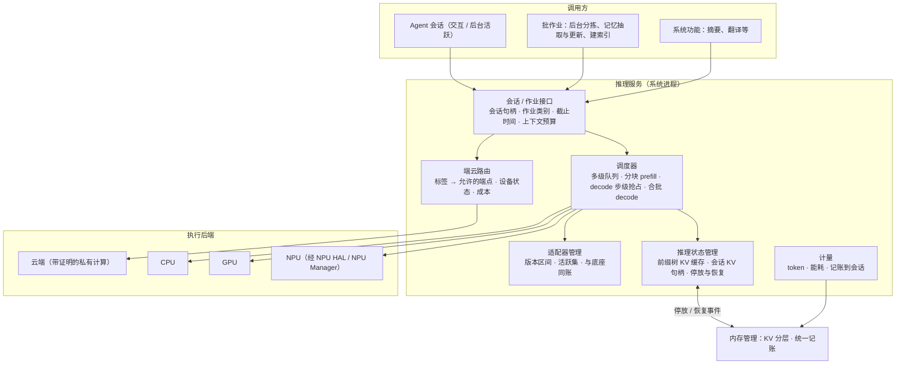

# 第三部分 · 推理服务

> 本文件是第三部分的一节，前面的总体架构见 [3-架构与关键技术.md](3-架构与关键技术.md)。负载与瓶颈见 [第二部分](2-场景与负载瓶颈.md) 2.2.2 和 2.4.1。
> 文中的「目标」都是建议值：依据写在旁边，需用立项后的实测校准。

---

## 3.2 推理服务的目标架构

### 3.2.1 定位：把一个底座模型变成全系统共享、按会话调度的服务

**为什么推理必须是系统服务，而不能由每个应用自带模型？** 第二部分给出三个理由：

1. **内存放不下多份模型。**
   - 基线配置的权重为 1.7GB，自带模型就是每个应用一份。
   - Android 17 对 12GB 机型的后台应用进程设 4GiB 上限，豁免的只有系统指定的端侧推理服务。
   - 结论：自带模型的第三方应用在后台跑不起来。
2. **算力是共享的稀缺资源。**
   - NPU、GPU 要同时服务前台请求、后台长任务、记忆写入作业，还要和前台的游戏、相机抢 GPU。
   - 单流 decode 就要约 52GB/s 的内存带宽。
   - 没有统一的调度者，就没有人能保证前台首 token ≤1 秒。
3. **推理状态是跨请求的资产。**
   - 复用与不复用前缀，全天 prefill 量相差 7–10 倍。
   - 长程任务的 KV 一旦丢失，要 6–14 秒才能重建。
   - 这些状态需要像内存页一样被系统管理。

**推理服务承担的角色**：

| 角色 | 内容 |
|---|---|
| 共享底座 | 一个底座被所有会话和系统功能复用 |
| 会话级调度 | 按会话档位排队与抢占 |
| 推理状态管理 | 共享前缀、会话 KV、上下文预算 |
| 适配器管理 | 按底座版本区间管理 |
| 端云路由 | 按标签和设备状态决定在哪里推理 |
| 计量与配额 | token、能耗，记到会话账本 |

**机制与策略的分工**：
- **推理服务（OS）**：提供上面这些机制。
- **Agent**：保留 prompt 内容、解码参数和模型选择。

### 3.2.2 架构

**三类作业**：作业类别由会话档位决定，第三部分 3.1.4 的契约表给出各档位下的行为。

| 作业类别 | 对应原型 | 调度语义 |
|---|---|---|
| 交互 | T1、T2、T5，以及用户在等的 T3 | 最高优先级，可抢占其余两类；KV 钉住 |
| 后台活跃 | 用户切走后的 T3 | 让出算力，可被抢占；KV 可停放 |
| 批作业 | T4 分拣、记忆写入、建索引 | 可延后到充电或空闲窗口；可被随时抢占；有 24 小时内完成的截止时间 |

**三项关键技术在架构上的位置**：
- **会话级调度与抢占**：对应「调度器」与执行后端适配。
- **KV / 前缀复用与多适配器驻留**：对应「推理状态管理」与「适配器管理」。
- **端云协同路由**：对应「端云路由」。

---

## 3.3 关键技术

### 关键技术一：会话级调度与抢占

**对应的负载与瓶颈**：
- T1、T5 要求前台首 token ≤1 秒；
- 与此同时，后台还有长程任务、后台分拣（每天约 100 条事件）和记忆写入作业（每天 4–9 万 prefill）在跑；
- 现有机制对后台推理直接拒绝；Android 17 NPU Manager 放开后，唯一的抢占手段是让客户端卸载整个模型，重载 0.4–1.7 秒，KV 丢失后重建 6–14 秒（第二部分 2.4.1 瓶颈一）。

**问题与挑战**：

1. **抢占点。**
   - 一次长 prefill 会长时间占住 NPU：23K 上下文在 3808 token/秒下约 6 秒。
   - 厂商 NPU 驱动大多不支持细粒度抢占，上下文切换代价不透明。
2. **抢占不能丢状态。** 被抢会话的 KV 必须原地保留或停放，否则抢占的代价比排队还大。
3. **带宽与热是真实上限。**
   - decode 受访存限制，多个流各自 decode 会成倍占用内存带宽，还会与前台图形争 GPU。
   - 持续推理带来热累积，调度必须带功耗预算。
4. **后台不能饿死。** 记忆写入和分拣是每天必须完成的作业，需要截止时间语义。

**技术目标（建议值）**：

| 指标 | 目标 | 依据 |
|---|---|---|
| 有后台负载时，前台首 token | P95 ≤1 秒；前缀命中时 ≤0.3 秒 | 第二部分 2.2.2 |
| 前台请求到达后的抢占时延 | ≤50 毫秒 | 128 token 的 prefill 分块在 3808 token/秒下约 34 毫秒（256 token 约 67 毫秒，超出目标）；一个 decode 步约 20 毫秒 |
| 抢占导致的 KV 丢失 | 0 次：抢占只暂停，不卸载 | 现有卸载式抢占的代价为 6–14 秒 |
| 前台 decode 速率 | 有后台负载时不低于独占时的 90% | 前台 ≥20 token/秒 |
| 批作业完成率 | 24 小时内 100%；优先使用充电窗口 | 记忆写入每天 4–9 万 prefill |

**模块级方案**：

1. **会话与作业接口。**
   - 调用方提交请求时带上会话句柄，作业类别由会话管理器给出，不由调用方自报。
   - 批作业另带截止时间。
   - 接口同时返回 token 与能耗计量，记到会话账本。
2. **多级队列调度器。**
   - 三类作业三个队列，优先级为：交互 > 后台活跃 > 批作业。
   - 同类内按截止时间与公平性排序。
   - 批作业在设备充电、屏幕关闭或热余量充足时集中执行。
3. **分块 prefill 与 decode 步级抢占。**
   - 长 prefill 切成固定大小的分块，每个分块结束和每个 decode 步结束都是抢占点。
   - 被抢会话的 KV 原地保留；内存紧张时交给内存管理停放，不卸载模型。
4. **后端适配。**
   - 三档作业类别映射到 Android 17 NPU Manager 的三档优先级。
   - NPU 无法细粒度抢占时，把后台会话的 decode 挪到 GPU 或 CPU，把 NPU 留给前台 prefill。
5. **合批 decode。** 同一底座上多个会话的 decode 合成一批，共享一次权重读取，降低带宽占用。公开资料没有可引用的端侧合批收益倍数，需要实测。
6. **功耗与热预算。** 按任务分配能耗预算，读取系统热状态；热余量不足时先降批作业，再降后台活跃，最后才动交互。

**细节技术点**：

- **prefill 与 decode 分到不同算力上。** 独立测量显示，NPU 在 prefill 上占优，CPU 在受访存限制的 decode 上胜过其他后端，框架差异在 NPU 上可放大到 10 倍（arXiv 2607.05475，只读到摘要）。调度可以让交互会话的 prefill 走 NPU，后台会话的 decode 走 CPU，需要实测校准。
- **算子级抢占的参照。** Agent.xpu 在 NPU 与集成 GPU 之间做算子级抢占，自报前台延迟降低至少 91%（原型）。
- **分块大小的权衡。** 分块越小，抢占时延越低，但 NPU 利用率越差，需按机型标定。
- **截止时间感知。** 批作业临近截止时间时临时提升优先级，避免永远被前台挤掉。

### 关键技术二：KV / 前缀复用与多适配器驻留

**对应的负载与瓶颈**：
- 每次调用都带约 2K 的系统提示与工具定义，复用与不复用的全天 prefill 量相差 7–10 倍；
- 前台首 token 只有前缀命中才稳定 ≤1 秒；
- 长程任务上下文 23–32K，超出端侧接口窗口（约 4K、8K），切走后 KV 丢失要 6–14 秒重建；
- 每个适配器约 160MB，绑死底座版本（第二部分 2.4.1 瓶颈二、三、四）。

**问题与挑战**：

1. **共享与隔离的张力。**
   - 系统提示与工具定义适合全局共享。
   - 含用户私有内容的前缀一旦跨应用共享，就有侧信道风险：前缀缓存的时序侧信道已有公开攻击。
2. **缓存身份。** 底座版本、适配器、分词器、量化方式任何一项变化，旧 KV 都不可用。缓存键缺任何一项，都会错用旧缓存。
3. **KV 的内存代价。**
   - 基线配置下每个会话 0.1–1.07 GiB，峰值合计 1.3GB；
   - 重配置下达 5.4GB。
   - 复用越多，驻留越多，必须与内存管理协同。
4. **长上下文。** 端侧模型窗口有限，长程任务需要「上下文预算」语义：超出部分放到哪里、何时取回。
5. **适配器。**
   - 切换适配器会让相关 KV 失效；
   - 底座 OTA 升级会让生态里的适配器集体失效。

**技术目标（建议值）**：

| 指标 | 目标 | 依据 |
|---|---|---|
| 系统提示与工具定义的前缀命中率 | ≥90% | 云端实测 84.6%–99.5%（2605.26297） |
| 首轮首 token（前缀命中时） | ≤0.3 秒 | 第二部分 2.2.2 |
| 停放会话的恢复（KV 部分） | ≤1 秒 | 内存管理换入 0.2–0.9 秒；重算 6–14 秒不可接受 |
| 上下文预算 | 支持 32K 会话，超出模型窗口的部分外存或摘要 | 长程任务上限 32K |
| 适配器切换 | ≤200 毫秒 | 160MB 在 1–4.3GB/s 下需 37–160 毫秒 |
| 缓存错用（版本不匹配） | 0 次 | 缓存键含版本 |
| 跨信任域共享私有前缀 | 0 次 | 侧信道风险 |

**模块级方案**：

1. **系统级前缀树 KV 缓存。**
   - 按块管理 KV，用前缀树做块级去重，参照 PagedAttention 与 RadixAttention，下沉到系统服务。
   - 缓存键为「底座 ID + 版本 + 适配器 ID + 分词器 + 量化方式 + 信任域」。
2. **信任域分区。**
   - 系统提示、工具定义这类不含用户数据的前缀全局共享；
   - 含用户私有内容的前缀只在同一信任域（即同一沙箱会话）内共享；
   - 跨域时各自持有。
3. **会话 KV 句柄与停放。**
   - 每个会话的 KV 有句柄，支持「停放」与「恢复」两个操作：停放时把 KV 交给内存管理分层（换出、降位宽或丢弃），恢复时取回。
   - 由会话档位事件驱动，推理服务决定 KV 的去向。
4. **上下文预算接口。**
   - Agent 申请上下文预算，系统决定预算内对象驻留在哪里：内存、闪存、云端，或经记忆服务摘要入库。
   - 这把「上下文窗口」当作 Agent 的地址空间。
5. **适配器管理器。**
   - 按「底座 ID + 版本区间」登记适配器；
   - 活跃集限额，活跃适配器钉住，与底座同账；
   - 切换时让相关 KV 失效；
   - 加载前校验签名与来源。
6. **嵌入模型托管。** 记忆服务的嵌入模型由推理服务统一提供，纳入模型内存域：按事件加载，空闲驱逐。

**细节技术点**：

- **工具定义精简。** MCP 式冗长 schema 每个工具约 740–1900 token（二手），8 个工具可超过 6K。系统层把工具定义规范成精简格式（约 200 token/个），直接降低共享前缀的体积。
- **停放会话的 KV 降位宽。** 停放期间降到 8-bit 或 4-bit，恢复时按需反量化，换出量减半。质量回归需按 Agent 任务集校准。
- **系统提示钉住。** 全局共享前缀常驻、不参与回收；前缀被换出时，重算 2K 需 0.5–3.7 秒，会直接击穿前台首 token。
- **底座升级的兼容策略。** 适配器声明兼容的底座版本区间；升级时先在后台验证适配器行为回归，失败的适配器标为不可用，而不是静默错用。

### 关键技术三：端云协同路由

**对应的负载与瓶颈**：
- 长程任务的上下文常超出端侧窗口，需要回落云端；
- 后台分拣与记忆问答处理的全是个人数据；
- 现在的路由要么由开发者选择，要么是厂商黑盒，没有按数据标签约束（第二部分 2.4.1 瓶颈五）。

**问题与挑战**：

1. **每一步都要做多目标决策。** 决策依据包括：能力（上下文长度、任务难度）、时延、电量与热、云成本、隐私标签。
2. **隐私约束必须是硬约束。** 敏感数据不能因为「云端答得更好」就出端。
3. **云端可信度。** 需要类似 Apple PCC 的证明机制，并校验证明的新鲜度。
4. **离线与弱网。** 端侧要能承接核心任务；需要上云的子任务要能排队或降级。

**技术目标（建议值）**：

| 指标 | 目标 | 依据 |
|---|---|---|
| 带隐私标签的数据违规出端 | 0 次 | 第三部分 3.1.3 约定二 |
| 端侧承接的请求比例（按次数） | ≥80% | T1、T4、T5 占每天请求的大头，均可在端侧满足 |
| 路由决策时延 | ≤10 毫秒 | — |
| 端云切换的额外时延 | ≤500 毫秒 | 2027 立项调研 M1 的建议值 |
| 离线时 T1、T4、T5 可用率 | 100% | 第二部分 2.2.2 端侧可行性 |

**模块级方案**：

1. **路由器。**
   - **输入**：会话标签、任务原型、上下文长度、设备状态（电量、热、负载）、网络状态。
   - **输出**：允许的端点集合，以及从中选出的那个端点。
2. **标签到端点的硬约束表。**
   - 由沙箱签发的标签决定允许的端点，例如「含支付」只能在端侧，「不可信外部」可以上云。
   - 路由器只在允许集合内做优化。
3. **云端证明校验。** 调用云端前校验证明及其有效期；证明过期即视为不可用。
4. **子任务级路由。** 长程任务拆开处理：规划和不含个人数据的子任务上云，涉及个人数据的步骤留在端侧。上云前做上下文最小化，只发送标签允许的片段。
5. **成本与能耗计量。** 端侧记能耗，云端记 token 成本，统一记到会话账本，供路由策略与部门的仿真评估使用。

**细节技术点**：

- **学习式路由的参照。**
  - Hybrid LLM（ICLR 2024）按预测难度选择大小模型，大模型调用最多减少 40% 且质量不降；
  - RouteLLM（ICLR 2025）报告成本降低超过 2 倍。
  - 端侧场景要再加入隐私和能耗两个维度（见 2027 立项调研 M4）。
- **投机式端云解码。** 端侧小模型起草，云端验证，可作为后续选项。实验台上时延最多降 35%（Jetson 加 A100，非手机）。
- **降级策略。** 离线时，需要上云的子任务进入队列，并告诉用户「联网后继续」，而不是静默失败。
