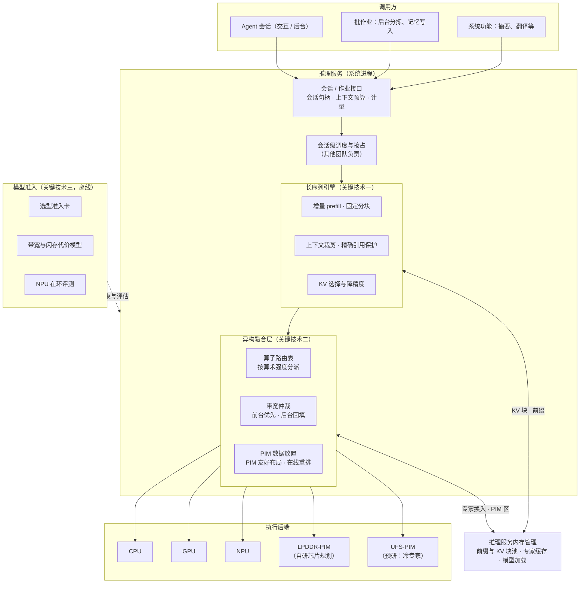

# 第三部分 · 推理服务

> 本文件是第三部分的一节，前面的总体架构见 [3-架构与关键技术.md](3-架构与关键技术.md)。负载见[第二部分](2-场景与负载瓶颈.md) 2.2.2，体验与商业化问题见 2.3.1，瓶颈见 2.5.1。
> 文中的「目标」都是建议值：依据写在旁边，需用立项后的实测校准。调研依据见笔记 [R1 超长序列](../notes/R1-超长序列推理.md)、[R2 SoC 与 LPDDR-PIM](../notes/R2-异构融合-SoC与LPDDR-PIM.md)、[R3 闪存侧计算](../notes/R3-异构融合-闪存侧计算.md)、[R4 模型结构](../notes/R4-硬件亲和模型结构.md)。
> 2026-11-09 改版：关键技术改为超长序列、异构融合、模型结构三项；会话级调度由其他团队负责，只在架构中体现；前缀与 KV 复用移到推理服务内存管理。

---

## 3.2 推理服务的目标架构

### 3.2.1 定位：让长上下文推得动、新算力用得上、模型与手机匹配

**为什么推理必须是系统服务，而不能由每个应用自带模型？**

1. **内存放不下多份模型。** 基线权重 1.7GB，2027 年的 MoE 底座在闪存中占 8–11GB。Android 17 对 12GB 机型的后台应用进程设 4GiB 上限，豁免的只有系统指定的端侧推理服务。
2. **算力和带宽是共享的稀缺资源。** 单流 decode 就要约 52GB/s 的内存带宽，约占 LPDDR5X 理论峰值的 68%。没有统一的系统服务，NPU、GPU、PIM 无法协同，带宽也无法在 Agent 与前台应用之间仲裁。
3. **模型要和硬件一起设计。** KV 体积、专家布局决定内存与闪存的压力，这些只能在系统层统一约束，不能交给每个应用各自选。

**商业价值：端侧推理能力决定云转端能走多远**（详见 2.3.1）：

- 推理需求在爆发，云端单价并不总在降。重度 Agent 用户的云成本每年约 79–296 美元，按 1000 万重度日活计，每年约 7.9 亿到 30 亿美元（估算）。
- 端侧能承接多少 Agent 任务，取决于三件事：长上下文推不推得动；新算力能不能推开带宽墙；模型结构是否与手机匹配。这三件事就是本章的三项关键技术。
- 按中档云价，端侧每多承接一成重度用户的 token，每 1000 万重度日活每年少付约 3 亿美元（估算，未计涨价）。

**本次投入与只在架构中体现的部分：**

| 部分 | 内容 | 归属 |
|---|---|---|
| **本次投入** | 超长序列推理的优化；LPDDR-PIM、NPU、UFS-PIM 异构融合计算；硬件亲和的模型架构寻优 | 本项目；模型结构与模型团队联合，PIM 与自研芯片团队联合 |
| 架构中体现 | 会话级调度与抢占：按会话档位排队、在分块与 decode 步边界抢占 | 其他团队 |
| 架构中体现 | 端云路由：按数据标签决定能否出端的硬约束 | 执行沙箱的出口控制 |
| 移到内存与资源 | 前缀与 KV 的复用、停放与恢复；专家缓存；模型加载 | 推理服务内存管理 |

**推理服务承担的角色**：

| 角色 | 内容 |
|---|---|
| 共享底座 | 一个底座被所有会话和系统功能复用 |
| 长序列计算 | 增量 prefill、分块、上下文裁剪、KV 选择与降精度 |
| 异构融合 | 把算子分派到 CPU、GPU、NPU、LPDDR-PIM、UFS-PIM，并仲裁带宽 |
| 模型准入 | 按内存、带宽、闪存预算评估与约束底座模型 |
| 计量 | token、能耗，记到会话账本 |

**机制与策略的分工**：推理服务提供上面这些机制；Agent 保留 prompt 内容、解码参数和模型选择。

### 3.2.2 架构

**三项关键技术在架构上的位置**：

- **Agent 超长序列推理的优化**：对应「长序列引擎」，与推理服务内存管理的 KV 块池共用块格式。
- **LPDDR-PIM、NPU、UFS-PIM 异构融合计算**：对应「异构融合层」和执行后端中的 PIM。
- **硬件亲和的模型架构寻优**：对应「模型准入」，离线进行，与模型团队联合。

---

## 3.3 关键技术

### 关键技术一：Agent 超长序列推理的优化

**对应的体验问题、负载与瓶颈**：

- **体验与商业问题**（2.3.1）：端侧推不动长上下文，长任务只能回云，成本与隐私都承受不起。
- **负载**：长程任务的上下文 23–32K，每轮只追加约 0.5–2K 的工具返回；前台首 token ≤1 秒。
- **瓶颈**（2.5.1 瓶颈一）：
  - 端侧接口窗口只有 4K、8K；公开的手机 NPU 实测最长只到 1024 token；
  - 24K 时 KV 约占每 token 访存的 45%，decode 被带宽卡在约 30–42 token/秒（估算）；
  - 没有增量 prefill，工具返回追加后整段重算。

**问题与挑战**：

1. **公开基线缺失。** 没有手机 8K–32K prefill 的公开实测，内部数据没有外部参照，必须先建基线。
2. **NPU 对动态长度不友好。** NPU 图是静态形状：长度刚超过标准尺寸时，padding 平均多出 1.91 倍开销；在线建图，1000 token 要约 2 秒 [R1]。长序列只能分块，而越靠后的分块要读的历史 KV 越多。
3. **稀疏化与 Agent 的精确引用冲突。** KV 选择类方法在问答基准上近乎无损，但 Agent 的工具调用要精确引用路径、参数、ID，丢掉相关 token 就会出错；多种稀疏方法在 32K 精确检索上精度大幅下降 [R1]。
4. **增量 prefill 要与状态管理配合。** 只算新增部分的前提是前缀 KV 一直在、且版本正确，这依赖推理服务内存管理的前缀缓存。

**技术目标（建议值）**：

| 指标 | 目标 | 依据 |
|---|---|---|
| 工具返回追加（1–2K token）后的首 token | ≤1.5 秒 | 增量 prefill；2K 在 3808 token/秒下约 0.5 秒（2B 级、GPU），为 3B 底座与 NPU 路径留出余量 |
| 24K 上下文的 decode 速度 | ≥35 token/秒 | 带宽上限约 42 token/秒；每 token 的 KV 读取减半可回到约 50 |
| 24K 上下文每 token 的 KV 读取量 | ≤0.4GiB | KV 8-bit 加选择性读取 |
| 上下文裁剪后的任务成功率 | 下降 ≤1 个百分点 | 编码 Agent 上遮蔽旧工具返回，成功率持平或略升 [W28] |
| 精确引用 token 的保留 | 100% | 工具名、路径、参数、ID 不被裁剪或淘汰 |

**模块级方案**：

1. **增量 prefill 与块对齐。** 系统提示、工具描述与历史作为稳定前缀，工具返回追加时只 prefill 新增的块。块大小与 KV 块池对齐，前缀命中由推理服务内存管理保证。
2. **NPU 分块 prefill 与 GPU、NPU 协同。** 采用固定分块（参照 llm.npu 取 256 token），预编译常用分块尺寸的图，避免在线建图；GPU 与 NPU 按张量切分协同（参照 HeteroInfer）。
3. **Agent 上下文裁剪。** 对旧的工具返回做遮蔽，保留调用与结论，不改模型即可降低 prefill 量。这比稀疏注意力的收益更确定。
4. **KV 降精度与选择性读取。** KV 用 8-bit；decode 时按查询选择相关块读取，同时给需要精确引用的 token 打「不可淘汰」标记。
5. **超预算会话的 KV 卸载。** 只有超过 DRAM 预算的会话才把冷块放到闪存。推理侧负责预测哪些块重要，放盘与预取由内存管理负责。

**细节技术点**：

- **块对齐**：KV 块大小与 NPU 分块应成整数倍，使前缀复用与增量 prefill 的粒度一致。
- **精度分层**：prefill 用 W8A8，对异常通道单独处理，精度损失 <1%（llm.npu 的做法）[W21]；KV 用 8-bit；避免激活量化带来的明显精度损失。
- **与前台共存**：HeteroInfer 与游戏并发时 prefill 只降 0.5%–2.2%，游戏帧率不受影响 [W22]，说明 GPU 只承担少量份额即可兼顾前台。
- **基线先行**：2027-Q1 先在真机上测出 3B 底座 8K、16K、32K 的 prefill 与 decode，作为全部目标的校准依据。

### 关键技术二：LPDDR-PIM、NPU、UFS-PIM 异构融合计算

**对应的体验问题、负载与瓶颈**：

- **体验与商业问题**（2.3.1）：decode 被带宽卡住，端侧又慢又占前台资源，云转端的比例上不去。
- **负载**：单流 decode 约 52GB/s，占 LPDDR5X 峰值的约 68%，长上下文时超过峰值；后台 Agent 推理与前台应用争用同一条总线；MoE 底座专家未命中时每 token 约读 1.1GB 闪存。
- **瓶颈**（2.5.1 瓶颈二）：推理运行时只在 CPU、GPU、NPU 之间分配算子；PIM 没有系统支持；UFS 没有计算接口。

**分阶段的定位**：

| 阶段 | 内容 | 依赖 |
|---|---|---|
| 2027 年交付 | SoC 内 NPU、GPU、CPU 协同与带宽仲裁 | 不需要新硬件 |
| 2027 年预研 | LPDDR-PIM：仿真与 FPGA 评估，与自研芯片团队联合定义系统接口 | PIM 已列入自研芯片规划；LPDDR6-PIM 标准尚未发布 |
| 2027 年预研 | UFS-PIM：冷专家卸载的盈亏评估与命令集提案 | 需定制 NAND，存储厂商合作 |

**问题与挑战**：

1. **模式切换与一致性。** PIM 模式下要关闭缓存、预取与乱序执行，PIM 与普通访存不能同时进行 [R2]，前台应用的访存可能被迫等待。
2. **数据放置与容量。** prefill 需要缓存友好的权重布局，decode 需要 PIM 友好、不可缓存的布局，两份拷贝会吃掉容量 [R2]；12GB 机型 Agent 侧只有约 4GB。
3. **编程模型缺失。** 标准未定，各厂商指令集私有，主流推理框架都不支持 PIM。
4. **收益口径窄。** 三星的 3.01 倍只测了 320 token、INT4、稠密 8B [W23]；长上下文的 KV 读取、MoE 专家、投机解码（GEMV 变 GEMM）都没有端侧数据。
5. **UFS-PIM 的器件形态。** 所有闪存内计算方案都需要定制 NAND die 或 chiplet，UFS 5.0 没有计算接口 [R3]。而且专家命中率越高，闪存内计算的边际收益越小。

**技术目标（建议值）**：

| 指标 | 目标 | 依据 |
|---|---|---|
| NPU 与 GPU 协同的端到端收益 | 相对最优单一引擎 ≥1.3 倍，含能耗 | HeteroInfer 下限 1.34 倍 [W22] |
| 带宽仲裁下的前台干扰 | Agent 推理期间前台掉帧率增量 ≤1 个百分点 | 2027 立项的体验目标 |
| PIM 路径 3B 4-bit 的 decode | ≥100 token/秒，外部总线占用 <10GB/s（仿真或样片） | 三星 3.01 倍乘以基线 52 token/秒约为 156，保守取 2 倍 |
| 24K 上下文下 PIM 的收益保持率 | ≥60% | 需要 KV 注意力也进入 PIM |
| PIM 与前台访存的切换 | 前台访存最大等待 <1 毫秒 | 估算，无公开数据 |
| UFS-PIM 的立项门槛 | 闪存内有效带宽 ≥20GB/s；每 token 能耗 ≤DRAM 路径的 50% | R3 估算 |

**模块级方案**：

1. **统一算子路由表。** 把 CPU、GPU、NPU、PIM 视为同一张「算子 × 位置」路由表，按算术强度分派：prefill 与 GEMM 走 NPU、GPU，decode 的 GEMV 走 PIM。
2. **带宽仲裁。** 在内存控制器或操作系统侧给 NPU、GPU、PIM 与前台应用分配带宽配额；前台优先，后台 Agent 推理作为低优先级回填（参照 Agent.xpu 的带宽感知分派）[W29]。
3. **PIM 作为带属性的内存区域。** 分配器区分 PIM 区与普通区；权重一次布局成 PIM 友好格式，prefill 时在线重排（参照 PIM-SHERPA）。
4. **UFS-PIM 冷专家卸载预研。** 命中的热专家仍在 NPU 与 DRAM 中计算，未命中的冷专家交给闪存侧计算，只回传激活向量；以「只读 GEMV 卸载加结果回传」作为最小命令集，向存储厂商与 JEDEC 提出需求。
5. **与自研芯片团队联合定义接口。** 例如三星的地址对齐模式（AAM）让 PIM 适配现有内存控制器，需要与芯片团队确认是否采用。

**细节技术点**：

- **投机解码与 PIM 选路**：投机解码把 GEMV 变成 GEMM，PIM 的优势随推测长度增加而下降，运行时要按推测长度选择路径。
- **softmax 与 layer norm 仍在 SoC 上**：要设计 SoC 与 PIM 之间的流水，隐藏往返时延。
- **按稳态设计**：手机热包络下持续的 PIM 计算可能降频，设计输入应取稳态而不是峰值。
- **先做命中率，再做闪存内计算**：专家命中率从 38.6% 提到 70%，每 token 的闪存 IO 从约 0.68GB 降到约 0.33GB [R3]。两者是替代关系，命中率提升由推理服务内存管理负责。

### 关键技术三：硬件亲和的模型架构寻优

**分工**：模型团队主导结构设计、训练与质量；本项目提供约束、代价模型与 NPU 在环评测平台。投入只计本项目的部分。

**对应的体验问题、负载与瓶颈**：

- **体验与商业问题**（2.3.1）：同样的硬件，结构选错，长上下文的 KV 和 MoE 的专家 IO 就会超出预算，端侧只能回云。
- **负载**：Agent 侧可用约 4GB；24–32K 上下文的 KV 应不超过约 1GB；MoE 底座占闪存 8–11GB、DRAM 驻留 2–2.5GB。
- **瓶颈**（2.5.1 瓶颈三）：每 token 的 KV 随结构相差可达 12 倍；专家的大小、布局与路由方式决定闪存 IO；公开的硬件在环搜索只做到 CPU 在环。

**问题与挑战**：

1. **NPU 不在搜索环里。** 公开最完整的硬件在环搜索（LFM2）以手机 CPU 的首 token、decode 时延和峰值内存为约束，没有 NPU 实测 [W26]；PIM 在环更是空白。
2. **混合结构的 NPU 友好度不明。** 线性注意力与短卷积在 NPU 上是否高效，没有公开测量。
3. **结构省下的 KV 可能以 Agent 任务质量为代价。** 线性注意力与滑窗对工具调用、长程精确引用的影响，缺少独立评测。
4. **评估口径分裂。** 模型团队看困惑度与基准分，系统团队看首 token、峰值内存与闪存 IO，没有统一的代价模型。

**技术目标（建议值）**：

| 指标 | 目标 | 依据 |
|---|---|---|
| 候选底座每 token 的 KV（fp16） | ≤35KiB，争取 ≤16KiB | LFM2-1.2B 为 12KiB，Qwen3.5-4B 为 32KiB；Qwen3-4B 为 144KiB，超标 |
| 32K 上下文的 KV 常驻（int8） | ≤1.1GiB | 长程任务上限 1.07GiB |
| decode 速度随上下文的掉幅（4K → 32K） | ≤30% | LFM2-1.2B 从 1K 到 4K 掉 20%，Qwen3-1.7B 掉 32%（厂商自报）[W26] |
| MoE 底座的可预取性 | 支持注意力前路由或每请求路由；单专家 ≥1.5MB | R5：逐 token 路由下预取与按需读争带宽 |
| 选型准入 | 候选底座 100% 提供 NPU 实测：4K 与 32K 的首 token 与峰值内存 | 借用 LFM2 的约束项 |
| 代价模型的时延预测误差 | ≤10% | 黑盒 NPU 时延预测已有 2.15% 的报告（预印本，二手）[R4] |

**模块级方案**：

1. **选型准入卡。** 每个候选底座自动从配置文件生成：层数、KV 头数、全注意力层数、滑窗与线性层比例、每 token KV、固定状态大小、每 token 活跃权重字节、专家大小与路由方式。
2. **带宽与闪存代价模型。** decode 时延约等于「计算时间」与「活跃权重字节 ÷ 带宽 + KV 读取字节 ÷ 带宽」中的较大者，再加上专家未命中的闪存 IO；输入为配置文件与目标 SoC 的实测带宽，包括 PIM 的内部带宽。作为模型团队搜索时的约束。
3. **NPU 在环评测。** 把设备农场的 NPU 编译与实测接入搜索循环。初期可冻结已训练权重、只搜注意力布局，降低搜索成本（参照 Jet-Nemotron 的做法，把目标从 GPU 改为手机 NPU）。
4. **MoE 结构约束。** 优先采用注意力前路由（SmallThinker 路线）或每请求选专家（AFM 3 路线），使专家 IO 能与注意力计算重叠；单专家大小不低于 UFS 单次读取的效率拐点；每 token KV 不超过约 40KiB。
5. **与另两项技术联动。** KV 缩减优先在结构层完成；推理侧的选择性读取（关键技术一）与内存管理的分页换出作为补充，避免重复投入。

**细节技术点**：

- **位宽与结构联动**：Apple 采用 2-bit 量化感知训练加 8-bit KV，这必须在训练阶段完成。
- **层间 KV 共享**：Apple 的层间共享使 KV 减少 37.5%，Gemma 3n 把中层 KV 共享给上层。共享后 NPU 的 KV 缓冲可以复用，内存记账要覆盖这种情况。
- **滑窗层的固定状态**：滑窗层的 KV 不随任务增长，可视为常驻；只有全注意力层进入分页与换出。
- **权重的闪存放置**：Gemma 3n 的 PLE 可放在 CPU 与闪存侧，只把核心权重放进加速器内存；MatFormer 让同一份权重在运行时按内存预算降档。这是「权重分层」的量产先例。
