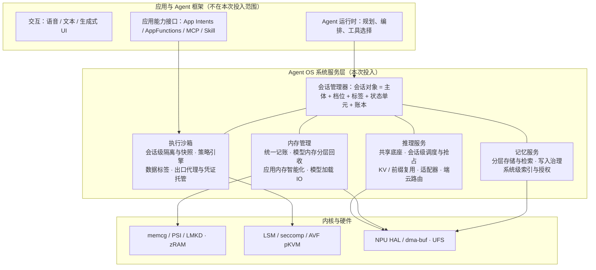

# 第三部分 架构与关键技术

> 本部分回答：Agent OS 的总体架构是什么样，四个组件在其中的位置和相互关系（3.1）；每个组件内部的架构和关键技术（3.2），以及每项关键技术要解决的具体问题、目标和模块级方案（3.3）。
> 3.1 节在本文件；3.2、3.3 按组件分成四个文件：
>
> - [推理服务](3-推理.md)
> - [执行沙箱](3-沙箱.md)
> - [记忆服务](3-记忆.md)
> - [内存管理](3-内存管理.md)
>
> 每项关键技术开头都会复述它对应的负载需求和瓶颈（见[第二部分](2-场景与负载瓶颈.md)）。

---

## 3.1 Agent OS 总体架构

### 3.1.1 一句话架构

**把「Agent 会话」做成 OS 的一等对象，四个系统服务围绕它分工。**

- 推理服务为会话调度算力；
- 执行沙箱为会话划定边界、签发数据标签；
- 记忆服务持久化会话的产出；
- 内存管理为会话记账、按档位回收。

**为什么必须是「会话」**：第二部分的负载分析表明，Agent 的资源需求、风险和状态都以「一个任务的执行过程」为单位产生和消亡，而不是以进程或 App 为单位：

- 一次跨应用下单会调用多个 App；
- 一个长程任务会跨越数小时和多次切换；
- 一条不可信消息的影响会从读入一路传到发送。

经典 OS 的记账、隔离和回收都以进程为主体，在这里对不上号：

- 推理服务代多个会话持有 KV，内存全记在服务进程名下；
- 一个会话的风险跨越多个 App 进程；
- 回收时 OS 分不清该杀哪个进程才不破坏用户正在等的任务。

### 3.1.2 分层与组件

**四个组件各自的职责**，以及与会话的关系：

| 组件 | 对会话做什么 | 会话的哪部分状态由它保管 | 依赖的内核与硬件机制 |
|---|---|---|---|
| 推理服务 | 按会话档位分配 NPU / GPU / CPU 算力，可抢占；复用共享前缀；按数据标签决定端侧还是云端 | KV cache；当前加载的适配器 | NPU HAL、dma-buf、Android 17 NPU Manager |
| 执行沙箱 | 为会话装配接口面和权限；隔离执行；出口与凭证由系统托管；签发并传播数据标签 | 隔离实例（进程或 pVM）及其快照；审计日志 | LSM、seccomp、AVF pKVM、网络命名空间 |
| 记忆服务 | 接收会话产出写入长期记忆，带来源标签；按授权供其他会话读取；遗忘 | 长期记忆条目与索引 | 文件系统、嵌入模型（由推理服务提供） |
| 内存管理 | 以会话为主体记账：权重、KV、沙箱、索引都记在会话或服务名下；按档位回收；模型内存分层驻留 | 会话账本；分层驻留位置（DRAM / zRAM / UFS） | memcg、PSI、LMKD、zRAM、dma-buf heap、UFS |

### 3.1.3 四条贯穿性约定

四个组件不是各自为政的子系统。它们之间的接口收敛为四条约定，这也是「架构为什么是这样」的核心理由。

1. **档位只算一次。**
   - **做法**：会话档位由会话管理器统一算出，同时驱动四个组件：推理优先级、隔离与确认强度、记忆读取路径、内存保底与回收顺序。
   - **依据**：用户正在等的任务是交互档，切走后的长程任务是后台档，等用户确认时是待机档。
   - **理由**：如果四个组件各自判断「这个 Agent 重要不重要」，就会出现推理在全速跑、内存却在回收它的 KV 这类互相打架的情况。
2. **标签只有一套。**
   - **做法**：数据的来源与敏感度标签由沙箱在数据流过接口时签发，例如「来自不可信网页」「含支付信息」。
   - **流转**：记忆服务把标签随条目持久化，推理服务的端云路由按标签决定能否出端，内存管理按标签决定共享前缀能否跨会话复用。
   - **理由**：只要有一处丢了标签，一条注入内容就能洗白成「可信记忆」。
3. **归属只有一个账本。**
   - **做法**：权重、KV、适配器、沙箱实例、记忆索引的内存，都记在 memcg 之上的会话或服务账本里。推理服务代某个会话持有的 KV，用「代分配归账」记到该会话名下。
   - **理由**：模型内存一旦不在账本上，OS 的回收决策就是在信息不全的情况下做的。
4. **事件而非调用。**
   - **做法**：跨组件的暂停、回收、驱逐、降级都用事件通知，由拥有策略的一方决定动作。例如内存管理只发出「该会话的 KV 将被回收」事件，由推理服务决定换出还是丢弃重算，由记忆服务决定是否先写摘要。
   - **理由**：这是「机制归 OS、策略归 Agent」在接口上的落地，也避免组件之间形成环形调用。

### 3.1.4 会话档位与四组件的联动

下表是总体架构的「契约表」。每一行是一个会话档位，每一列是该档位下各组件的行为。它把第二部分提出的跨组件需求落成了一张统一的规则：

- 长程任务切走后要在秒级恢复；
- 后台分拣不能拖慢前台；
- 等待确认时不应继续占用内存。

| 会话档位 | 进入条件 | 推理服务 | 执行沙箱 | 记忆服务 | 内存管理 |
|---|---|---|---|---|---|
| **交互** | 用户正在等结果：前台对话、确认弹窗、实时语音 | 最高优先级，可抢占后台会话的 decode；该会话 KV 钉住 | 运行；敏感动作按档位确认 | 检索走低时延路径 | 保底供给，不回收其 KV 与沙箱内存 |
| **后台活跃** | 用户切走，任务仍在执行（长程任务、后台分拣） | 低优先级，可被抢占；分块 prefill，让出算力 | 运行；需确认的动作排队，等用户回来再处理 | 接触过不可信内容的会话，写入先进待确认区 | 弹性供给，压力下先于前台应用降级 |
| **待机** | 等用户确认、等外部事件、等工具返回 | 不占算力；KV 可降位宽或换出 | 暂停：冻结进程，内存保留 | — | 沙箱与 KV 内存可压缩或换出 |
| **挂起** | 长时间无活动，或内存压力超过阈值 | KV 换出到闪存，或丢弃待重算；共享前缀保留 | 快照落盘后释放内存 | 必要时把被驱逐的上下文写摘要入库（治理检查点） | 释放到最低；恢复时按工作集预取 |
| **销毁** | 任务完成或被取消 | 释放 KV | 销毁并清算，审计日志落盘 | 会话记忆按策略归档或丢弃 | 账本清零 |

**两个端到端的例子**：

**例一：用户切走长程任务，再切回来。**

1. 会话管理器把会话从「交互」降为「后台活跃」，几分钟没有进展后降为「挂起」。
2. 「挂起」事件广播到四个组件：
   - 推理服务把该会话的 KV 换出到闪存（或标记为可重算）；
   - 沙箱先做快照再释放进程内存；
   - 内存管理按账本把这些内存还给前台应用。
3. 用户切回时，会话升为「交互」，四个组件按逆序恢复：
   - 内存管理先按工作集预取；
   - 沙箱从快照恢复；
   - 推理服务读回 KV 或重算前缀。
4. 恢复的时延目标由第二部分的负载推出。

**例二：后台分拣读到一条注入消息。**

1. 后台分拣会话读入一封邮件，沙箱给这段内容打上「不可信外部内容」标签。
2. 模型被诱导调用「发消息」，且参数中带有这段内容，沙箱按定档规则把这次调用升为「每次确认」，排队等用户。
3. 分拣结果要写入记忆时，标签随条目持久化。
4. 之后其他会话检索到这条记忆，读出的内容仍是低完整性；推理服务的端云路由也按标签处理。

**例二说明了「标签只有一套」的必要性**：注入的风险不在读入的那一刻，而在它被跨时间、跨会话地带到一个有副作用的动作上。

### 3.1.5 本次投入的关键技术总览

| 组件 | 关键技术 | 对应的核心瓶颈（详见第二部分 2.4） |
|---|---|---|
| 推理服务 | 会话级调度与抢占 | 后台长任务与前台请求争抢 NPU，现有抢占只到模型级 |
| | KV / 前缀复用与多适配器驻留 | 每轮重复 prefill 系统提示与工具定义；适配器绑定底座版本 |
| | 端云协同路由 | 端侧算力只能承接部分任务，路由缺隐私与成本约束 |
| 执行沙箱 | 会话级隔离与状态底座 | 手机没有会话级执行边界与快照，长任务暂停恢复只能靠杀进程重来 |
| | 策略引擎与数据标签 | 静态权限无法表达「这次能不能做」，不可信内容一路无标签 |
| | 出口代理与凭证托管 | 没有按会话的出口策略（含 DNS），凭证进入 Agent 可见范围 |
| 记忆服务 | 端侧分层记忆存储与检索 | 写入量与累积规模下，端侧检索时延与内存预算 |
| | 记忆写入治理 | 摘要丢约束、投毒长期留存、冲突更新普遍失败 |
| | 系统级个人语义索引与授权 | 个人上下文散落各 App，第三方 Agent 无授权读取通道 |
| 内存管理 | 统一记账底座 | 模型内存（dma-buf / NPU）在 LMKD 与 memcg 视野之外 |
| | 模型内存分层回收 | KV 与权重随上下文和模型规模增长，超出 12GB 机型可用预算 |
| | 应用内存智能化 | Agent 调起多个 App 时冷启动劣化、后台被杀、切回重启 |
| | 模型加载 IO 与零拷贝 | 模型冷加载与换入受闪存带宽与多次拷贝限制 |

各项技术的问题、目标与方案，见四个组件文件。
