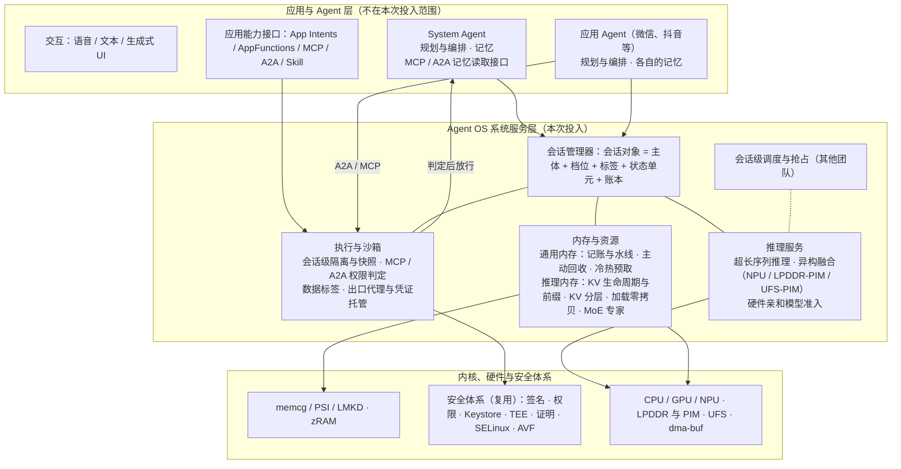

# 第三部分 架构与关键技术

> 本部分回答：Agent OS 的总体架构是什么样，三项系统服务在其中的位置和相互关系（3.1）；每项系统服务内部的架构和关键技术（3.2），以及每项关键技术要解决的具体问题、目标和模块级方案（3.3）。
> 3.1 节在本文件；3.2、3.3 按系统服务分成三个文件：
>
> - [推理服务](3-推理.md)
> - [执行沙箱](3-沙箱.md)
> - [内存与资源](3-内存管理.md)：通用内存管理优化、推理服务内存管理两个模块
>
> 记忆属于 Agent 层，不在本次投入范围，其位置与接口见[附录](附录-记忆（Agent层）.md)。
> 每项关键技术开头都会复述它对应的体验问题、负载需求和瓶颈（见[第二部分](2-场景与负载瓶颈.md)）。
> 2026-11-09 改版：由四组件改为三项系统服务。

---

## 3.1 Agent OS 总体架构

### 3.1.1 一句话架构

**把「Agent 会话」做成 OS 的一等对象，三项系统服务围绕它分工。**

- 推理服务为会话提供算力：长上下文推得动，NPU 与 PIM 等新算力用得上；
- 执行沙箱为会话划定边界：MCP 出站与 A2A 入站的每次调用都在 Agent 之外判定，并签发数据标签；
- 内存与资源为会话记账：Agent 与应用共用一本账，按档位回收，管理 KV、前缀与专家。

记忆由各 Agent 自己持有；其他 Agent 经 System Agent 的 MCP 或 A2A 接口读取，每次读取由执行沙箱判定权限。

**为什么必须是「会话」**：第二部分的负载分析表明，Agent 的资源需求、风险和状态都以「一个任务的执行过程」为单位产生和消亡，而不是以进程或 App 为单位：

- 一次跨应用下单会调用多个 App；
- 一个长程任务会跨越数小时和多次切换；
- 一条不可信消息的影响会从读入一路传到发送。

经典 OS 的记账、隔离和回收都以进程为主体，在这里对不上号：

- 推理服务代多个会话持有 KV，内存全记在服务进程名下；
- 一个会话的风险跨越多个 App 进程；
- 回收时操作系统无法判断终止哪个进程才不影响用户正在等待的任务。

### 3.1.2 分层与组件

**三项系统服务各自的职责**，以及与会话的关系：

| 系统服务 | 对会话做什么 | 会话的哪部分状态由它保管 | 依赖的内核与硬件机制 |
|---|---|---|---|
| 推理服务 | 长上下文的增量 prefill 与 KV 选择；把算子分派到 CPU、GPU、NPU、PIM 并仲裁带宽；按内存、带宽、闪存预算约束底座模型 | 计算中的激活与分块 | NPU HAL、dma-buf、LPDDR-PIM（规划）、UFS |
| 执行与沙箱 | 为会话装配接口面；判定 MCP 出站与 A2A 入站的每次调用；隔离执行；出口与凭证托管；签发并传播数据标签 | 隔离实例（进程或 pVM）及其快照；审计日志 | 复用安全体系；LSM、seccomp、AVF pKVM、网络命名空间 |
| 内存与资源 · 通用内存管理优化 | 以会话为主体记账：权重、KV、专家、沙箱都记在会话或服务名下；按档位设置 memcg 水线；主动回收常驻服务的冷页；应用匿名页冷热预取与换出 | 会话账本；memcg 水线 | memcg、PSI、LMKD、zRAM、DAMON、ARM SPE |
| 内存与资源 · 推理服务内存管理 | 前缀缓存与 KV 的生命周期；KV 分页与分层；模型加载零拷贝；MoE 专家缓存 | 前缀树与 KV 块；专家缓存；KV 与权重的驻留位置（DRAM / 压缩区 / UFS） | 推理运行时、NPU HAL、dma-buf heap、IOMMU、UFS |
| （Agent 层）记忆 | 不由系统服务承担：Agent 自己持有；对外读取经 System Agent 的 MCP / A2A 接口，由执行沙箱判定 | — | — |

### 3.1.3 四条贯穿性约定

三项系统服务不是各自独立的子系统。它们之间的接口收敛为四条约定，这也是总体架构如此设计的核心理由。

1. **档位统一计算。**
   - **做法**：会话档位由会话管理器统一计算，同时驱动推理优先级、隔离与确认强度、内存保底与回收顺序。
   - **依据**：用户正在等待的任务属于交互档，切走后的长程任务属于后台档，等待用户确认时属于待机档。
   - **理由**：如果各项服务各自判断会话的重要程度，就会出现推理全速运行、内存管理却在回收其 KV 这类相互冲突的情况。
2. **标签全链路一致。**
   - **做法**：数据的来源与敏感度标签由沙箱在数据流经接口时签发，例如「来自不可信网页」「含支付信息」。
   - **流转**：经 A2A 交给外部 Agent 的数据带着标签走；Agent 写入自己的记忆时按约定保留标签；端云路由按标签决定能否出端；内存管理按标签决定前缀能否跨会话复用。
   - **理由**：任一环节丢失标签，注入内容就可能成为「可信记忆」。
3. **内存统一记账。**
   - **做法**：权重、KV、专家、适配器、沙箱实例的内存，都记在 memcg 之上的会话或服务账本里。推理服务代某个会话持有的 KV，通过「代分配归账」记入该会话名下。
   - **理由**：模型内存一旦未纳入记账，操作系统的回收决策就建立在不完整的信息之上。
4. **跨服务以事件协同。**
   - **做法**：跨服务的暂停、回收、驱逐、降级都以事件通知，由持有策略的一方决定动作。例如内存管理只发出「该会话的 KV 将被回收」事件，由推理服务内存管理决定换出还是丢弃重算，由 Agent 决定是否先把上下文摘要写进自己的记忆。
   - **理由**：这是「机制归操作系统、策略归 Agent」在接口上的体现，也避免服务之间形成环形调用。

### 3.1.4 会话档位与三项系统服务的联动

下表是总体架构的「契约表」。每一行是一个会话档位，每一列是该档位下各服务的行为。它把第二部分提出的跨服务需求落成了一张统一的规则：

- 长程任务切走后要在秒级恢复；
- 后台分拣不能拖慢前台；
- 等待确认时不应继续占用内存。

| 会话档位 | 进入条件 | 推理服务（调度由其他团队负责） | 执行沙箱 | 内存与资源 |
|---|---|---|---|---|
| **交互** | 用户正在等结果：前台对话、确认弹窗、实时语音 | 最高优先级；增量 prefill；该会话 KV 钉住 | 运行；敏感动作按档位确认 | 保底供给，不回收其 KV、专家缓存与沙箱内存 |
| **后台活跃** | 用户切走，任务仍在执行（长程任务、后台分拣） | 低优先级，带宽仲裁中让位前台 | 运行；需确认的动作排队，等用户回来再处理 | 弹性供给，压力下先于前台应用降级 |
| **待机** | 等用户确认、等外部事件、等工具返回 | 不占算力 | 暂停：冻结进程，内存保留 | KV 可降位宽或换出；沙箱内存可压缩 |
| **挂起** | 长时间无活动，或内存压力超过阈值 | — | 快照落盘后释放内存 | KV 换出到闪存或丢弃待重算，共享前缀保留；发出「状态单元被回收」事件，由 Agent 决定是否写摘要；恢复时按工作集预取 |
| **销毁** | 任务完成或被取消 | 释放计算资源 | 销毁并清算，审计日志落盘 | 释放 KV，账本清零 |

**两个端到端的例子**：

**例一：用户切走长程任务，再切回来。**

1. 会话管理器把会话从「交互」降为「后台活跃」，几分钟没有进展后降为「挂起」。
2. 「挂起」事件广播到三项服务：
   - 推理服务内存管理把该会话的 KV 换出到闪存，或标记为可重算；
   - 沙箱先做快照再释放进程内存；
   - 通用内存管理按账本把这些内存还给前台应用。
3. 用户切回时，会话升为「交互」，三项服务按逆序恢复：
   - 通用内存管理先按工作集预取；
   - 沙箱从快照恢复；
   - 推理服务内存管理读回 KV，推理服务只对新增部分做增量 prefill。
4. 恢复的时延目标由第二部分的负载推出：会话整体 ≤1 秒。

**例二：外部 Agent 经 A2A 读取用户上下文，同时后台分拣读到一条注入消息。**

1. 外卖应用的 Agent 经 A2A 请求「用户今晚的日程与地址」。沙箱的入站网关核验调用方身份与用户授权，按用途只返回所需字段，并打上来源标签。
2. 后台分拣会话读入一封邮件，沙箱给这段内容打上「不可信外部内容」标签。
3. 模型被诱导调用「发消息」，且参数中带有这段内容，沙箱按定档规则把这次调用升为「每次确认」，排队等用户。
4. 之后 System Agent 把分拣结果写入自己的记忆时保留标签；其他会话再读到这条记忆，内容仍是低完整性，端云路由也按标签处理。

**例二说明了「标签全链路一致」的必要性**：注入的风险不在读入的那一刻，而在于它被跨时间、跨主体地带到一个有副作用的动作上。

### 3.1.5 本次投入的关键技术总览

共 13 项。

| 系统服务 | 关键技术 | 对应的核心瓶颈（详见第二部分 2.5） |
|---|---|---|
| 推理服务 | Agent 超长序列推理的优化 | 23–32K 上下文推不动：接口窗口 4–8K，24K 时 KV 约占每 token 访存的 45%，没有增量 prefill |
| | LPDDR-PIM、NPU、UFS-PIM 异构融合计算 | decode 带宽已占 LPDDR 峰值的约 68%，长上下文时超过峰值；PIM 与闪存侧计算没有系统支持 |
| | 硬件亲和的模型架构寻优 | 每 token KV 随结构相差可达 12 倍；专家布局决定闪存 IO；硬件在环搜索只做到 CPU 在环 |
| 执行与沙箱 | 会话级隔离与状态底座 | 手机没有会话级执行边界与快照，长任务暂停后只能终止进程、重新开始 |
| | MCP / A2A 调用的权限判定与数据标签 | 静态权限判定不了单次调用与入站读取，不可信内容在流转中没有标签 |
| | 出口代理与凭证托管 | 没有按会话的出口策略（含 DNS），凭证处于 Agent 可见范围；密钥存储复用安全体系 |
| 内存与资源 · 通用内存管理优化 | 会话级记账与 memcg 水线自适应 | 模型内存（dma-buf / NPU）未纳入记账；分档仅有上限、缺少保底 |
| | 系统服务与常驻进程的主动回收 | 常驻服务空闲比例高，回收被动且缺乏场景语义 |
| | 匿名页冷热识别与预取换出 | Agent 调起多个应用时冷启动劣化，后台应用被终止后切回需重新启动 |
| 内存与资源 · 推理服务内存管理 | KV Cache 生命周期管理与前缀缓存命中率提升 | 前缀被反复重算；缓存身份不含版本；会话 KV 没有停放与恢复接口 |
| | KV Cache 分页与冷热分层管理 | KV 被钉住、不可回收，超出 12GB 机型可用预算 |
| | 模型加载 IO 零拷贝优化 | 模型冷加载与专家换入受闪存带宽与多次拷贝限制 |
| | MoE 专家命中率提升 | 逐 token 路由要达到 20 token/秒需命中率约 80%，命中率对缓存策略高度敏感 |

各项技术的问题、目标与方案，见三个文件；内存与资源的两个模块均在 [3-内存管理.md](3-内存管理.md) 中。
