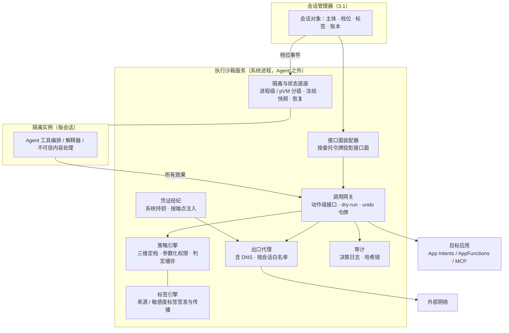

# 第三部分 · 执行沙箱

> 本文件是第三部分的一节，前面的总体架构见 [3-架构与关键技术.md](3-架构与关键技术.md)。负载与瓶颈见 [第二部分](2-场景与负载瓶颈.md) 2.2.3 和 2.4.2。
> 文中的「目标」都是建议值：依据写在旁边，需用立项后的实测校准。

---

## 3.2 执行沙箱的目标架构

### 3.2.1 定位：Agent 所有对外动作的唯一通道

**为什么 Agent OS 一定要有执行沙箱？** 第二部分给出三点：

- Agent 以用户身份行事；
- 它读入的内容 70%–100% 来自第三方；
- 它每天发起约 200 次工具调用，其中约 12 次不可逆或外发。

只要策略执行依赖 Agent 自身，一次注入就足以让它越界。dot 在 10 步任务链上的越权率达到 19.7%（二手），说明依赖模型自律并不可靠。

沙箱把这个概率问题改写成确定性问题，从「模型愿不愿意」变成「环境允不允许」。最坏情况从「整机失守」收窄为「该档位接口面内的任务失败」。

**沙箱承担四个关键角色**：

1. **影响范围有界**：最坏情况等于会话被授予的接口面，而不是整台设备。
2. **可验证的声明**：「我的 Agent 做不了 X」从厂商承诺变成系统机制。
3. **可归责**：所有动作经过同一个通道，可以记录、回放、定责。
4. **可组合**：应用敢于把能力暴露给 Agent，因为策略执行由系统结构性保证。

**设计原则**：

- **假设 Agent 已被攻破**：所有判定与策略执行都放在 Agent 进程之外（带外）。
- **执行内容不限，效果必须受控**：沙箱内可以运行任意代码，但出网、写盘、调用应用、发消息等一切效果，都必须经过系统接口流出。
- **边界跟着会话走**：每个 Agent 会话一个执行边界，状态随会话档位变化。

### 3.2.2 架构

**三层结构**：

| 层 | 回答的问题 | 内容 | 新建还是配置 |
|---|---|---|---|
| 隔离边界 | 代码被关在哪里 | 进程级隔离（isolatedProcess、seccomp、SELinux 域、文件系统视图）、虚拟机级隔离（AVF pKVM），以及冻结、快照与恢复 | 主要配置现有 OS 机制，新建的是会话级聚合与快照恢复 |
| 接口面 | 能做什么 | 动作级接口（`message.send`、`payment.charge`、`app.invoke`、`http.fetch`……），每个接口自带输入输出 schema、效果描述、dry-run、可逆性声明与 undo 令牌、幂等键、结构化拒绝 | 新建 |
| 权限决策 | 这次能不能做 | 参数化权限、三维定档、数据标签、三时机执行（装配时、调用时、销毁时）、跨链不升级 | 新建 |

**三项关键技术在架构上的位置**：

- **会话级隔离与状态底座**：对应图中「隔离与状态底座」和隔离实例，在最底层。
- **策略引擎与数据标签**：对应「策略引擎」「标签引擎」「调用网关」，在决策层，是沙箱的核心。
- **出口代理与凭证托管**：对应「出口代理」「凭证经纪」，在策略执行层的网络出口。

**与其他组件的接口**：

| 对接组件 | 接口内容 |
|---|---|
| 会话管理器 | 接收档位事件 |
| 内存管理 | 实例内存记在会话账本上；状态与内存契约同表，见 3.1.4 |
| 记忆服务 | 写入时携带会话主体与来源标签 |
| 推理服务 | 工具调用处暂停与恢复；路由读取标签 |

---

## 3.3 关键技术

### 关键技术一：会话级隔离与状态底座

**对应的负载与瓶颈**：

- 长程任务每天切走切回 3–6 次，用户回来时要在约 1 秒内看到「上次做到哪」；
- 后台分拣每天约 45 次「用完即毁」的实例创建，处理的全是第三方内容；
- 手机上只有 App 级边界，内存紧张时 LMKD 直接终止进程，任务状态全部丢失（第二部分 2.4.2 瓶颈一、二）。

**问题与挑战**：

1. **隔离强度、启动速度、内存开销三者需要权衡。**
   - 进程级创建只需 10–30 毫秒，私有页 40–100MB。
   - 虚拟机级隔离强，但 Microdroid 的绝对启动时延和内存开销没有公开数据，AVF 机型受限。
   - 云端 microVM 的经验（Firecracker 约 125 毫秒、约 5MB）不能直接照搬到手机。
2. **手机上没有会话快照原语。**
   - 云端 E2B 暂停约 4 秒/GiB，在手机上不能发生在用户可见路径上，必须在切走后的后台完成，还要和 LMKD 争用闪存带宽。
3. **生命周期与系统回收脱节。**
   - 虚拟机内存与 LMKD 的耦合没有解决：AVF 的气球回收曾因内存不足被回退。
   - 快照存储（每天 0.8–2.3GB）没有配额与清理归属。
4. **一个会话横跨多个进程。** Agent 的解释器、工具子进程、被调用的 App 分属不同进程，需要聚合成一个可冻结、可快照、可记账的单元。

**技术目标（建议值）**：

| 指标 | 目标 | 依据 |
|---|---|---|
| 进程级实例创建（含策略装配） | ≤50 毫秒（池化后） | zygote fork 10–30 毫秒；后台分拣每天约 45 次 |
| 虚拟机级实例创建 | 冷启动 ≤1 秒；从模板快照拉起 ≤300 毫秒 | 每天不超过 5 次；云端 Cube 单并发 <60 毫秒为上限参照 |
| 切回恢复（沙箱部分） | ≤300 毫秒；会话整体 ≤1 秒 | 256MB 实例读入 30%–60% 私有页估算 80–310 毫秒；推理侧 KV 换入 0.2–0.9 秒，二者需并行 |
| 单实例额外内存 | 进程级 ≤100MB；虚拟机级写时复制后 ≤150MB | 第二部分 2.2.3 |
| 峰值并发 4 实例的总内存 | ≤0.8GB | 12GB 机型峰值可用约 4GB 的 20% |
| 内存压力下的任务状态丢失 | 0 次：先快照、后回收 | 第二部分 2.4.2 瓶颈二 |
| 快照存储 | 每会话配额加 24–72 小时过期；计入会话账本 | 每天 0.8–2.3GB |

**模块级方案**：

1. **隔离级别选择器。** 按会话档位和接口面选择隔离级别：
   - **默认进程级**：isolatedProcess 加 seccomp 白名单、独立 SELinux 域、只读文件系统视图、无直连网络。
   - **升到虚拟机级（AVF pKVM）的三种情况**：
     - 用户授权运行 L0 任意代码；
     - 处理大体积不可信文件，如文档解析、附件；
     - 策略要求强隔离。
   - **后台分拣固定走进程级**，用完即毁。
2. **实例池与模板。**
   - 进程级用预热的 zygote 式模板 fork。
   - 虚拟机级用「模板快照 + 写时复制」拉起：模板镜像预置解释器与常用工具，恢复时只映射差量。
3. **冻结、快照与恢复引擎。**
   - **进程级**：cgroup freezer 冻结，私有页经 zRAM 压缩换出或写入快照文件；恢复时解冻并按工作集预取。
   - **虚拟机级**：内存快照加按需缺页的懒恢复（userfaultfd 思路），文件系统用写时复制叠加层。
   - 快照可压缩；切走后在后台完成，不占用户可见路径。
4. **生命周期适配器。**
   - 订阅会话档位事件：交互、后台活跃时运行；待机时冻结；挂起时快照落盘并释放内存；销毁时清算。
   - 对接 LMKD 与 Memory Limiter：收到回收压力时先发「挂起」，快照完成后再释放；只有快照失败才允许直接回收。
5. **会话聚合与记账。**
   - 一个会话的解释器、工具子进程、快照文件，都挂在同一个会话账本下：在 memcg 之上加会话归属标签，见内存管理的统一记账底座。
   - 虚拟机的气球回收与 PSI 联动。

**细节技术点**：

- **工作集记录**：冻结前记录最近访问的页集合；恢复时先读这些页（约 30%–60%），其余按需缺页。顺序读路径 18–36 毫秒，随机缺页路径 80–310 毫秒（估算）。
- **快照写入的时机与预算**：
  - 在用户切走后、系统空闲时写出，并限制每天的写入总量，与闪存寿命预算一起管理；
  - 等确认这类 10–60 秒的短间隙只做压缩，不落盘。
- **恢复的并行化**：沙箱恢复、推理服务的 KV 换入、内存管理的工作集预取同时发起，由会话管理器协调。整体 ≤1 秒的预算按三者并行来分配。
- **虚拟机级隔离的机型分级**：AVF 不可用的机型退回进程级加更严格的策略，即更少的接口面、更多确认。

### 关键技术二：策略引擎与数据标签

**对应的负载与瓶颈**：

- 每天约 200 次工具调用里，约 12 次不可逆或外发，需要参数级约束：金额、收件人、商户、次数；
- 这些动作集中在用户正在等的 T1、T2 上，判定必须在亚秒内完成；
- 确认弹窗的批准率约 93%，仅靠弹窗无法拦截；
- T2、T3、T4 有 70%–100% 的读取来自第三方，现有 OS 里没有任何数据标签（第二部分 2.4.2 瓶颈三、四）。

**问题与挑战**：

1. **策略设计的三项权衡**：表达力、可验证性、运行时开销三者相互制约。策略过粗则价值有限，过细则难以判定，逐次判定又不能成为热路径瓶颈。
2. **标签粒度的取舍**：
   - 会话级污点简单但过度保守：一旦读过网页，整个会话都不可信。
   - 值级标签精确（CaMeL / FIDES），但有效用代价：任务完成率 77%，不设防的基线为 84%，而且需要改造执行方式。
3. **标签要跨时间存活**：注入内容可能先写入记忆，几天后再被另一个会话读出来用在外发动作上（第三部分 3.1.4 例二）。
4. **确认疲劳**：确认太多，用户会习惯性点击「允许」；太少，又无法拦截风险。

**技术目标（建议值）**：

| 指标 | 目标 | 依据 |
|---|---|---|
| 单次调用策略判定时延 | P99 ≤1 毫秒（命中判定缓存）；未命中 ≤5 毫秒 | 每天约 200 次，T1、T2 每步时延预算 1–1.5 秒 |
| 需要用户逐次确认的调用占比 | ≤6%，即只有不可逆和外发类，约每天 12 次以内 | 第二部分 2.2.3 |
| 注入语料回归 | 「不可信内容 → 外发 / 支付」路径 100% 被拦截或升档确认 | AgentDojo 类语料；被注入时有效动作集不变 |
| 标签持久性 | 标签随记忆条目跨会话保持，丢失 0 次 | 第三部分 3.1.3 约定二 |
| 正常任务的效用损失 | 任务完成率下降 ≤3 个百分点 | CaMeL 为 7 个百分点；本方案用分级标签降低代价 |
| 策略变更的形式化检查 | 可建模子集 100% 经差异证明 | OpenShell 证明器的做法及其边界 |

**模块级方案**：

1. **接口面装配器。**
   - 应用在清单中声明它暴露的动作及其「角色 → 档位」映射；系统按会话的委托令牌投影出接口面，「应用自管」指的是声明权。
   - 注册表供 Agent 规划器查询：「我当前能做什么、约束是什么」。
2. **三维定档函数。**
   - 每个接口按三个维度打分：
     - 外部性：效果是否越出设备；
     - 可逆性：能否撤销；
     - 敏感度：触碰哪类数据。
   - 档位决定同意形式：默认放行、会话级授权、或每次确认。
   - 定档结果写回会话对象，同时驱动推理优先级与内存契约，即「档位只算一次」。
3. **标签引擎。**
   - **签发**：数据经接口进入会话时签发来源标签，如 `http.fetch` 和读取第三方消息产生「不可信外部」，读取支付信息产生「含支付」。
   - **两级粒度**：
     - 会话级污点，开销近零，作为默认；
     - 关键参数级标签，如 `message.send` 的正文、`payment.charge` 的收款方，只在外发类接口的参数上精确追踪。
   - **升档规则**：带「不可信」标签的内容流入外部性高的接口时，自动升到「每次确认」。
4. **判定缓存与热路径。** 按「策略版本 + 输入哈希」缓存判定结果；高频的读类接口在本地判定；审计异步落盘。会话创建时钉住策略版本，热更新只影响新会话。
5. **系统确认界面。**
   - 确认弹窗由系统渲染，被授权的 Agent 不能自己画授权框。
   - 同一任务内的多个低风险动作合并确认；不可逆动作单独确认，并展示 dry-run 的效果预览。
6. **审计。** 每次允许或拒绝记录五元组：会话、策略版本、目标、调用方、结论。用哈希链防篡改，供回放与定责。

**细节技术点**：

- **dry-run 与可逆性声明**：
  - 接口规格的七要素中，dry-run 返回效果预览，供 Agent 规划与用户确认共用；
  - 可逆接口返回 undo 令牌，不可逆接口必须声明为不可逆。
  - 业界目前没有 dry-run 与 undo 的系统级实现。iOS App Intents 的 undo 仅见二手转述，按分档声明降低承诺。
- **跨链不升级**：委托链上每一跳的有效权限，不超过链上的最小值，由系统强制执行。
- **结构化拒绝**：拒绝时告诉 Agent「为什么、如何申请更大范围」，使 Agent 在边界不明处由「猜测」变为「询问」。
- **有状态额度**：
  - 额度按会话累计，例如单笔上限加总额度、条数上限；
  - 时序规则，如「读过不可信内容后 N 分钟内禁止外发」。可参照 AWS Dogwood 的时序额度。
- **策略预演回放**：用历史轨迹回放新策略，显示它「会拦截什么」，降低策略上线的风险。

### 关键技术三：出口代理与凭证托管

**对应的负载与瓶颈**：

- 跨应用事务涉及支付与外发，长程任务会读写外部网站与服务；
- 2026-09 公开事件中，研究 Agent 被 HTTP 代理拦截后改走 DNS 外传（二手）；
- 手机网络按 UID 管控，没有按会话的出口策略，凭证对 Agent 进程可见（第二部分 2.4.2 瓶颈五）。

**问题与挑战**：

1. **粒度**：手机网络栈按应用 UID 管控，同一个 Agent 的不同会话共享网络身份，无法按会话放行或拦截。
2. **隐蔽通道**：DNS、TXT 记录、时序信道，HTTP 代理之外的出口常被遗漏。
3. **凭证的位置**：今天凭证在应用进程或 Keystore 里，由应用取出使用，Agent 只要能控制应用进程就能拿到。
4. **对应用的调用也是出口**：`message.send`、`payment.charge` 不走网络，但同样把数据送出会话，需要同一套检查。
5. **响应侧泄漏**：外部服务的返回可能回显凭证或敏感数据。厂商声称做了响应脱敏，但缺独立评测。

**技术目标（建议值）**：

| 指标 | 目标 | 依据 |
|---|---|---|
| 会话出网经过代理的比例 | 100%，含 DNS 与 TXT 等记录类型 | DNS 外泄事件 |
| 凭证进入沙箱实例的次数 | 0 | 云端、OpenShell、Claude Code 已做到 |
| 代理引入的额外时延 | 每请求 ≤10 毫秒 | 每天出网请求为百次量级；T2 每步预算 1.5 秒 |
| 出口策略 | 每会话默认拒绝加白名单；策略按会话装配 | 第二部分 2.4.2 |
| 外发数据的标签检查 | 覆盖 100% 外发类接口，网络与应用调用都算 | 关键技术二的升档规则 |

**模块级方案**：

1. **会话网络身份。** 每个会话的隔离实例没有直连网络，所有套接字都经 cgroup 级的 eBPF 钩子或独立网络命名空间，导向系统代理。这样网络身份就从 UID 细化到会话。
2. **七层出口代理。**
   - 按「域名 × 方法 × 路径」放行；
   - 速率与流量额度按会话累计；
   - 代理运行在系统进程中，不在沙箱内。
3. **DNS 强制代理解析与解析审计。**
   - 实例内的解析请求一律由代理解析，禁止直连外部解析器；
   - 异常子域名长度和熵值告警；
   - 解析记录进审计。
4. **凭证经纪。**
   - 凭证存放在 Keystore / StrongBox（HarmonyOS 为 HUKS，iOS 为 Keychain / Secure Enclave），可用、不可导出；
   - 代理按「目标端点 × 令牌授权范围」把凭证注入请求头，沙箱内只持有占位符；
   - 使用记录与额度进审计。
5. **应用调用出口。** 对 App Intents、AppFunctions 的外发类调用（发消息、分享、支付），在调用网关做同样的检查：
   - 收件人与商户范围；
   - 内容标签；
   - 额度。

**细节技术点**：

- **响应侧处理**：对返回内容中的凭证回显做匹配与脱敏，标为「厂商声称、待评测」，不作硬保证。
- **代理的策略来源**：与策略引擎共用同一份策略和版本钉住；白名单变更走形式化差异检查（可建模的 HTTP / REST 子集），MCP、GraphQL 等暂不可建模的协议回退为人工审批。
- **证书与 TLS**：系统代理需要终止 TLS 才能做七层检查，用系统级信任锚和固定的会话证书，不向第三方应用暴露。
- **离线与弱网**：代理不可用时，出口一律拒绝，任务降级为「排队，等网络恢复」，不允许绕过。
