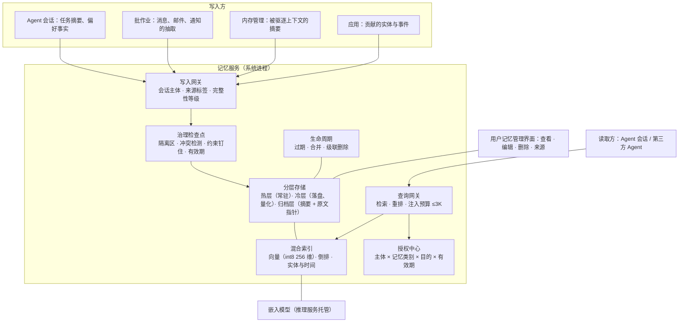

# 第三部分 · 记忆服务

> 本文件是第三部分的一节，前面的总体架构见 [3-架构与关键技术.md](3-架构与关键技术.md)。负载与瓶颈见[第二部分](2-场景与负载瓶颈.md) 2.2.4 和 2.4.3。
> 文中的「目标」都是建议值：依据写在旁边，需用立项后的实测校准。

---

## 3.2 记忆服务的目标架构

### 3.2.1 定位：跨 App、跨会话的个人上下文，由系统统一存、取、授权、遗忘

**为什么记忆必须是系统服务？**

1. **个人上下文散落在各个 App 里。** 消息、邮件、日程、订单、照片分属不同应用。只有系统能建立跨应用的统一索引，并决定谁能读。
2. **写入是攻击面。**
   - 每天约 31 条记忆来自不可信内容。
   - 摘要压缩会丢约束：Governance Decay 测得，策略在 compaction 后违规率从 0% 升到 30%。
   - 应用内的记忆框架没有来源标签，被注入的内容会长期留存，并在以后被别的会话读出来用。
3. **用户需要一个看得见、删得掉的地方。** 云端 Agent 的记忆要么单条不可删（dot），要么保留策略不公开（Grok Bot），这正是端侧系统可以做出差异化的地方。

**机制与策略的分工**：

| 分工方 | 负责内容 |
|---|---|
| 记忆服务（OS） | 存储、索引、写入检查点、授权、遗忘与级联删除 |
| Agent | 记什么、何时检索、怎样组织提问 |

**写入路径只有一条**：必须经过记忆服务的治理检查点。

### 3.2.2 架构

**记忆分层**：

| 层 | 内容 | 驻留 | 由谁管 |
|---|---|---|---|
| 工作记忆 | 当前会话的上下文 | KV / 上下文窗口 | 推理服务与内存管理（上下文预算） |
| 情景记忆 | 发生过什么：任务记录、对话事件 | 近 30 天在热层，之后合并入归档层 | 记忆服务 |
| 语义记忆 | 关于用户的事实与偏好：地址、联系人关系、口味 | 热层，带版本与有效期 | 记忆服务 |
| 程序记忆 | 怎么做：常用流程、技能 | 小规模，热层 | 记忆服务；业界尚无成熟机制 |

**三项关键技术在架构上的位置**：

- **端侧分层记忆存储与检索**：分层存储、混合索引、查询网关、嵌入模型托管；
- **记忆写入治理**：写入网关、治理检查点、生命周期；
- **系统级个人语义索引与授权**：应用贡献接口、授权中心、查询网关的授权过滤、用户管理界面。

---

## 3.3 关键技术

### 关键技术一：端侧分层记忆存储与检索

**对应的负载与瓶颈**：

- 每天新增约 39 条记忆，3 年 4–12 万条；
- T1 的检索预算 ≤150 毫秒，单次注入上限约 3K token；
- 嵌入模型约 200MB，是记忆组件最大的单项内存，换代时整库重建需 16–44 分钟；
- 写入路径每天 4–9 万 prefill；
- 手机上没有检索的公开基线，外推的全扫描时延在 3 年规模下逼近或超出预算（第二部分 2.4.3 瓶颈三）。

**问题与挑战**：

1. **规模与时延。** 3 年规模下，fp32 全扫描外推为 120–490 毫秒；HNSW 这类图索引的随机访问对闪存不友好。
2. **常驻成本。** 嵌入模型加索引加缓存常驻 0.25–0.4GB，在 12GB 机型的峰值时刻是要和模型争的内存。
3. **召回质量。**
   - LongMemEval 中最佳检索的 recall@5 只有 0.73。
   - 小模型注入超过约 3K token 后效果反而下降，所以不能用「多注入」弥补召回。
4. **写入路径的推理成本。** 抽取与更新是长输入、短输出的批作业。与前台同级排队，会拖慢首 token。
5. **嵌入模型换代。** 换代后旧向量全部失效，重建期间检索不能中断。

**技术目标（建议值）**：

| 指标 | 目标 | 依据 |
|---|---|---|
| 3 年规模（12 万条）下 T1 检索时延 | P95 ≤150 毫秒 | 第二部分 2.2.4 |
| 记忆组件常驻内存 | ≤0.3GB；嵌入模型按需加载 | 现状估算 0.25–0.4GB |
| 召回质量 | 在自建的 3 年规模基准上 recall@5 ≥0.85 | LongMemEval 最佳为 0.73；目标规模上没有公开基线，需自建 |
| 单次注入 | ≤3K token，且注入后任务质量不降 | LongMemEval 中 8B 模型的拐点 |
| 写入路径推理 | ≤5 万 prefill/天，全部在批作业类别中、不占前台 | 现状估算 4–9 万 |
| 嵌入模型换代 | 在充电窗口内完成重建，期间旧索引持续可用 | 估算 16–44 分钟 NPU 时间 |

**模块级方案**：

1. **分层存储。**
   - **热层**：近 30 天的条目和高频条目（联系人、地址、偏好），常驻内存。
   - **冷层**：落盘，向量量化。
   - **归档层**：旧情景记忆合并后的摘要，加上指向原文的指针。
   - 层间按访问频率与有效期迁移。
2. **混合索引。** 三路索引组合检索：
   - 向量：768 维截断到 256 维再转 int8，体积降约 12 倍，扫描约 30–40 毫秒（外推）；
   - 倒排：精确词匹配，如人名、单号；
   - 实体与时间索引：「上次」「下周」这类时间约束。

   冷层采用分区索引，减少随机读，可参照 MobileRAG 的 EcoVector，自报搜索时延提升 1.7–8.9 倍、内存降低 11%–55%。
3. **嵌入服务。**
   - 嵌入模型由推理服务托管，按事件加载、空闲驱逐，纳入模型内存域记账。
   - 换代时新旧两套索引并行，新索引在充电窗口后台重建，完成后再切换。
4. **写入流水线。**
   - 消息、邮件、通知的抽取与更新合并成批，作为推理服务的批作业提交，优先在充电时执行；
   - 前台任务产生的偏好事实即时写入热层。
5. **检索与重排。**
   - 三路召回后用小模型重排；
   - 按注入预算截断，并优先保留与当前任务实体重叠的条目；
   - 高频查询（联系人、偏好）走缓存。

**细节技术点**：

- **自建 3 年规模基准。** 公开基准比目标规模小近三个数量级，需用合成加脱敏的方式造出「3 年、万级条目、含冲突与时效」的评测集。这是部门负载建模与仿真能力的直接用武之地。
- **抽取去重。** 同一事实多次出现只保留一条，并累计证据计数；证据计数也用于写入治理的「佐证后提升」。
- **写入批的大小与时机。** 起床或解锁后的积压批处理，一次约 2–4 万 prefill，必须可抢占，不能阻塞用户的第一条指令。
- **索引写入很小。** 每天约 0.14MB，按 10 倍写放大约 1.4MB，可以忽略，不需要为闪存寿命做特别设计。

### 关键技术二：记忆写入治理

**对应的负载与瓶颈**：

- 每天约 31 条记忆来自不可信内容；
- 每天还有 2–4 次冲突更新、约 20 次过期删除；
- 写入完全交给模型，没有来源与完整性标签；
- 冲突消解在多跳场景都不超过约 7%；
- 摘要会丢约束；
- 用户删除后，无法确认派生数据一并清除（第二部分 2.4.3 瓶颈一、二）。

**问题与挑战**：

1. **来源不可伪造。** 标签必须来自沙箱在数据进入会话时的签发，不能由写入方自报。
2. **低完整性要传染。**
   - 由低完整性内容派生出的摘要、事实，仍然是低完整性的。
   - 分片投毒（FragFuse）把恶意指令拆成多条看似无害的记忆，检索时再重组，所以检查点必须放在检索重组之后。
3. **摘要丢约束。** 被驱逐上下文的摘要必须保留被钉住的约束，否则等于把治理规则「压缩掉」了。
4. **冲突检测。** 「新地址覆盖旧地址」要在写入时发现，而不是留给检索时让模型猜哪个对。
5. **可验证的删除。** 删除一条记忆时，由它派生出的摘要、向量、合并条目都要一并清除。

**技术目标（建议值）**：

| 指标 | 目标 | 依据 |
|---|---|---|
| 带不可伪造来源标签的记忆 | 100% | 第三部分 3.1.3 约定二 |
| 来自不可信会话的写入 | 100% 进入低完整性区，佐证或用户确认后才提升 | 每天约 31 条 |
| 摘要入库时被钉住的约束 | 保留 100% | Governance Decay：约束钉住后违规率为 0% |
| 写入时检出单跳冲突 | ≥80% | 现有方法在多跳冲突上都不超过约 7%；先解决单跳 |
| 删除级联 | 100%：派生的摘要、向量、合并条目同步清除，用户可查验 | 第二部分 2.4.3 瓶颈二 |
| 时效记忆按期清除 | ≥95% | 每天约 20 次过期删除 |

**模块级方案**：

1. **写入网关。**
   - 唯一写入路径。每次写入携带三样东西：会话主体、沙箱签发的来源标签、数据域。
   - 写入方不能自定义完整性等级。
2. **完整性分级。** 分三级：
   - **高**：用户亲口说的、系统自身数据；
   - **中**：可信应用贡献的；
   - **低**：不可信外部内容派生的。

   低完整性条目读出时仍为低完整性，不能用来驱动外发类动作，规则由沙箱执行。
3. **隔离区与佐证提升。**
   - 低完整性写入先进入隔离区，在检索中可见但带标记；
   - 被独立来源佐证达到阈值，或经用户确认后，才提升等级。
   - 在预印本中，「写入时绑定来源、佐证后提升」把攻击成功率从最高 68% 降到 0%（作者自评）。
4. **冲突检测器。**
   - 语义记忆按「实体 + 属性」建键，写入时与已有事实比对；
   - 冲突时生成新版本，旧版本标记失效但保留，采用双时间轴：生效时间与记录时间；
   - 无法判定的冲突交给用户或下一次任务确认。
5. **生命周期管理。**
   - **按类别设有效期**：验证码、物流、行程这类时效记忆 7–30 天。
   - **情景记忆合并**：30 天后合并为摘要。
   - **级联删除**：派生关系图记录「谁由谁生成」，删除沿图级联。
6. **摘要检查点。**
   - 内存管理驱逐上下文时，只发出「状态单元被回收」事件；
   - 由记忆服务和 Agent 决定是否写摘要；
   - 系统提示、技能前缀、治理约束永不摘要；
   - 摘要条目带原文指针，并预留异步校验。

**细节技术点**：

- **检查点放在检索重组之后。** 针对分片投毒，在检索结果组装成注入内容后，再做一次完整性检查。
- **审计。** 每次写入、提升、删除都记日志，用户在管理界面可以看到「这条记忆从哪来、被谁用过」。
- **用户记忆管理界面。** 条目级查看、编辑、删除，并显示来源与完整性；删除结果可查验。这是对比云端 Agent（dot 单条不可删）最直观的差异点。

### 关键技术三：系统级个人语义索引与授权

**对应的负载与瓶颈**：

- 第三方 Agent 需要按任务读取个人上下文，如地址、支付偏好、历史订单；
- 每天约 75 次访问控制判定，用户却只能承受 2–3 次弹窗；
- 现有授权最细只到「应用级连接」或「整块只读」，系统级索引不向第三方开放（第二部分 2.4.3 瓶颈四）。

**问题与挑战**：

1. **授权粒度。** 需要「谁、读哪类记忆、为了什么目的、多长时间有效」四维授权，又不能让用户每天面对几十个弹窗。
2. **读后数据的去向。** 第三方 Agent 读到的数据，之后被发往哪里？只授权读取不够，读出的数据要带标签，后续外发由沙箱把关。
3. **最小披露。** 很多任务只需要「是否」或「摘要」，不需要原文，例如「用户是否对花生过敏」。
4. **生态。** 应用要愿意把实体贡献给系统索引，接口要与 App Intents、AppFunctions 这类现有声明机制兼容。
5. **监管。** 系统级个人数据索引会受到反垄断与隐私监管的审视：Apple 的系统级 Agent 方案在欧盟遇到过阻力（见证据库 C3）。

**技术目标（建议值）**：

| 指标 | 目标 | 依据 |
|---|---|---|
| 稳态下面向用户的授权弹窗 | ≤3 次/天 | 第二部分 2.2.4 |
| 授权判定时延 | ≤5 毫秒 | 每天约 75 次判定 |
| 第三方读取经授权并带标签返回 | 100% | 第三部分 3.1.3 约定二 |
| 读出数据的外发检查覆盖 | 100% | 由沙箱的标签规则执行 |
| 撤销授权生效时间 | ≤1 秒 | — |
| 以最小披露形式（字段子集或摘要）返回的查询 | ≥70% | 建议值，需按任务统计校准 |

**模块级方案**：

1. **应用贡献接口。** 应用把实体与事件贡献给系统索引，类型包括联系人、订单、行程、文档，带 schema 与标签。接口形态对齐 App Intents 的实体声明与 AppFunctions 的函数声明。
2. **统一索引。** 跨应用、按记忆类别组织：联系人与关系、日程与行程、订单与支付偏好、位置、文档、偏好。与记忆服务的分层存储共用底层。
3. **授权中心。**
   - **预授予策略**：「主体 × 记忆类别 × 目的 × 有效期」。首次使用时由系统界面询问一次，之后按策略自动判定。
   - **逐次确认只留给外发披露**，例如把地址发给外部应用。
4. **查询网关。**
   - 读取按「读者权限 ∩ 条目标签」判定；
   - 返回最小披露：字段子集、布尔回答，或摘要；
   - 结果带上条目的来源与敏感度标签，进入读者的会话。
5. **审计与透明。** 用户可以查看「哪个 Agent 在什么时候、为什么读了哪类记忆」，并一键撤销。

**细节技术点**：

- **目的绑定。** 授权与任务原型绑定。例如「订餐任务可以读地址和口味偏好」，不能读健康记录。
- **首月突发。** 新装应用和 Agent 接入的首月约有 30 次授权请求，界面要支持按类别批量授权，避免集中打扰。
- **后台读取不弹窗。** 后台分拣每天约 10 次读取，只能依据预授予策略；没有策略就拒绝，并在下次前台交互时提示。
